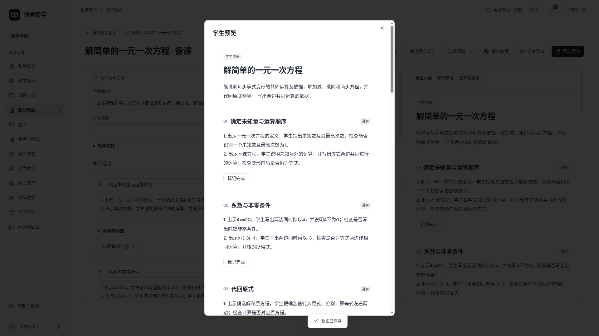
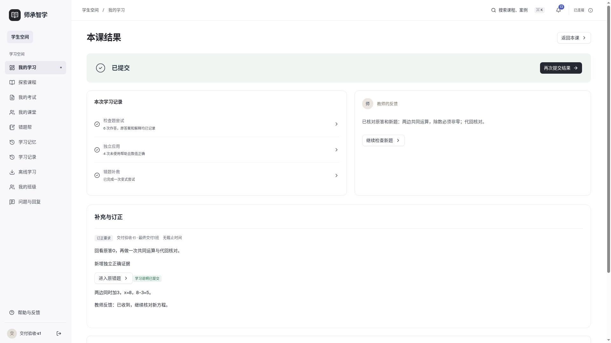

# 师承智学

日期 2026-11-11　版本 v30

师承智学提供教师经验、备课、班级任务、学生学习与学情反馈的完整流程。产品面向桌面 Web，前端使用 **Vue 3 + JavaScript**，业务服务使用 **FastAPI + MySQL**。模型默认通过本机 Codex CLI 调用外部服务，统一使用 gpt-6-luna 和 low 思考强度。教学案例采用字段加权 BM25、知识关联与情境检索，教师可选 Codex 重排；语音输入和朗读使用浏览器能力，不支持时保留文字操作。现已支持资料解析、教学案例版本、课程内容编辑、知识前置关系、首课发布及按课时贯通的师生任务。

- [当前进度：第二十步部署准备交付，30/35通过](docs/planning/当前进度_20261111_v7.md)
- [第二十步最终报告与35项验收](docs/planning/第二十步最终交付报告_20261111_v1.md)
- [安装使用手册、DOCX和PDF](docs/manuals/20261111_v1/README.md)
- [实际操作演示视频](docs/demos/20261111_v1/README.md)
- [最终验收证据](docs/verification/final_20261111_v1/README.md)
- [正式操作待批准清单](docs/planning/第二十步部署与迁移操作清单_20261111_v1.md)
- [第十九步功能与使用](docs/planning/第十九步功能与使用说明_20261111_v1.md)
- [第十九步离线数据、缓存与同步](docs/planning/第十九步离线数据缓存与同步协议_20261111_v1.md)
- [第十九步36项验收](docs/planning/第十九步统一验收表_20261111_v1.md)
- [第十九步五条真实流程与视觉](docs/planning/第十九步五条流程与视觉回归_20261111_v1.md)
- [第十九步证据与截图](docs/verification/offline_20261111_v1/README.md)
- [第十八步功能、使用与数据迁移](docs/planning/第十八步功能与数据迁移说明_20261111_v1.md)
- [第十八步32项验收](docs/planning/第十八步统一验收表_20261111_v1.md)
- [第十八步三条真实流程与回归](docs/planning/第十八步三条流程与回归记录_20261111_v1.md)
- [第十八步证据与桌面截图](docs/verification/classroom_20261111_v1/README.md)
- [第十七步语音环境例外与阶段门槛](docs/planning/第十七步收尾与阶段门槛_20261111_v1.md)
- [正式数据库0014升级待批准清单](docs/planning/正式数据库0014升级待批准清单_20261111_v1.md)
- [第十七步题库、组卷与考试说明](docs/planning/第十七步功能与技术说明_20261111_v1.md)
- [第十七步38项验收](docs/planning/第十七步统一验收表_20261111_v1.md)
- [第十七步三条真实流程](docs/planning/第十七步完整业务与验收记录_20261111_v1.md)
- [第十七步数据模型与迁移](docs/planning/第十七步数据模型与迁移说明_20261111_v1.md)
- [第十七步证据与截图](docs/verification/exams_20261111_v1/README.md)
- [第十六步完整单元与数学条件](docs/planning/第十六步单元内容与数学条件说明_20261111_v1.md)
- [第十六步35项验收](docs/planning/第十六步统一验收表_20261111_v1.md)
- [第十六步流程与真实评测](docs/planning/第十六步完整业务与评测报告_20261111_v1.md)
- [本机部署、备份恢复与回滚](docs/planning/第十六步部署备份恢复与回滚说明_20261111_v1.md)
- [第十六步证据与截图](docs/verification/unit_20261111_v1/README.md)
- [第十五步使用与实现](docs/planning/第十五步使用与实现说明_20261111_v1.md)
- [第十五步35项验收](docs/planning/第十五步统一验收表_20261111_v1.md)
- [教师学情统计口径](docs/planning/第十五步教师学情统计口径说明_20261111_v1.md)
- [教学干预业务流程](docs/planning/第十五步教学干预业务流程说明_20261111_v1.md)
- [问题反馈与日常管理](docs/planning/第十五步问题反馈与管理端设计_20261111_v1.md)
- [第十五步证据与截图](docs/verification/insights_20261111_v1/README.md)
- [第十四步使用与实现](docs/planning/第十四步使用与实现说明_20261110_v1.md)
- [第十四步32项验收](docs/planning/第十四步统一验收表_20261110_v1.md)
- [学习证据与状态规则](docs/planning/第十四步学习证据与状态规则_20261110_v1.md)
- [跨课时记忆与复习推荐](docs/planning/第十四步跨课时记忆与复习推荐_20261110_v1.md)
- [第十四步证据与截图](docs/verification/memory_20261110_v1/README.md)
- [第十三步使用与实现](docs/planning/第十三步使用与实现说明_20261110_v1.md)
- [第十三步统一验收](docs/planning/第十三步统一验收表_20261110_v1.md)
- [错题补救流程与评分](docs/planning/错题补救流程与评分设计_20261110_v1.md)
- [第十三步数据迁移](docs/planning/第十三步数据结构与迁移说明_20261110_v1.md)
- [第十三步证据与桌面截图](docs/verification/remediation_20261110_v1/README.md)
- [第十二步使用与实现](docs/planning/第十二步使用与实现说明_20261110_v1.md)
- [第十二步统一验收](docs/planning/第十二步统一验收表_20261110_v1.md)
- [第十二步真实指导评测](docs/planning/第十二步指导策略评测报告_20261110_v1.md)
- [第十二步证据与桌面截图](docs/verification/tutoring_20261110_v1/README.md)
- [第十一步使用与实现](docs/planning/第十一步使用与实现说明_20261110_v1.md)
- [第十一步23项验收](docs/planning/第十一步统一验收表_20261110_v1.md)
- [第十一步完整业务报告](docs/planning/第十一步完整业务验收报告_20261110_v1.md)
- [多用户证据与桌面截图](docs/verification/teaching_20261110_v1/README.md)
- [Word排版与教学语言专项](docs/planning/DOCX与教学语言专项修复说明_20261110_v1.md)
- [Word专项20项验收](docs/planning/DOCX与教学语言专项验收表_20261110_v1.md)
- [第十步使用与实现](docs/planning/第十步使用与实现说明_20261110_v1.md)
- [第十步24项验收](docs/planning/第十步统一验收表_20261110_v2.md)
- [第十步完整业务报告](docs/planning/第十步完整业务验收报告_20261110_v1.md)
- [第九步 Agent 编排与验收](docs/planning/第九步Agent编排实施与验收_20261110_v1.md)
- [统一22项验收](docs/planning/统一验收表_20261110_v1.md)
- [第八步使用与实现说明](docs/planning/第八步使用与实现说明_20261109_v1.md)
- [第八步实施与验收](docs/planning/第八步实施与验收_20261109_v1.md)
- [第八步小样本检索对比](docs/planning/第八步小样本检索对比_20261109_v1.md)
- [整体20步计划](docs/planning/系统代码迭代步骤_20261107_v3.md)
- [第七步使用与实现说明](docs/planning/第七步使用与实现说明_20261109_v1.md)
- [第七步实施与验收](docs/planning/第七步实施与验收_20261109_v1.md)
- [第七步开发提示词（必须使用 grill-me）](docs/planning/第七步开发提示词_20261108_v1.md)
- [第六步使用与实现说明](docs/planning/第六步使用与实现说明_20261109_v1.md)
- [第六步实施与验收](docs/planning/第六步实施与验收_20261109_v1.md)
- [第六步开发提示词](docs/planning/第六步开发提示词_20261108_v1.md)
- [第五步使用与实现说明](docs/planning/第五步使用与实现说明_20261108_v3.md)
- [第五步开发提示词与推荐回答](docs/planning/第五步开发提示词与推荐回答_20261108_v1.md)
- [第五步实施与验收（替代方案）](docs/planning/第五步实施与验收_20261108_v3.md)
- [第四步使用与实现说明](docs/planning/第四步使用与实现说明_20261108_v1.md)
- [第四步实施计划](docs/planning/第四步实施计划_20261108_v1.md)
- [第三步使用与实现说明](docs/planning/第三步使用与实现说明_20261107_v1.md)
- [当前视觉与交互设计](docs/design/前端视觉与交互设计_20261110_v2.md)
- [平台结构与首课流程](docs/planning/平台结构与首课使用流程_20261107_v1.md)

## 运行与部署

固定运行包：`f985287324a93dd4902feec2f8dc9211803a0265`。当前隔离验证入口 https://127.0.0.1:9443（同主机或已有端口转发，自签测试证书），后端仅127.0.0.1:8095，MySQL独立23320；数据、上传、运行环境和发布包均位于持久私有目录。该入口不是正式公开站点。

安装、配置、账号和更新见[手册](docs/manuals/20261111_v1/README.md)。部署使用deploy/manage.py的preflight、明确migrate、check/start/serve、backup/restore，start不迁移、不重建。正式库23317/sczx仍0013；正式服务、域名、证书、上传路径和宿主重启待批准，不能直接upgrade head。

本地162项MySQL全量＋11项部署专项、23项Chromium、4项JS和构建通过；最终源码双CI成功，MySQL为163项无跳过。回归命令及独立数据库/上传配置见[测试说明](backend-business/tests/README.md)。当前工程没有旧错题帮的backend-algorithms或make verify入口。

## 当前交付状态

第二十步工程和隔离走查已交付，30/35通过，5项阻塞。四项为正式环境HTTPS、宿主重启、健康及访问；另一项为6个已追溯本轮测试上传移回私有测试目录待批准。正式原始业务行与82原图保持完整。第十七步两项原生语音仍保留已批准环境例外，不据此声称实际通过。

早期阶段说明和截图保留于上方历史文档；当前状态以第二十步报告为准。模型与学习记录属于工程验收，不代表真实课堂效果。今后进入使用反馈与版本维护，不新增业务模块。

用户已授权本项目每一步验收和本地提交后自动推送sczx/main；只提交sczx范围，保留父项目改动，不误推origin。正式数据库迁移、服务切换和公网开放仍须单独批准。
