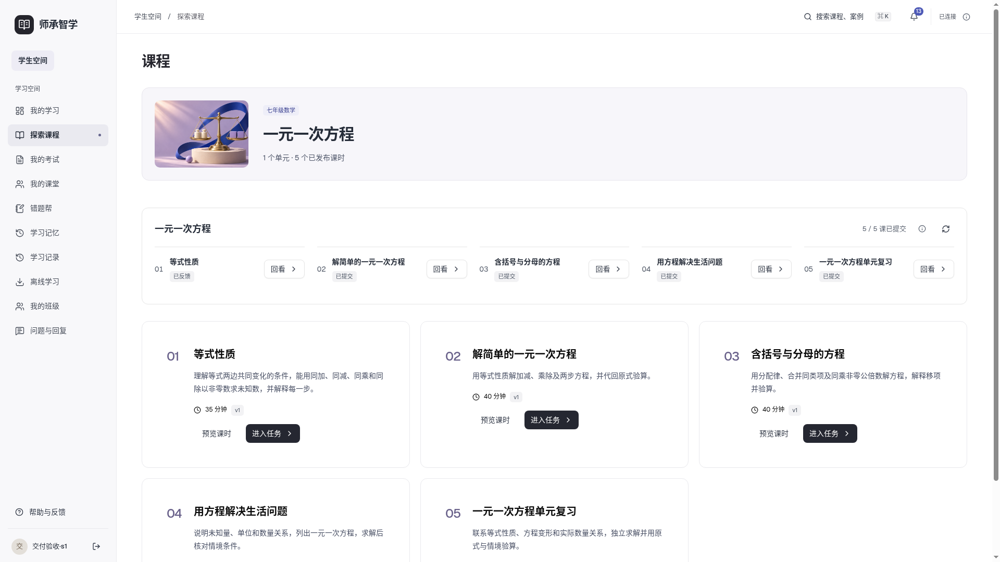

# 师承智学

2026-11-14 / v49 / 本地软件作品

教师经验、备课、课程班级、学生学习、我的错题和学情反馈共用一套网页系统。前端Vue3＋JavaScript，FastAPI业务服务，MySQL数据；基础组件使用Element Plus，图标统一Element Plus Icons。AI通过当前已登录Codex CLI调用gpt-6-luna/low，不安装本地模型。

登录注册页已改为左侧大图、右侧表单，参考GitHub vue-pure-admin模板并保留插画MIT许可。[来源与截图](docs/verification/auth_split_20261113_v1/README.md)。

## 第二轮：直接可用的教学方法资源

已追加19学科57条中文方法摘要，每科3条，参考29个可核验正文来源；用户单人复核，明确标注AI辅助整理及年级适配。教师从“教学资源”搜索、阅读出处并用于备课；学生在匹配学科、年级和知识点时由指导调用，缺少匹配仍可使用通用AI。无需先上传材料。

八科真实Codex指导与备课、独立新题保存及师生反馈读取通过；其他11科已验证导入、检索和范围规则，尚未逐科实测模型。原作明确版本开放许可19份摘要、许可版本待确认21份、原作许可不明17份，均未附原课件或音视频。不是57条国内名师课堂实录或完整教材。

[19学科覆盖与质量验收](docs/planning/全学科优质教学经验资源建设与验收表.md) / [来源目录](docs/planning/第二轮19学科资源调研目录_20261114_v1.md) / [操作、真实调用及截图](docs/verification/resources_20261114_v1/README.md)。首次新安装自动载入已复核摘要；已有实例的显式导入方法见验收报告，不覆盖已有资源和教师修改。

## 第一轮教师经验与个性化指导升级

平台定位为面向乡村及教育资源薄弱地区的全学科教师经验共享与AI个性化教学系统。本轮增强既有案例JSON的诊断依据、具体教法、效果检查和来源类别；来源、许可及管理员审核共同参与筛选。学生指导和教师备课保存匹配理由与案例版本，相关独立学习证据影响后续策略；无可靠经验时明确退化为通用AI指导。

[创新能力审计](docs/planning/师承智学核心创新能力审计.md) / [第一轮实施与验收](docs/planning/第一轮实施与验收报告.md) / [真实联调与截图](docs/verification/innovation_20261114_v1/README.md)。第一轮原验收时未更新日常进程；第二轮已在本地开发实例8099加载两轮后端及资源，旧记录保持。没有正式迁移、正式服务切换或公网部署。真实教师来源确认、自由文本适用边界及跨学科课堂效果仍需后续验证。

## 全平台蓝白教育工作台

已统一三端导航、字体、颜色和排版；首页、课程、错题筛选、备课与管理编辑区重新整理。中文字体本地加载，继续Element Plus与5175入口。[广泛调研及重构说明](docs/design/全平台蓝白教育工作台调研与重构_20261113_v1.md) / [全站截图与验收](docs/verification/platform_redesign_20261113_v1/README.md)。

## 注册与班级

登录页可自主注册学生、教师账号。学生以学号作为登录账号；教师建班后，在“成员与邀请”输入学生学号添加，也可邀请学生输入班级邀请码加入。所有账号和成员关系保存到MySQL。[使用说明与验收](docs/planning/真实账号注册与学号入班交付_20261113_v1.md)。

前端开发、预览与本地启动入口统一5175；端口被占用直接报错，不自动换端口。后端8099仅作接口代理目标。

## 启动使用

```bash
./install-local.sh   # 首次安装：依赖、网页构建、独立数据库及五课示例
./start-local.sh     # 启动软件
./stop-local.sh      # 停止网页与专用数据库，数据保留
```

在运行主机浏览器打开 **http://127.0.0.1:5175**。Linux安装脚本已验证；需要Python3.11以上、Node22以上及MySQL8的mysqld/mysql/mysqladmin命令。当前未验证Windows原生一键安装。

全新安装生成admin、teacher、student，随机密码保存在本机`backend-business/var/local/accounts.json`。当前验收实例导入完整隔离示例，使用handoff-admin、handoff-t1/t2、handoff-s1—s5，仍从该私有文件读取密码。账号和数据库、上传不提交Git。

前端固定5175，后端8099与专用MySQL23321仅回环监听，数据持久保存在`backend-business/var/local`。`./start-local.sh doctor`诊断，`backup`备份，`restore --archive 备份目录`在新库/新目录恢复并保留旧数据。不会改原23317库，不安排公网、域名或正式服务切换。

## 初高中全学科支持

课程、题库、作答、错题与AI已按实际学科和年级工作，支持19个常见学科预设、自定义学科及13类题型。管理员建课选择年级学科，新课时自动继承；教师发布、学生作答、保存恢复和反馈共用现有流程。开放题保留原答并等待教师评阅，不强制填写或求解方程。

通用与分科提示词位于 `backend-business/sczx_business/prompts/`，一元一次方程作为专项规则按需附加。现有数学五课保留为示例，其他教材内容可录入或AI辅助生成后审核发布；当前没有预装六个年级的全部教材。

[本轮交付与验收](docs/planning/初高中全学科通用化交付与验收_20261112_v1.md) / [实际三端截图与检查记录](docs/verification/all_subjects_20261112_v1/README.md)。

## 当前界面调整

本轮完成剩余原生控件、内容框、拖拽和音频控制的Element Plus统一。页面采用浅灰底、白色卡片和清晰边框，修复首页消息重叠。48项浏览器回归、18项JS检查和三端64次桌面页面检查通过。[全站组件与区域边界验收](docs/planning/ElementPlus全站统一与区域边界验收_20261112_v1.md)。

提示、警告和作答结果统一为Element Plus Alert，23处原生确认调用改为MessageBox；教案折叠、分步讲解卡片、备课进度与加载占位改用Collapse、Card、Steps及Skeleton，清理旧控件皮肤。45项浏览器回归、17项JS与构建通过。[本轮说明与截图](docs/planning/ElementPlus提示与讲稿统一_20261112_v1.md)。


侧栏与分类导航已统一为 Element Plus Menu/Tabs，去掉文字左侧装饰竖线；全项目图标统一 Element Plus Icons，已移除 Lucide。43项浏览器回归与三端78次页面检查通过。[本轮截图与验收](docs/planning/ElementPlus导航与图标统一_20261112_v1.md)。

基础组件已统一迁移到 Element Plus，包括消息、按钮、输入、选择、页签、弹窗、标签、卡片、表格、上传、图片、空状态与分栏；自定义粗边通知已删除。旧shadcn/Reka实现和直接依赖已移除。42项浏览器、17项JS与构建通过。[迁移说明与截图](docs/planning/ElementPlus组件迁移与验收_20261112_v1.md)。

已统一待处理、进行中、完成、异常及普通提示的颜色和图标，增强三端卡片与选中状态层次；“我的错题”命名保持一致。41项浏览器、17项JS与构建通过。[本轮状态与视觉验收](docs/planning/状态提醒与视觉层次调整_20261112_v1.md)。

桌面工作区已优化布局密度：班级与任务并排、课时目录常驻、练习题与作答分栏，收紧三端列表及编辑区间距。三端78次尺寸检查与40项浏览器回归通过，8099已更新。[说明与验收](docs/planning/桌面布局密度与留白调整_20261112_v1.md)。

登录页已改为居中卡片，强调色改为蓝色，界面不再使用中点分隔信息。[截图与说明](docs/planning/登录页与蓝色配色调整_20261112_v1.md)。

## 前次更新 v36

已删除离线学习页面、菜单、下载/加密存储/同步代码及后端接口。旧离线地址返回学习首页；旧Service Worker只保留一次性退役清理，不再缓存页面。历史数据库迁移保留，不删除既有学习数据。

主按钮、选中导航、页签与焦点使用克制的蓝绿色，正文保持深色。[本轮说明与截图](docs/planning/移除离线学习与轻量配色_20261112_v1.md)。下方v35验收属于历史范围，离线功能已按用户要求移除。

## 本轮全功能验收

169个主功能单元已尝试，167通过、2项语音设备阻塞。完成六条新业务链、30项权限核对和两轮集中返修，修复20项，合并1处重复AI入口；完整操作、保存结果及未穷举边界都在逐项表中。

[当前进度v35](docs/planning/当前进度_20261112_v4.md) · [统一验收表](docs/planning/全功能正确性与入口合理性验收表.md) · [返修报告](docs/planning/全功能专项验收与返修报告_20261112_v1.md) · [三角色及接口证据](docs/verification/full_function_20261112_v1/README.md)

41项浏览器、12项JS、181项全量MySQL及新增启动恢复后的12项相关检查通过，共182个不同后端检查的有效证据；[GitHub双CI](https://github.com/Baxxhy/sczx/actions/runs/43169417456)通过（MySQL完整182项）。8099已更新，qmx登录读取通过；私有备份完成，仅新增案例收藏表，旧业务行和上传保持。新安装照上方脚本；已有0016副本需要先备份并显式迁移至0017，本机已完成，见[升级说明](docs/verification/full_function_20261112_v1/本地升级说明.md)。

可冻结本地文字主流程。保留两项语音设备例外，以及管理员后台重试后近期状态提示滞后P3；选择任务或刷新后结果正确。通过主功能不表示所有异常组合或AI全文数学正确性都已穷举。

此前[v34三角色界面返修](docs/planning/三角色界面走查与返修报告_20261112_v1.md)与[分步学习截图](docs/verification/focus_20261112_v1/README.md)保留为历史；本轮不再用主观95分替代功能验收。

## 前序交付结果

- [当前进度](docs/planning/当前进度_20261111_v8.md)与[本地最终报告](docs/planning/本地软件最终交付报告_20261111_v1.md)
- [本地验收表](docs/planning/本地软件最终交付验收表_20261111_v1.md)：23项本地工程/回退通过；原生语音2项保留设备限制，未伪称通过
- [原35项适用性调整](docs/planning/第二十步验收适用性调整_20261111_v1.md)：31项适用通过，4项上线不适用；原始记录不改写
- [本地手册、DOCX和PDF](docs/manuals/local_20261111_v1/README.md)
- [真实操作视频](docs/demos/20261111_v1/README.md)与[本轮证据及截图](docs/verification/local_20261111_v1/README.md)

本地安装、从零建库与账号、重复启停、备份恢复、三角色读写、AI指导、离线关闭重开/同步已实际验证。源码双CI成功，MySQL165项全量无跳过；23页面×1440/1920/2560已检查。D05的6个测试文件经授权可逆整理完成，82原图与原业务行保持不变。

语音在非无头浏览器尝试后未得到有效识别，系统无中文朗读声音；输入、保存及阅读文字均正常。V01/V03仍是设备级未验证，不是上线问题。示例内容和自动输入不代表真实课堂效果。



历史[第二十步报告](docs/planning/第二十步最终交付报告_20261111_v1.md)、[35项原表](docs/planning/第二十步统一验收表_20261111_v1.md)和之前各版本文档保留。最新范围以本地报告为准，不再开发第二十一阶段。项目继续按AGENTS.md授权推送sczx/main，父级其他项目工作不动。
