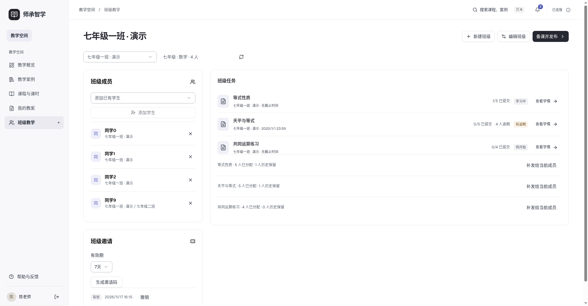
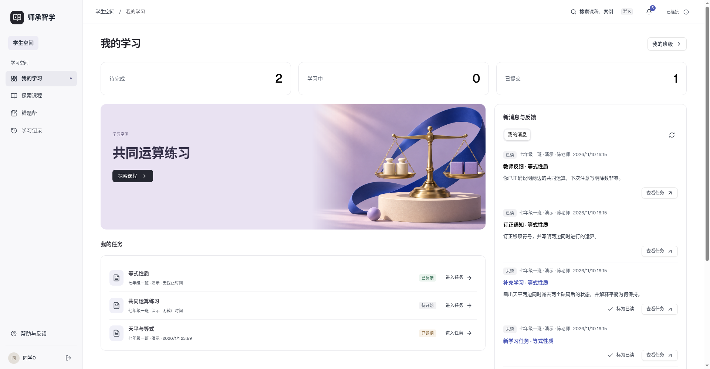
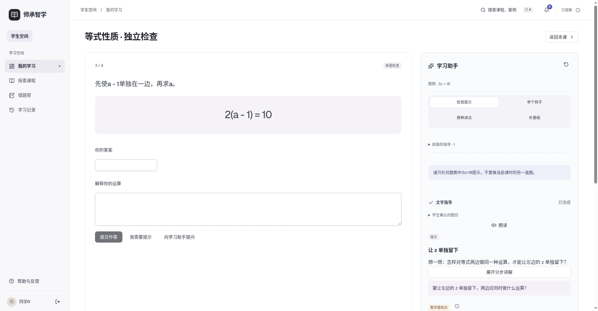
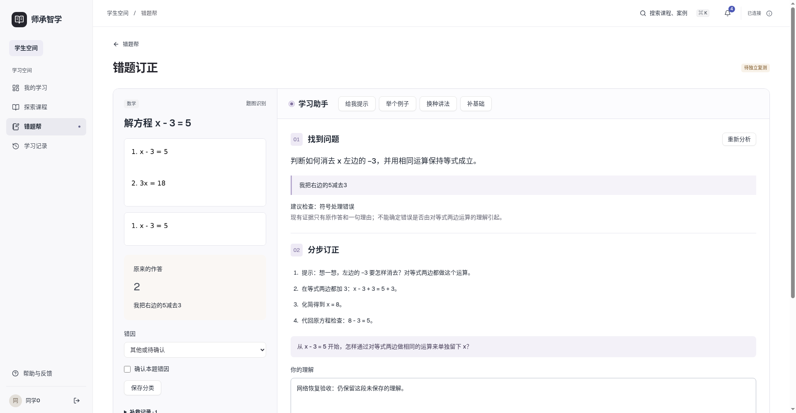
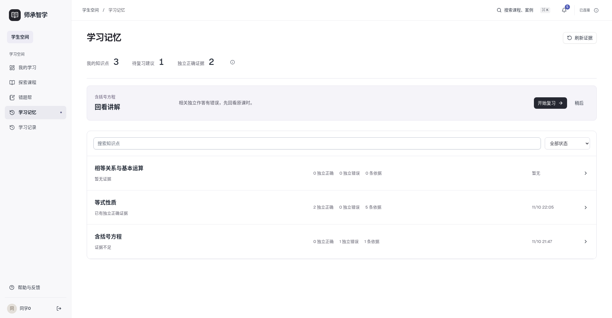
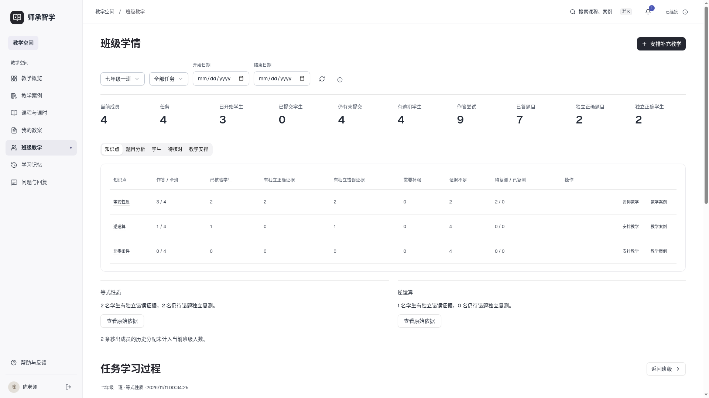

# 师承智学

日期 2026-11-11　版本 v27

师承智学提供教师经验、备课、班级任务、学生学习与学情反馈的完整流程。产品面向桌面 Web，前端使用 **Vue 3 + JavaScript**，业务服务使用 **FastAPI + MySQL**。模型默认通过本机 Codex CLI 调用外部服务，统一使用 gpt-6-luna 和 low 思考强度。教学案例采用字段加权 BM25、知识关联与情境检索，教师可选 Codex 重排；语音输入和朗读使用浏览器能力，不支持时保留文字操作。现已支持资料解析、教学案例版本、课程内容编辑、知识前置关系、首课发布及按课时贯通的师生任务。

- [当前进度：第17步功能隔离验收，真实语音与正式部署仍有阻塞](docs/planning/当前进度_20261111_v3.md)
- [第十七步题库、组卷与考试说明](docs/planning/第十七步功能与技术说明_20261111_v1.md)
- [第十七步38项验收](docs/planning/第十七步统一验收表_20261111_v1.md)
- [第十七步三条真实流程](docs/planning/第十七步完整业务与验收记录_20261111_v1.md)
- [第十七步数据模型与迁移](docs/planning/第十七步数据模型与迁移说明_20261111_v1.md)
- [第十七步证据与截图](docs/verification/exams_20261111_v1/README.md)
- [第十六步完整单元与数学条件](docs/planning/第十六步单元内容与数学条件说明_20261111_v1.md)
- [第十六步35项验收](docs/planning/第十六步统一验收表_20261111_v1.md)
- [第十六步流程与真实评测](docs/planning/第十六步完整业务与评测报告_20261111_v1.md)
- [本机部署、备份恢复与回滚](docs/planning/第十六步部署备份恢复与回滚说明_20261111_v1.md)
- [第十六步证据与截图](docs/verification/unit_20261111_v1/README.md)
- [第十五步使用与实现](docs/planning/第十五步使用与实现说明_20261111_v1.md)
- [第十五步35项验收](docs/planning/第十五步统一验收表_20261111_v1.md)
- [教师学情统计口径](docs/planning/第十五步教师学情统计口径说明_20261111_v1.md)
- [教学干预业务流程](docs/planning/第十五步教学干预业务流程说明_20261111_v1.md)
- [问题反馈与日常管理](docs/planning/第十五步问题反馈与管理端设计_20261111_v1.md)
- [第十五步证据与截图](docs/verification/insights_20261111_v1/README.md)
- [第十四步使用与实现](docs/planning/第十四步使用与实现说明_20261110_v1.md)
- [第十四步32项验收](docs/planning/第十四步统一验收表_20261110_v1.md)
- [学习证据与状态规则](docs/planning/第十四步学习证据与状态规则_20261110_v1.md)
- [跨课时记忆与复习推荐](docs/planning/第十四步跨课时记忆与复习推荐_20261110_v1.md)
- [第十四步证据与截图](docs/verification/memory_20261110_v1/README.md)
- [第十三步使用与实现](docs/planning/第十三步使用与实现说明_20261110_v1.md)
- [第十三步统一验收](docs/planning/第十三步统一验收表_20261110_v1.md)
- [错题补救流程与评分](docs/planning/错题补救流程与评分设计_20261110_v1.md)
- [第十三步数据迁移](docs/planning/第十三步数据结构与迁移说明_20261110_v1.md)
- [第十三步证据与桌面截图](docs/verification/remediation_20261110_v1/README.md)
- [第十二步使用与实现](docs/planning/第十二步使用与实现说明_20261110_v1.md)
- [第十二步统一验收](docs/planning/第十二步统一验收表_20261110_v1.md)
- [第十二步真实指导评测](docs/planning/第十二步指导策略评测报告_20261110_v1.md)
- [第十二步证据与桌面截图](docs/verification/tutoring_20261110_v1/README.md)
- [第十一步使用与实现](docs/planning/第十一步使用与实现说明_20261110_v1.md)
- [第十一步23项验收](docs/planning/第十一步统一验收表_20261110_v1.md)
- [第十一步完整业务报告](docs/planning/第十一步完整业务验收报告_20261110_v1.md)
- [多用户证据与桌面截图](docs/verification/teaching_20261110_v1/README.md)
- [Word排版与教学语言专项](docs/planning/DOCX与教学语言专项修复说明_20261110_v1.md)
- [Word专项20项验收](docs/planning/DOCX与教学语言专项验收表_20261110_v1.md)
- [第十步使用与实现](docs/planning/第十步使用与实现说明_20261110_v1.md)
- [第十步24项验收](docs/planning/第十步统一验收表_20261110_v2.md)
- [第十步完整业务报告](docs/planning/第十步完整业务验收报告_20261110_v1.md)
- [第九步 Agent 编排与验收](docs/planning/第九步Agent编排实施与验收_20261110_v1.md)
- [统一22项验收](docs/planning/统一验收表_20261110_v1.md)
- [第八步使用与实现说明](docs/planning/第八步使用与实现说明_20261109_v1.md)
- [第八步实施与验收](docs/planning/第八步实施与验收_20261109_v1.md)
- [第八步小样本检索对比](docs/planning/第八步小样本检索对比_20261109_v1.md)
- [整体20步计划](docs/planning/系统代码迭代步骤_20261107_v3.md)
- [第七步使用与实现说明](docs/planning/第七步使用与实现说明_20261109_v1.md)
- [第七步实施与验收](docs/planning/第七步实施与验收_20261109_v1.md)
- [第七步开发提示词（必须使用 grill-me）](docs/planning/第七步开发提示词_20261108_v1.md)
- [第六步使用与实现说明](docs/planning/第六步使用与实现说明_20261109_v1.md)
- [第六步实施与验收](docs/planning/第六步实施与验收_20261109_v1.md)
- [第六步开发提示词](docs/planning/第六步开发提示词_20261108_v1.md)
- [第五步使用与实现说明](docs/planning/第五步使用与实现说明_20261108_v3.md)
- [第五步开发提示词与推荐回答](docs/planning/第五步开发提示词与推荐回答_20261108_v1.md)
- [第五步实施与验收（替代方案）](docs/planning/第五步实施与验收_20261108_v3.md)
- [第四步使用与实现说明](docs/planning/第四步使用与实现说明_20261108_v1.md)
- [第四步实施计划](docs/planning/第四步实施计划_20261108_v1.md)
- [第三步使用与实现说明](docs/planning/第三步使用与实现说明_20261107_v1.md)
- [当前视觉与交互设计](docs/design/前端视觉与交互设计_20261110_v2.md)
- [平台结构与首课流程](docs/planning/平台结构与首课使用流程_20261107_v1.md)

按第四步说明配置 `backend-business/.env`、安装 Python 依赖并迁移 MySQL，再运行 FastAPI；安装前端依赖后执行 `npm --prefix frontend run dev`。前端生产构建使用 `npm --prefix frontend run build`。

第十七步隔离生产构建入口为 http://127.0.0.1:8089（原生语音两项待验收，正式库迁移待批准）；第十六步预发布仍为 http://127.0.0.1:8087；当前没有配置公网目标、域名或HTTPS。长期使用前需将验收临时目录迁入持久目录并配置开机守护。

## 当前桌面页面

以下为自编验收内容，完整截图入口见视觉与交互设计。

第八步已走通知识关联发布、教师检索备课、学生OCR确认与指导、来源回看及反馈。小样本为4篇自编案例、14条查询和56个用户复核标签；可选重排未体现额外指标收益，继续默认关闭。实际结果与限制见第八步验收记录。

教师备课页新增“任务备课”：生成、编辑、局部重生成、确认写入草稿，再由教师预览发布。升级后安装 `backend-business` Python依赖以包含 LangGraph；回归命令见 `backend-business/tests/README.md`，前端使用 `npm --prefix frontend test`（需现有 Chromium）。

第十步增加主辅案例、教案版本/恢复、并发冲突、单块差异确认和DOCX。升级先执行0009迁移。隔离MySQL25项、Chromium5项、无外部服务JS1项和生产构建通过；第十步原T11现由Word专项及用户Word/WPS人工确认补齐，24项全部通过；第十一步现已完成，见上方最新验收。Actions配置已加入，远端结果以对应提交为准。

导出新增正式教案/完整溯源版，中文宋体、西文Times New Roman、全文纯黑A4；疑似编辑前缀只在用户明确选择后清理下载副本。后续生成增加教师语言约束及文本质量警告，支持一次定向修订。最新隔离MySQL31项、前端5+1项通过，五份样例19页实际渲染与用户复核已归档。

第十一步补齐多班级、邀请码、历史补发、移出历史只读、补充学习/订正及持久消息。升级执行0010迁移；本地业务库已升级并核对原数据未变。当前42项后端、7项Chromium、1项JS和构建通过，第十二步现已完成，见最新进度。

第十二步完成五种学习指导、最多4轮的有限上下文和题图确认后的独立指导对象；权限、独立作答、重试与原图保留继续关联原任务。54项后端、10项Chromium、1项JS及构建通过，25情境100行真实比较及用户单人复核已归档。无新迁移或依赖，第十三步现已完成，见最新进度。

后续交付约定：用户已于2026-11-10授权每一步完成验收和本地提交后自动推送至本仓库main，无需再次确认。具体推送范围与远程核对规则见[项目约定](AGENTS.md)。

第十三步将错题帮改为独立工作区，课程、个人文字和题图统一管理。补救与实际错题关联，变式题先解方程核验再按本题评分；历史固定示例不重算，也不计入新版独立复测通过。新增0011增量迁移，当前主服务已升级并核对原始数据不变。65项后端、11项Chromium、2项JS与构建通过；三条实际流程及1440/1920/2560桌面证据已归档。

第十四步增加可追溯的学习记忆、跨课时相关证据与规则复习建议，教师/学生纠正以0012追加审计保存，原作答与核验不改写。80项后端、13项Chromium、4项JS及构建通过，固定14情境预期由用户单人认可。状态和规则比较不代表真实教学效果；第十四步已冻结，后续进度见第十五步。

第十五步完成班级/知识/题目/学生学情、原答核对、五类补充教学和多条问题队列。重复作答按唯一学生/发布题目统计，尝试次数另列；安排保存目标与发布基线，提交说明不算新题通过。新增0013迁移，正式库原字段摘要一致。103项后端、15项Chromium、3个JS文件检查、构建与17项正式入口通过，35项验收及三条真实师生流程归档；实际Codex失败任务重试成功。第十六步尚未开始。

