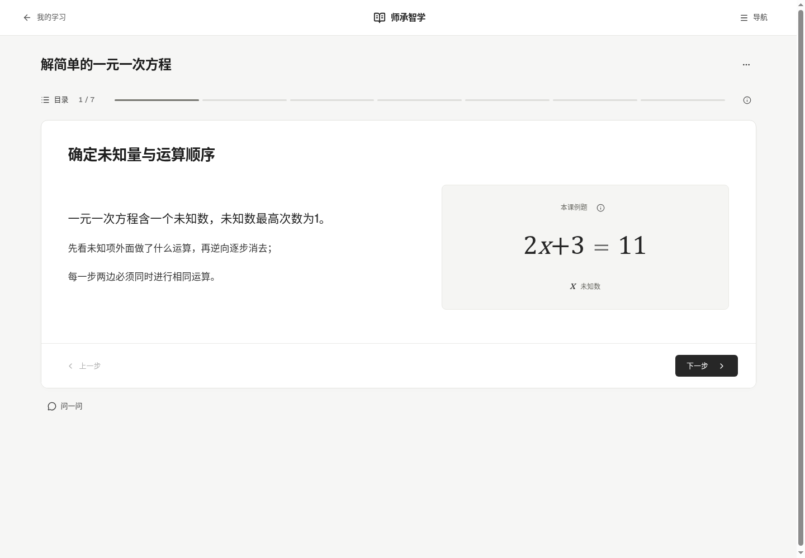

# 师承智学

2026-11-12 · v33 · 本地软件作品

教师经验、备课、课程班级、学生学习、错题帮和学情反馈共用一套网页系统。前端Vue3＋JavaScript，FastAPI业务服务，MySQL数据；沿用Nova、shadcn-vue、Lucide。AI通过当前已登录Codex CLI调用gpt-6-luna/low，不安装本地模型。

## 启动使用

```bash
./install-local.sh   # 首次安装：依赖、网页构建、独立数据库及五课示例
./start-local.sh     # 启动软件
./stop-local.sh      # 停止网页与专用数据库，数据保留
```

在运行主机浏览器打开 **http://127.0.0.1:8099**。Linux安装脚本已验证；需要Python3.11以上、Node22以上及MySQL8的mysqld/mysql/mysqladmin命令。当前未验证Windows原生一键安装。

全新安装生成admin、teacher、student，随机密码保存在本机`backend-business/var/local/accounts.json`。当前验收实例导入完整隔离示例，使用handoff-admin、handoff-t1/t2、handoff-s1—s5，仍从该私有文件读取密码。账号和数据库、上传不提交Git。

专用MySQL23321和网页8099仅回环监听，数据持久保存在`backend-business/var/local`。`./start-local.sh doctor`诊断，`backup`备份，`restore --archive 备份目录`在新库/新目录恢复并保留旧数据。不会改原23317库，不安排公网、域名或正式服务切换。

## 本轮界面更新

学习页一次一节，练习一次一题，公式独立排版；目录、助手和历史按需打开。教师备课与批阅、管理资料也围绕当前对象组织。沿用Vue/JavaScript和现有组件体系，没有增加依赖。

[当前进度v33](docs/planning/当前进度_20261112_v2.md) · [低文字量与分步学习](docs/planning/低文字量与分步学习改造_20261112_v1.md) · [截图及实际验证](docs/verification/focus_20261112_v1/README.md)

本轮33项浏览器回归、7项JS单元检查与构建通过；新界面的五课与师生发布作答流程已实际验证。上轮168项MySQL和F01—F12结果保留，后端源码不变。



## 前序交付结果

- [当前进度](docs/planning/当前进度_20261111_v8.md)与[本地最终报告](docs/planning/本地软件最终交付报告_20261111_v1.md)
- [本地验收表](docs/planning/本地软件最终交付验收表_20261111_v1.md)：23项本地工程/回退通过；原生语音2项保留设备限制，未伪称通过
- [原35项适用性调整](docs/planning/第二十步验收适用性调整_20261111_v1.md)：31项适用通过，4项上线不适用；原始记录不改写
- [本地手册、DOCX和PDF](docs/manuals/local_20261111_v1/README.md)
- [真实操作视频](docs/demos/20261111_v1/README.md)与[本轮证据及截图](docs/verification/local_20261111_v1/README.md)

本地安装、从零建库与账号、重复启停、备份恢复、三角色读写、AI指导、离线关闭重开/同步已实际验证。源码双CI成功，MySQL165项全量无跳过；23页面×1440/1920/2560已检查。D05的6个测试文件经授权可逆整理完成，82原图与原业务行保持不变。

语音在非无头浏览器尝试后未得到有效识别，系统无中文朗读声音；输入、保存及阅读文字均正常。V01/V03仍是设备级未验证，不是上线问题。示例内容和自动输入不代表真实课堂效果。


历史[第二十步报告](docs/planning/第二十步最终交付报告_20261111_v1.md)、[35项原表](docs/planning/第二十步统一验收表_20261111_v1.md)和之前各版本文档保留。最新范围以本地报告为准，不再开发第二十一阶段。项目继续按AGENTS.md授权推送sczx/main，父级其他项目工作不动。
