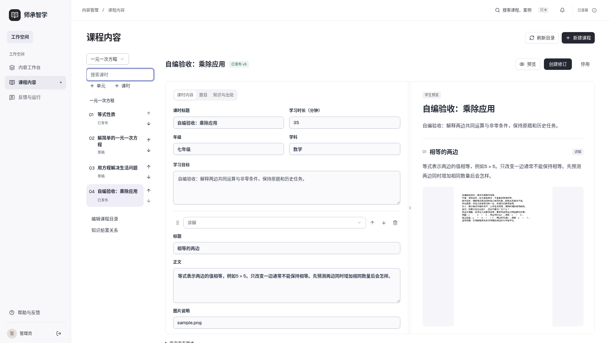
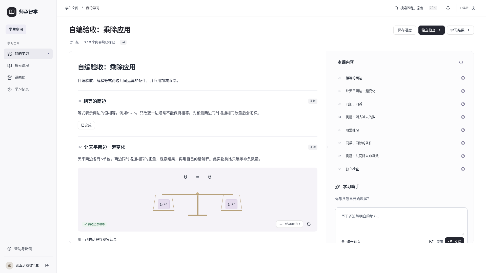
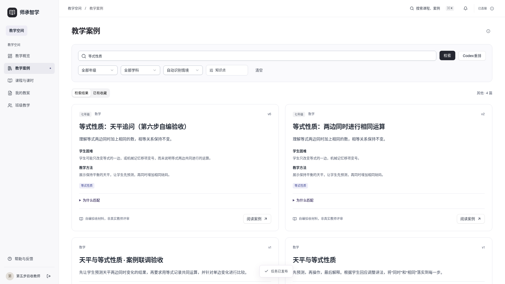
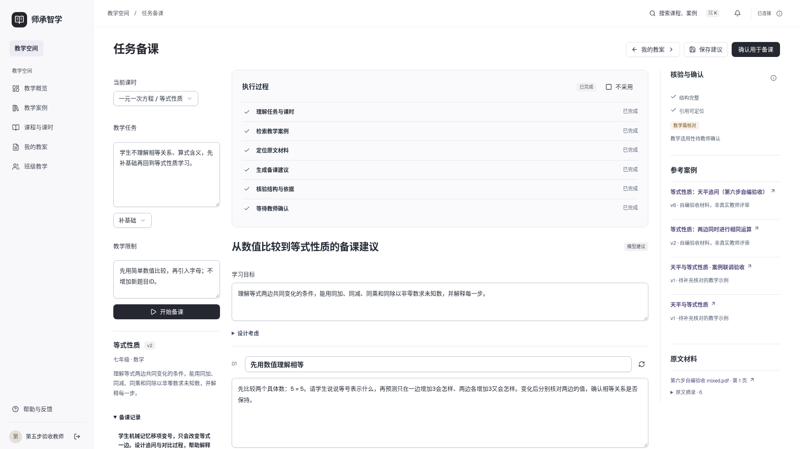

# 师承智学

日期 2026-11-10　版本 v20

师承智学提供教师经验、备课、班级任务、学生学习与学情反馈的完整流程。产品面向桌面 Web，前端使用 **Vue 3 + JavaScript**，业务服务使用 **FastAPI + MySQL**。模型默认通过本机 Codex CLI 调用外部服务，统一使用 gpt-6-luna 和 low 思考强度。教学案例采用字段加权 BM25、知识关联与情境检索，教师可选 Codex 重排；语音输入和朗读使用浏览器能力，不支持时保留文字操作。现已支持资料解析、教学案例版本、课程内容编辑、知识前置关系、首课发布及按课时贯通的师生任务。

- [当前进度：第10步及Word专项验收完成](docs/planning/当前进度_20261110_v3.md)
- [Word排版与教学语言专项](docs/planning/DOCX与教学语言专项修复说明_20261110_v1.md)
- [Word专项20项验收](docs/planning/DOCX与教学语言专项验收表_20261110_v1.md)
- [第十步使用与实现](docs/planning/第十步使用与实现说明_20261110_v1.md)
- [第十步24项验收](docs/planning/第十步统一验收表_20261110_v2.md)
- [第十步完整业务报告](docs/planning/第十步完整业务验收报告_20261110_v1.md)
- [第九步 Agent 编排与验收](docs/planning/第九步Agent编排实施与验收_20261110_v1.md)
- [统一22项验收](docs/planning/统一验收表_20261110_v1.md)
- [第八步使用与实现说明](docs/planning/第八步使用与实现说明_20261109_v1.md)
- [第八步实施与验收](docs/planning/第八步实施与验收_20261109_v1.md)
- [第八步小样本检索对比](docs/planning/第八步小样本检索对比_20261109_v1.md)
- [整体20步计划](docs/planning/系统代码迭代步骤_20261107_v3.md)
- [第七步使用与实现说明](docs/planning/第七步使用与实现说明_20261109_v1.md)
- [第七步实施与验收](docs/planning/第七步实施与验收_20261109_v1.md)
- [第七步开发提示词（必须使用 grill-me）](docs/planning/第七步开发提示词_20261108_v1.md)
- [第六步使用与实现说明](docs/planning/第六步使用与实现说明_20261109_v1.md)
- [第六步实施与验收](docs/planning/第六步实施与验收_20261109_v1.md)
- [第六步开发提示词](docs/planning/第六步开发提示词_20261108_v1.md)
- [第五步使用与实现说明](docs/planning/第五步使用与实现说明_20261108_v3.md)
- [第五步开发提示词与推荐回答](docs/planning/第五步开发提示词与推荐回答_20261108_v1.md)
- [第五步实施与验收（替代方案）](docs/planning/第五步实施与验收_20261108_v3.md)
- [第四步使用与实现说明](docs/planning/第四步使用与实现说明_20261108_v1.md)
- [第四步实施计划](docs/planning/第四步实施计划_20261108_v1.md)
- [第三步使用与实现说明](docs/planning/第三步使用与实现说明_20261107_v1.md)
- [当前视觉与交互设计](docs/design/前端视觉与交互设计_20261110_v2.md)
- [平台结构与首课流程](docs/planning/平台结构与首课使用流程_20261107_v1.md)

按第四步说明配置 `backend-business/.env`、安装 Python 依赖并迁移 MySQL，再运行 FastAPI；安装前端依赖后执行 `npm --prefix frontend run dev`。前端生产构建使用 `npm --prefix frontend run build`。

## 当前桌面页面

以下为自编验收内容，完整截图入口见视觉与交互设计。

第八步已走通知识关联发布、教师检索备课、学生OCR确认与指导、来源回看及反馈。小样本为4篇自编案例、14条查询和56个用户复核标签；可选重排未体现额外指标收益，继续默认关闭。实际结果与限制见第八步验收记录。

教师备课页新增“任务备课”：生成、编辑、局部重生成、确认写入草稿，再由教师预览发布。升级后安装 `backend-business` Python依赖以包含 LangGraph；回归命令见 `backend-business/tests/README.md`，前端使用 `npm --prefix frontend test`（需现有 Chromium）。

第十步增加主辅案例、教案版本/恢复、并发冲突、单块差异确认和DOCX。升级先执行0009迁移。隔离MySQL25项、Chromium5项、无外部服务JS1项和生产构建通过；第十步原T11现由Word专项及用户Word/WPS人工确认补齐，24项全部通过；第十一步尚未启动。Actions配置已加入，本轮没有推送或远端执行结果。

导出新增正式教案/完整溯源版，中文宋体、西文Times New Roman、全文纯黑A4；疑似编辑前缀只在用户明确选择后清理下载副本。后续生成增加教师语言约束及文本质量警告，支持一次定向修订。最新隔离MySQL31项、前端5+1项通过，五份样例19页实际渲染与用户复核已归档。
