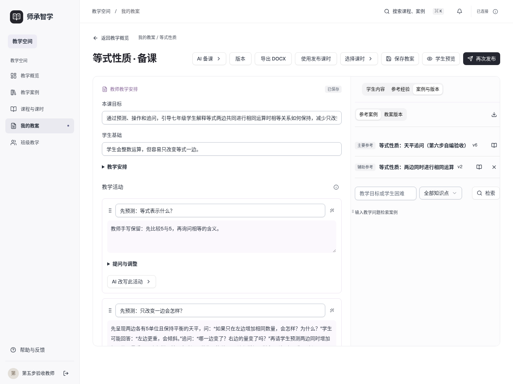
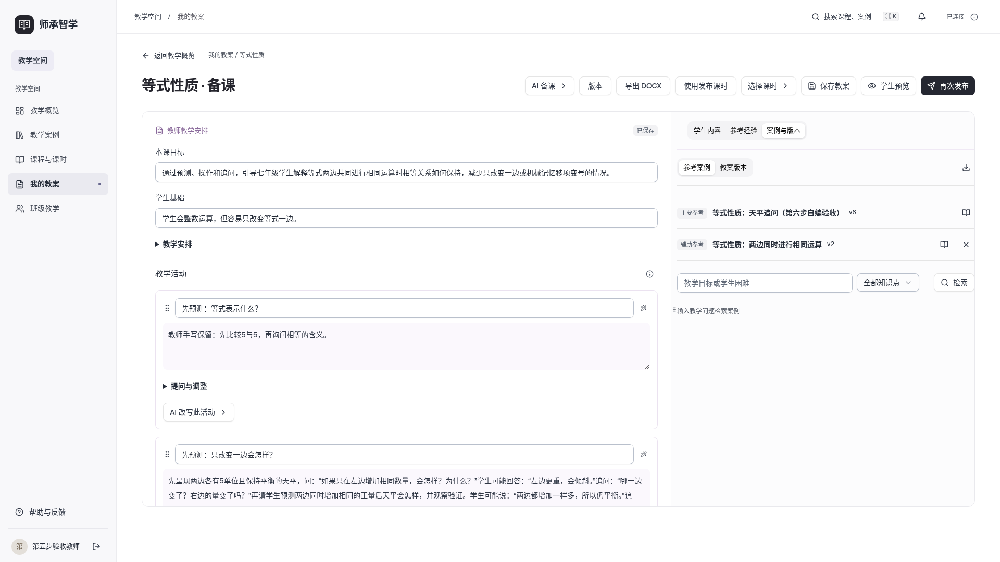
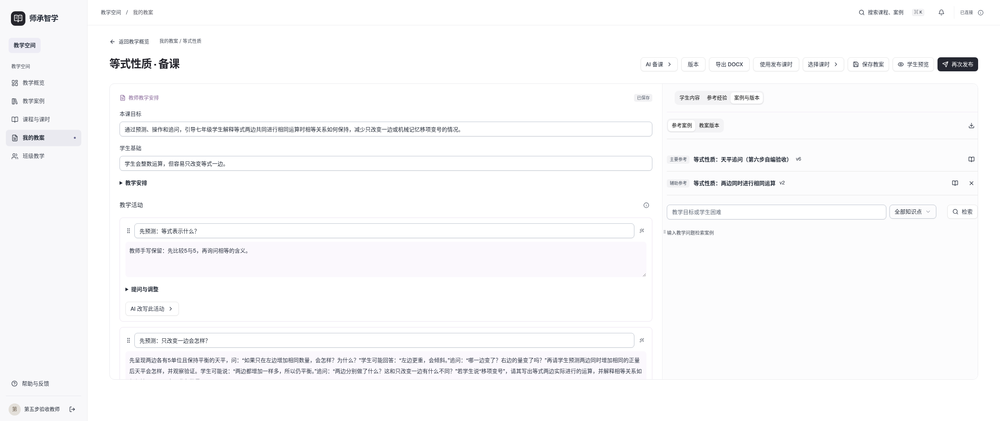
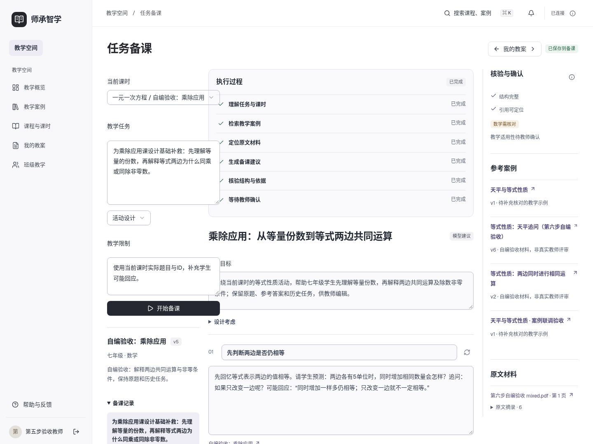
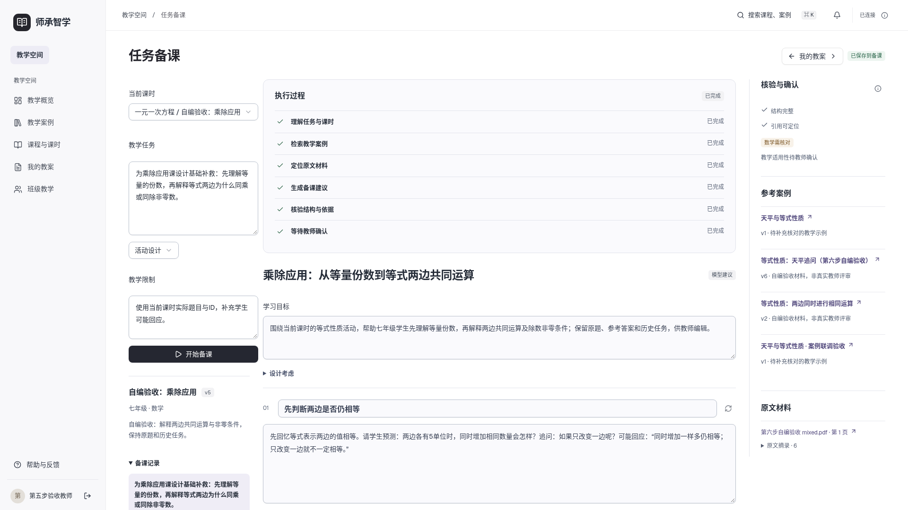
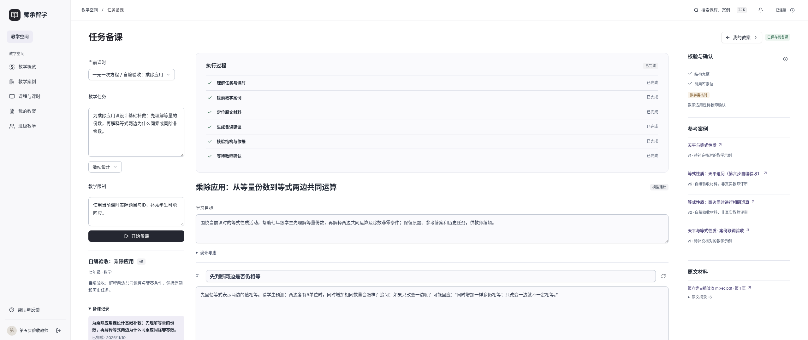
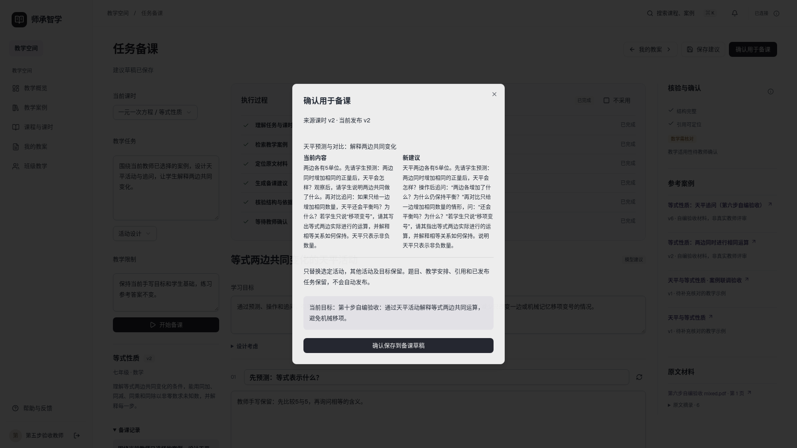

# 教师辅助备课工作区视觉与交互

日期 2026-11-10　版本 v2

沿用Nova、shadcn-vue/Reka、Lucide和现有字体/色彩。编辑与学生预览/案例版本共用工作区；Agent沿用任务/内容/依据三栏。所有页面为桌面Web。

本轮新增活动标题、提问/回应/调整编辑，固定版本主辅参考，历史版本侧栏及预览恢复，DOCX入口；Agent显示来源冲突、原内容与新建议差异。切换课时读取期间不呈现可操作的旧编辑区，保存冲突提供保留本地修改与重新读取。未增加装饰性口号。

实际1440、1920、2560截图与浏览器交互均完成，无文档横向溢出或脚本错误。

来源冲突及初验保存竞态截图保留在同目录，修复记录见规划文档。Office文档实机验收未通过，不以网页截图代替DOCX验收。

第十三步补充（2026-11-10）：错题帮使用统一列表筛选及来源/状态，详情显示原题、原答、实际补救和新题。不在未使用时保留空助手栏；先显示顶部四个指导入口，产生指导后展开三栏。保留Nova、Geist/现有中文字体、黑色主按钮和可读灰阶。原图按比例显示，可点击打开；长公式可换行。1440/1920/2560实际结果见[本步桌面与状态](../verification/remediation_20261110_v1/states.json)。当前未增加手机端。

第十四步补充（2026-11-10）：学生/教师侧栏增加学习记忆。总览为真实计数、规则复习入口和知识列表；详情为相邻的来源证据、状态与审计。推荐卡片列数随实际数量变化，单条时使用横向结构，不留空列；无掌握百分比或装饰性AI图表。沿用Nova灰阶和现有字体、Lucide及组件。1440/1920/2560的最终截图与溢出检查见本步memory验收目录。
