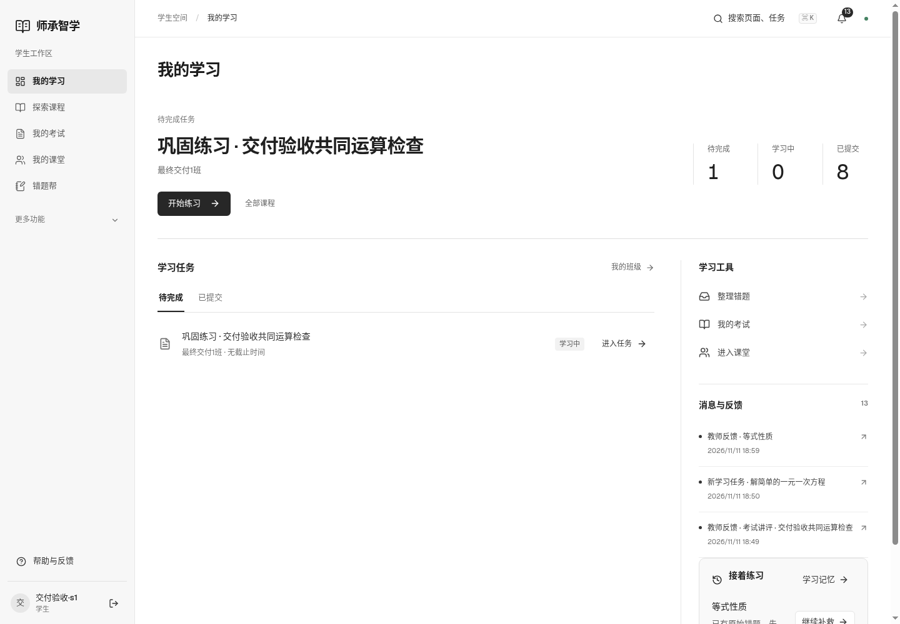
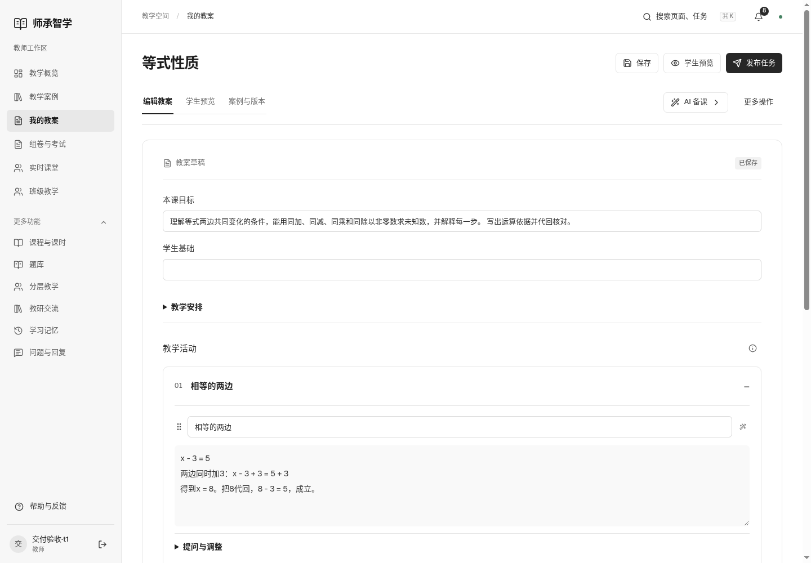

# 网页使用

打开 http://127.0.0.1:8099，使用当前账号登录。旧页面未更新时刷新一次。

学生从「我的学习」进入当前任务，按「下一步」学习，再打开独立练习，提交作答后在「学习结果」提交给教师。有疑问时点「问一问」；错题进入「错题帮」继续订正。考试与课堂分别从左侧入口进入，历史记录、复习和离线学习在导航的「更多功能」。

教师从「教学案例」阅读并选用案例，进入「我的教案」编辑；「学生预览」核对学生实际阅读内容，保存后「发布任务」。班级任务和成员在「班级教学」，学生记录与反馈从任务的「查看学情」进入。

「组卷与考试」先选择或新建试卷，再添加题目、保存、审核和发布。考试页面选择学生答卷完成批阅后发布成绩。

管理员从「内容工作台」上传资料、整理案例，在「课程内容」修订并审核发布课时；账号与运行在「反馈与运行」对应页签。

危险或不可逆操作的后果在执行处显示。所有账号仍独立；「更多功能」是导航分组，不是权限或功能删减。

