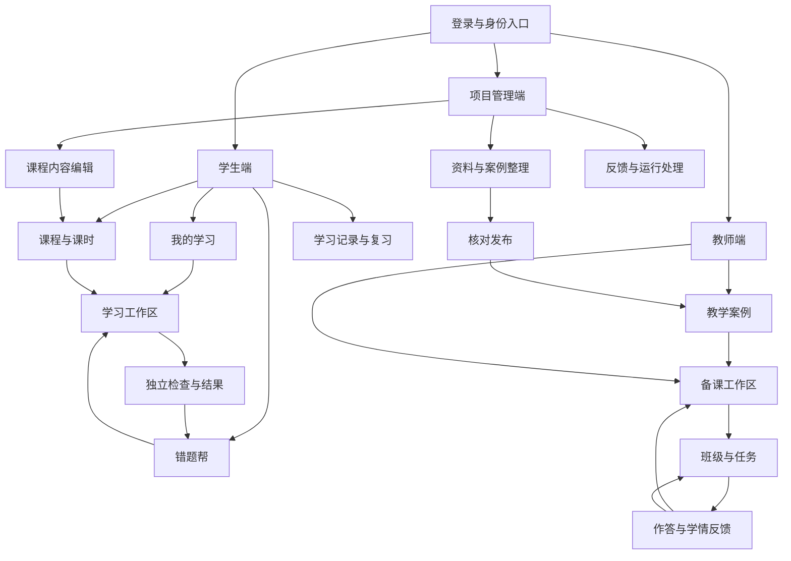
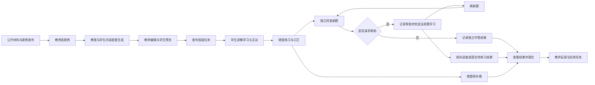

# 师承智学平台结构与首课使用流程

日期 2026-11-07　版本 v1

## 1. 本轮决定与设计依据

本文件完成《系统代码迭代步骤 v2》第 1 步，为第 2 步视觉设计及第 3 步前端开发提供页面、流程和状态输入。范围覆盖平台结构与首版业务流程。

|事项|当前决定|依据|
|---|---|---|
|平台定位|优秀教学经验支持的学生学习、教师教学和内容管理平台|用户要求及功能技术与落地计划 v9|
|错题帮位置|学生端内有独立入口，可接收课程错题并回到课程任务|用户要求及 v2|
|内容起点|一元一次方程单元，等式性质首课|v9 与 v2 的暂定内容起点|
|发布内容|教案与学生内容配套生成，教师可编辑并预览后发布；学习过程中按学生回应补充指导|本轮用户选择 1A|
|独立检查求助|允许求助，记录帮助，再换新题检查独立应用|本轮用户选择 2A|
|工程取向|简单可运行的 Vue 网页、模块化 Python 服务、MySQL；模型全部走外部 API|用户要求|
|界面要求|页面美观是重点，先完成高质量结构与视觉设计，再接入真实功能|用户要求|
|内容建设条件|使用公开材料、程序核验、AI 辅助和项目成员核对；示例班级及示例学情标记为演示|v9|

读取依据为当前 v2 文档及 Git HEAD 中的 v9 文档。当前工作目录的旧代码与 v9 文件已删除。本文件以从零开发为前提。Grill Me 技能未在本机找到，本轮采用关键选择追问，已取得上述两项回答。设计采用 brainstorming、information-architect、user-research、frontend-design、writing-plans 和 verification-before-completion 中适用于本阶段的指导。

## 2. 平台组织与导航

平台按使用者的日常任务组织。学生围绕学习目标继续学习，教师围绕一课完成备课、发布与反馈，管理人员围绕内容整理与问题处理工作。

|入口|一级导航|主要职责|
|---|---|---|
|学生端|我的学习、课程、错题帮、学习记录|完成任务、自主学习、处理错题、查看复习与历史|
|教师端|教学首页、教学案例、我的教案、班级教学|借鉴经验、备课、发布任务、查看作答并指导|
|项目管理端|管理首页、资料与案例、课程内容、反馈与运行|整理来源、核对发布、维护课程、处理问题|
|公共入口|登录、账号设置、消息、问题反馈|进入对应身份、调整资料、定位任务与反馈|

默认采用一个账号承载相应身份，具备多种身份时通过账号菜单切换。学生未加入班级时仍可自主学习。一级导航保持稳定，具体课时、作答和题目通过详情页、页签和上下文入口进入。消息点击后直接进入相应任务或反馈位置。

## 3. 页面清单与主要操作

下表中的名称是页面标题与导航候选，编号用于方案走查。页面可以共用组件或作为同一工作区内的页签。保存结果由业务后端持久化，演示阶段使用明确标记的数据。

### 3.1 公共页面

|编号与页面|使用者及进入方式|主要展示与操作|保存结果与后续入口|
|---|---|---|---|
|P01 登录与注册|新用户或退出登录的用户|注册、登录；设置学生年级或教师任教信息|账号资料；进入相应首页|
|P02 账号设置|三端账号菜单|编辑资料；学生加入班级；切换已有身份|资料与班级归属；返回原页面|
|P03 消息|三端导航中的消息入口|教师任务、提交提醒、反馈处理结果；点击查看|消息阅读状态；进入关联任务或反馈|
|P04 问题反馈|讲解、题目、案例和公共菜单|填写问题并附带当前内容位置；查看处理结果|反馈单；返回原内容|

### 3.2 学生页面

|编号与页面|进入方式|主要展示与操作|保存结果与后续入口|
|---|---|---|---|
|S01 我的学习|学生登录后的首页|优先展示继续学习，其次为教师任务、待复习内容和自主课程；点击继续或开始|任务选择与学习入口；进入 S03 或 S08|
|S02 课程与单元|课程导航、首页推荐|浏览单元与课时、目标和前置知识；开始自主学习|自主学习实例；进入 S03|
|S03 学习工作区|班级任务、自主课时、继续学习|讲解、例题、活动、进度与帮助；文字或题图提问、操作教具、随堂作答|学习进度、作答、互动与帮助事件；进入 S04、S06 或继续本课|
|S04 独立检查|完成课内活动后的检查入口|查看新题、提交解释或作答、请求帮助；帮助后学习当前题，再进入新检查题|每次作答及帮助状态；进入 S05 或返回 S03|
|S05 本课结果|提交检查或查看历史任务|分项展示已完成活动、独立作答结果、仍需练习内容；订正、查看教师反馈|结果记录及订正进度；进入 S06、S08 或下一课|
|S06 错题帮|一级导航、练习错题入口|查看错题；拍照、裁剪、OCR 修订或手动录题；按知识点和订正状态查找|原图、确认后的题目及来源；进入 S07|
|S07 错题学习|错题列表、课程转入|原题、原作答、错误分析、分步指导、变式与补救；重新尝试|补救记录与变式结果；返回来源任务或错题列表|
|S08 学习记录与复习|一级导航、首页复习入口|按课时和目标查看历史作答、帮助记录、复习安排；继续或发起复习|复习结果；返回 S03 或 S07|

学生任务详情复用 S03、S05。讲解帮助在当前学习工作区内呈现，保留所在题目和课时上下文。课程目录与单元详情采用列表到详情的两层结构。

### 3.3 教师页面

|编号与页面|进入方式|主要展示与操作|保存结果与后续入口|
|---|---|---|---|
|T01 教学首页|教师登录后|待继续教案、班级任务、待查看提交和反馈提醒|快捷操作；进入 T04、T05 或 T07|
|T02 教学案例|一级导航、备课参考入口|按目标、年级、知识点和学生困难搜索；收藏、选择案例|收藏及备课引用；进入 T03 或 T04|
|T03 案例详情|检索结果、教案引用|阅读适用条件、引导步骤、调整策略和原文；用于备课、记录使用意见|案例引用及意见；进入 T04 或返回检索|
|T04 我的教案与备课工作区|教案导航、案例详情、教学首页|教案列表；填写目标与基础；生成配套内容、编辑单个环节、查看出处、预览学生页面|教案草稿与版本；进入 T06 发布|
|T05 班级详情|班级教学导航、首页|创建班级、邀请成员、查看班级任务；进入学生或任务详情|班级、成员及任务；进入 T06、T07|
|T06 发布与任务详情|备课页、班级详情|选择班级、时间与内容；预览并发布；查看进度及提醒|发布内容快照、班级任务与学生实例；进入 T07|
|T07 作答与学情反馈|班级任务、教学首页|班级共同困难、学生原作答、帮助记录、独立检查结果；确认或修改反馈、安排补充学习|教师反馈、补充任务、复习安排；进入学生详情、T04 或 T06|

T04 的“教师教案”和“学生内容”使用相互对应的活动区块。修改教学环节后提示检查对应学生内容，教师以学生预览确认最终发布结果。T07 的学生详情作为内部详情展示，保留返回原班级任务的位置。

### 3.4 项目管理页面

|编号与页面|进入方式|主要展示与操作|保存结果与后续入口|
|---|---|---|---|
|M01 管理首页|管理人员登录后|待核对材料、案例、内容问题和失败任务|处理入口；进入 M02 至 M05|
|M02 资料与案例编辑|资料与案例导航|上传材料、登记来源、定位原文、提取经验、编辑可读案例和结构化内容|资料、案例草稿；进入 M03|
|M03 核对与发布|案例草稿、管理首页|并列查看原文与案例、数学核验结果；修订、发布或停用|核对记录、案例版本及索引更新任务；进入案例预览|
|M04 课程内容|课程内容导航|编辑单元、课时、目标、前置关系、例题、活动、题目及案例关联；预览和发布|课程版本与发布状态；进入学生预览|
|M05 反馈与运行|对应导航、管理首页|定位师生反馈和关联内容；处理问题、修订内容；查看失败任务并重试；查看备份恢复结果|处理记录与任务状态；返回关联案例、课时或反馈|

账号管理作为管理工作区的辅助页签，提供必要的账号和身份维护。首版消息与反馈使用站内页面承接。

## 4. 首课完整使用流程

首课的学习目标为解释等式两边进行相同运算时的关系，并能在新题中判断或应用等式性质。以下题目与学生回应是团队编写的流程示例，内容发布前还需核对，案例出处在实际整理时填写。

|环节|执行者与页面|输入与操作|系统响应与保存|下一步|
|---|---|---|---|---|
|1 整理来源|管理人员，M02|登记公开材料，选取与等式性质相关的段落|解析材料并保存来源、原文位置、草稿|M02 编辑案例|
|2 整理教学经验|管理人员，M02|检查引入、追问与学生困难后的调整方式|生成可读案例与结构化经验，保留原文对应关系|M03 核对|
|3 发布案例|管理人员，M03|对照原文、检查数学、修订并发布|保存已发布案例版本并更新索引|T02 可查找|
|4 配置首课|管理人员，M04|录入目标、例题、天平活动、随堂题及独立检查题，关联案例|保存课程发布版本；记录必需活动与检查目标|T04 可选课时|
|5 查找经验|教师，T02、T03|输入“学生只改变等式一边”等困难，阅读案例和出处|返回相关案例，保存教师选用的引用|T04 备课|
|6 生成配套内容|教师，T04|选择目标、课时与案例，填写学生基础|生成教师教案及对应学生讲解、活动和练习，显示引用|T04 编辑|
|7 编辑与预览|教师，T04|修改提问、活动或题目，预览学生页面|保存草稿和配套内容版本，核对数学与必需环节|T05、T06|
|8 发布任务|教师，T05、T06|创建或选择班级，确认参与学生与时间，发布|保存发布快照，为当前班级学生创建任务实例|S01 显示任务|
|9 开始学习|学生，S01、S03|打开任务，查看目标与已有进度，开始本课|建立学习记录，加载对应发布版本|S03 讲解与活动|
|10 操作与解释|学生，S03|操作天平两边同时增加相同数量，并解释变化|保存操作和学生解释；回应体现困难时调整提示|S03 随堂作答|
|11 按需指导|学生，S03|提问、上传题图、请求举例或换讲法|按当前目标和学习证据检索教法，补充指导，保存帮助记录|继续活动或作答|
|12 随堂练习|学生，S03|完成题目并解释理由，按反馈订正|保存原作答和各次修改；将错误关联目标与错题条目|S04 独立检查|
|13 独立检查|学生，S04|完成未展示答案的新题并提交|保存作答、判定和帮助情况；提供与本次结果对应的反馈|S05 或求助分支|
|14 求助后再检查|学生，S04|请求提示或讲解，学习当前题，再选择新的检查题|当前题记录为获得帮助；新题重新记录独立作答|S04 再次提交|
|15 错题补救|学生，S05、S07|查看原题与错误，学习补充讲解并做变式|保存补救结果，保留原始作答；带回来源任务进度|S05 返回本课|
|16 提交本课|学生，S05|完成必需环节并提交，查看完成与待练习项|记录提交结果与目标证据，通知教师|T07 查看结果|
|17 教师反馈|教师，T07|查看原作答、帮助和新题结果，修改或确认反馈|保存教师反馈和修改依据，学生可查看|安排补充学习|
|18 后续指导|教师，T07、T06|选择相关案例、补充讲解或复习，发布给指定学生|创建关联原任务的后续任务，保存案例使用意见|S01 继续学习|

教师教案可包含授课提醒和追问意图。学生发布内容包含讲解、例题、活动和作答任务。二者按目标与活动关联。对话生成的补充讲解保存到本次学习记录中，供教师回查。

求助后换题提供继续检查和稍后继续两个选择。学生也可提交当前情况供教师查看。题目准备不足时显示“待补充检查题”，保留进度并支持反馈，避免学习流程反复停留在同一环节。

### 自主学习路径

学生从 S02 选择已发布课时，创建自主学习实例，随后进入相同的 S03、S04、S05、S07 和 S08。课程内容采用管理端发布版本，帮助、作答和复习规则与班级任务共用。自主学习可在未加入班级时开展。

班级任务关联教师发布内容和班级提交情况。首版教师查看自己布置任务内的记录。学生先自主学习、后收到同课任务时，展示已有学习进度，并为班级任务单独保存完成证据与提交结果；可引用历史活动记录，任务要求的独立检查使用新题。

### 错题帮独立路径

从 S06 上传原图或手动录题，确认识别结果，补充自己的作答，再进入 S07 诊断、引导与变式。没有原作答时可先尝试一次，后续依据实际作答判断困难。独立录入题目的补救记录进入个人学习记录与复习；课程转入的错题同时关联原题、课时、任务和尝试记录，返回时定位对应任务。

## 5. 核心对象与关系

|业务对象|保存的业务信息|主要关系|
|---|---|---|
|资料来源|作者、出处、使用条件、原文及定位|一份资料可支持多个案例|
|教学案例及版本|目标、适用基础、困难、引导与调整、来源|可关联多个课时与教案；引用固定版本|
|课程、单元、课时|目录、目标、前置关系、内容与活动|课时包含题目，关联案例与知识目标|
|题目与活动|题干、答案与判定依据、知识目标、活动配置|用于随堂、检查、补救与复习；记录使用场景|
|教案及配套学生内容|教师教学安排、学生内容及对应活动、引用版本|由教师编辑，发布时形成任务内容快照|
|班级与成员|教师、学生及加入状态|班级包含多个任务，学生可参加多个班级|
|教学任务|发布内容、参与学生、时间、必需环节|包含每名学生的任务实例和提交结果|
|学习实例|班级或自主入口、当前版本、进度、状态|包含学习事件、题目尝试与教师反馈|
|作答与帮助事件|原作答、提交时间、提示和讲解、判断结果|绑定具体题目尝试与目标，支持过程回查|
|错题条目|原图、确认题目、错误证据、来源及补救情况|连接学习实例、作答与补救记录|
|目标级学习记录|掌握证据、待补目标、帮助情况和复习记录|汇总多次学习事件，教师和学生可反馈纠正|
|教师反馈与后续任务|确认或修改的意见、补充内容、复习安排|关联原任务及学生，形成后续指导|
|内容反馈与运行任务|问题定位、处理记录、生成或索引任务状态|连接案例版本、课时、作答或模型调用|

版本规则采用简单的发布快照。教师草稿可以继续修改，已发布任务保留对应内容。案例和课程修订形成新版本。内容确需停用时，已引用任务显示提示，支持教师选择替代内容并明确通知学生，已有学习记录可回查。

### 关键状态与触发操作

|对象|主要状态|触发与结果|
|---|---|---|
|材料与案例|草稿 → 待核对 → 已发布 → 已停用|提交核对、成员核对发布、停用；需修改时回到草稿形成修订版|
|课程内容|草稿 → 已发布 → 已停用|确认必需内容后发布；后续修改形成版本|
|教案|草稿 → 可发布|教师预览并确认配套内容后可发布；生成进行中与失败单独显示为运行状态|
|班级任务|已发布 → 已结束；可标记撤回|学生可在发布后开始；教师结束任务或撤回，记录对应原因|
|学生任务|未开始 → 学习中 → 已提交 → 待订正 → 已提交|开始学习、保存、提交、教师要求订正、学生再提交；教师确认后标记已完成|
|自主学习|未开始 → 学习中 → 已完成|完成本课必需活动并提交结果；待复习目标继续保留|
|独立检查尝试|待作答 → 已提交；求助时标记获得帮助|求助后当前题进入指导练习，新题创建新尝试；独立结果按每次尝试判断|
|错题|待确认 → 待补救 → 补救中 → 已订正 → 待复习|确认题目、开始指导、提交订正、安排复习；复习仍有困难时回到补救|
|后台任务|待执行 → 进行中 → 成功或失败|失败可重试，重试继续关联原业务对象，避免重复创建内容|
|内容反馈|待处理 → 处理中 → 已处理|管理人员确认、修订或回复，保存处理结果|

“已提交”表示学生交回本次学习结果，可以包含仍需帮助的目标。“已完成”表示流程要求已完成；掌握情况按目标证据展示。独立检查同时显示是否正确与是否获得帮助，教师可追查当次作答。暂停保存当前位置，任务继续处于学习中。

默认将截止时间用于提醒和迟交标记，结束任务由教师明确操作。截止后仍可提交，显示实际时间。任务结束后可回看与个人复习，新的班级提交由教师重新开放。发布时的班级成员生成实例，后加入成员由教师选择补发。

## 6. AI 与程序能力的业务分工

|环节|输入|处理与输出|用户看到什么、可以修改什么|
|---|---|---|---|
|经验提炼|公开原文、目标、材料定位|图文理解及结构化提取，生成案例和来源对应|管理人员对照原文修订、核对发布|
|案例检索|目标、年级、学生困难、基础与已选内容|关键词与语义召回、融合、重排；必要时改写查询补充检索|教师查看案例、适用说明与出处，可换选案例|
|配套备课|课时、案例、目标、学生基础|Agent 按步骤检索、组织教案与学生活动、核验结果|教师逐块编辑、局部重新生成、预览后发布|
|学生指导|当前目标、已发布内容、当前回应和相关学习记录|选择适用经验，提供提示、例子、换讲法或前置补充|学生操作帮助选项并反馈；教师可回查过程|
|图文录题|学生原图、裁剪区域、已有文字|OCR 与题图理解，输出结构化题目|学生修订后确认，保留原图|
|练习与独立检查|目标、题目、实际作答和帮助事件|规则与 SymPy 核验可计算结论，模型辅助理解解释|学生看到结果和理由，教师可修正判断；判定不足时标记待核对|
|目标记忆与复习|实际作答、错误、帮助、检查与复习结果|程序关联证据，模型辅助归纳困难及下一步建议|展示证据、待补内容及可进入的学习任务；支持纠正记录|
|学情反馈|班级提交、原作答、帮助和目标结果|程序统计，模型辅助整理共同困难和指导建议|教师查看依据，修改并确认反馈与补充安排|

短期上下文跟随当前课时和题目，长期记录按目标提取相关证据。程序负责状态变更、保存、版本关联与恢复，模型输出经结构校验后进入业务流程。教学互动图形采用 VisualizationSpec 与固定组件。首版案例排序与学习建议可查看关联依据，材料不足时明确显示缺口并允许教师自行编辑。

等式天平示例先表达适合天平类比的相等关系。等式两边同加或同减相同数、同乘相同数及同除以非零数分别通过适合的例题表达；除数为零等条件由内容与程序检查。具体教学材料和题目在内容建设步骤完成核对。

## 7. 首版范围和后续扩展

|阶段|包含内容|对应 v2|
|---|---|---|
|结构与界面|三端导航、核心页面、统一组件、演示内容与交互|第 1—3 步|
|真实业务与 AI 基础|账号、数据、模型调用、内容管理、首课、检索、教学编排|第 4—9 步|
|完整师生使用|备课、班级任务、学生学习、错题帮、学习记忆、教师反馈|第 10—15 步|
|首版可用|首课完整走查，扩展一元一次方程单元并部署|第 16 步|
|教学能力扩展|语音、更多教具、考试、批量导出|第 17 步|
|平台扩展|实时课堂、分层教学、教研交流与成长展示|第 18 步|
|完整体验与交付|离线学习、全平台视觉精修、最终部署与说明|第 19—20 步|

首版页面为后续功能保留可扩展的局部导航。首版已经包含基本的知识目标进度和站内任务提醒，复杂成长图谱与实时课堂按对应阶段建设。

## 8. 第 2 步视觉设计输入

重点制作 S01、S03、S06、T02/T03、T04、T07、M02/M03 七组高保真页面，并通过完整流程串联。先设计真实内容密度下的页面，准备一篇可读案例、一份配套教案、一段学生讲解、一题作答及一组明确标记的演示学情。视觉风格在第 2 步结合这些页面确定。

|页面组|必须表现的布局与交互|需要覆盖的状态|
|---|---|---|
|学生首页|继续学习为主要行动；任务、复习与课程有明确次序|有班级、无班级、首次进入、有未完成学习|
|学习工作区|桌面呈现课时进度、内容与帮助的稳定关系；窄屏在同一内容位置展开帮助|讲解、公式、天平、作答、生成中、保存失败、恢复位置|
|错题帮|原题与补救清楚关联，课程来源可见，返回任务入口明确|图片上传、OCR 修订、无原作答、补救中、完成待复习|
|案例阅读|检索结果、可读案例与出处有阅读层次，选用操作易找到|结果为空、正文较长、已收藏、案例更新|
|备课工作区|案例参考、教案编辑和学生预览之间切换清楚，活动保持对应|初始填写、生成中、局部修改、预览、发布前检查、失败重试|
|教师学情|班级概览到单题、单人原作答逐层展开，帮助与独立检查可辨识|未提交、已提交、获得帮助、待核对、教师已反馈|
|内容编辑与核对|原文与提炼结果可对照，来源定位、版本和发布状态可见|解析中、待核对、数学需确认、已发布、已停用|

共同交互要求为长公式可横向查看、图片可放大、操作有反馈、长内容不挤压作答区、生成时仍能阅读已有内容。学生学习与教师编辑的桌面布局优先，平板和手机按内容顺序重新组织。装饰图像、动效和图表应服务阅读与状态理解，样例数据明显标记。

## 9. 第 3 步前端开发输入

|输入|实施要求|
|---|---|
|路由结构|公共入口，学生、教师、管理三个工作区；详情包含对应业务对象标识，消息能直接定位|
|公共组件|应用布局、导航、面包屑、表单、搜索筛选、空状态、加载、错误与重试、文件上传、内容预览|
|教学组件|公式文本、来源引用、案例卡片、活动编辑、教案与学生预览、题目与作答、学习进度、帮助记录、反馈面板|
|页面状态|每页明确加载、空内容、正常、生成或保存中、失败及已完成状态；按钮对应可执行动作|
|演示方式|演示内容与真实接口数据采用一致业务对象，保留明确演示标记；所有主要按钮具备连贯的可点击路径|
|继续学习|保存课时位置、当前活动、作答草稿与关联任务；返回页面能理解从哪里继续|
|后端衔接|以本文件业务对象和流程为边界，第 4 步细化接口；真实接入后由 MySQL 保存记录|

前端演示至少能走完教师选案例、编辑教案、预览发布、学生开始学习、求助后换题、进入错题补救、教师查看反馈的页面链路。

## 10. 本步骤走查与后续验收

本轮使用设计走查核对入口、操作、保存对象和下一步。下面是后续实现时的操作验收标准。

|场景|具体走查|通过条件|
|---|---|---|
|教师发布一课|T02 选案例 → T04 编辑配套内容 → 学生预览 → T06 发布|学生收到同一发布版本，教师能追查选用案例|
|学生完成一课|S01 → S03 活动与练习 → S04 检查 → S05 提交|原作答与进度保存，教师能查看结果|
|求助后换题|S04 请求帮助 → 学习当前题 → 新题提交|两次题目尝试分开保存，帮助记录与独立结果准确对应|
|检查题不足|请求新题时无可用题 → 保存或提交待练习结果|当前记录保留、原因可见，学生可退出和继续|
|课程错题补救|S05 → S07 → 返回本课|错题与来源作答关联，返回正确任务位置|
|独立使用错题帮|S06 上传并确认 → S07 补救 → S08 复习|原图与修订题目保留，自主补救有学习记录|
|自主学习|无班级学生从 S02 开始 → 完成本课|可保存与继续，并查看个人结果|
|暂停与恢复|活动中或作答中离开 → S01 继续|恢复相应内容、草稿和任务，重复提交关联同次尝试|
|教师反馈|T07 查看原作答与帮助 → 修改反馈 → 补发学习|学生能看到反馈及后续任务，原记录可回查|
|内容修订|M03 发布新版本 → 查看既有任务和新建任务|既有记录关联原版本，新任务采用新版本|
|反馈定位|S03 反馈讲解问题 → M05 处理 → 学生查看回复|能定位内容版本与学习位置，并记录处理结果|

以上均为方案走查与待实现验收条件，实际功能验证在对应开发步骤执行。

## 11. 设计假设与待验证事项

|事项|本轮采用的默认设计|后续如何验证或调整|
|---|---|---|
|首次使用|学生设置年级后可自主学；加入班级为可选；教师可先备课再建班|第 3 步检查首次进入与导航是否顺畅|
|学生首页优先级|继续学习优先，其次教师任务与复习；课程始终可进入|使用演示路径核对查找成本，真实使用后调整|
|反馈时机|学生作答后即时反馈；教师随后确认或修改学情反馈|检查学生能否继续学习，教师能否清楚查看修订前后记录|
|完成规则|按完成活动、提交结果和教师确认记录流程，掌握情况单独按目标展示|第 7 步随内容建设定义具体活动与检查标准|
|晚加入与迟交|教师选择给新成员补发；截止提醒后允许迟交；结束任务需教师操作|第 11 步核对任务界面与消息|
|自主与班级学习衔接|显示个人已有进度，班级提交保留单独证据，新检查使用新题|第 12—16 步检查重复学习与教师查看体验|
|首版教具|先实现等式天平，适用范围随具体内容核对|第 7、13 步检查数学条件与活动可理解性|
|案例质量及实际成效|当前采用公开资料与团队核对，保留完整出处和真实学习证据|具备条件后开展真实师生试用；演示数据持续明确标记|

本轮用户已确认的两项选择记录在第 1 节。其余默认设计可在后续页面走查和内容建设中调整，并记录影响到的流程与状态。
