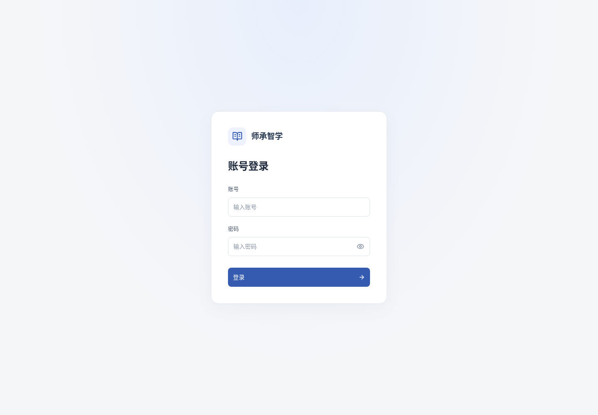

# 登录页与蓝色配色调整

按用户反馈将绿色主色改为克制蓝色。登录页使用居中卡片，去掉左右分屏、大方程及重复品牌，保留账号密码标签、显示密码、提交中与错误反馈。界面自带的分隔点改为空间分组，班级年级/学科/教师拆成独立字段；用户原文和数学内容不批量改写。

实际qmx登录成功，班级页无分隔点，主按钮计算颜色为rgb(52,91,175)，无浏览器脚本异常。浏览器回归、12项JS及构建结果见证据。

