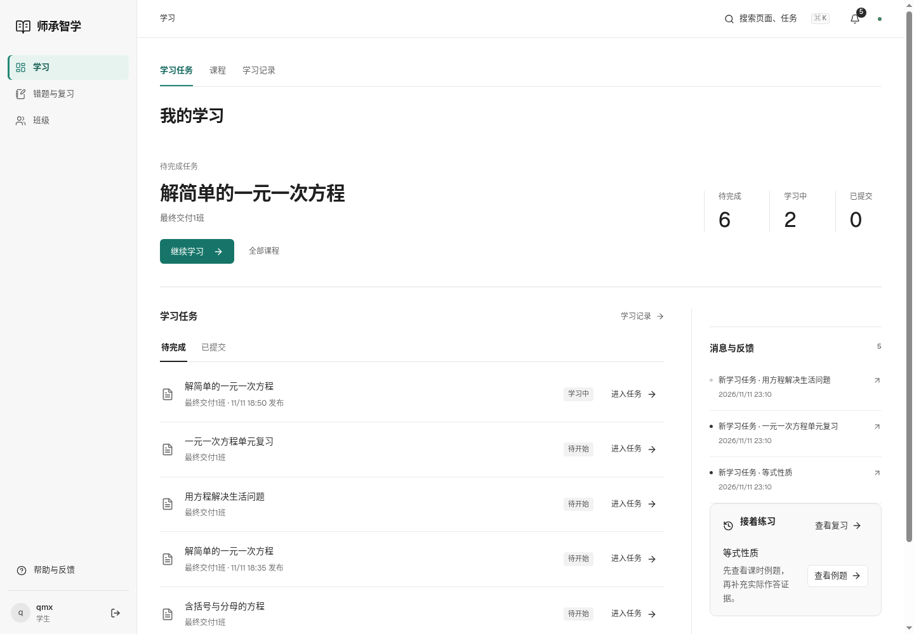

# 移除离线学习与轻量配色

2026-11-12 · v36

按用户要求删除离线业务页面、登录/导航入口、浏览器加密存储与同步服务、后端离线路由和运行模型及对应专用测试。原会话竞态检查保留并改名session-auth。数据库历史迁移0016独立定义原表，保障新旧安装兼容；不删除既有业务行。旧离线链接重定向学习首页，旧缓存通过退役Worker清理，后续不注册离线缓存。

使用低饱和蓝绿色点缀主操作、导航选中、页签、图标与焦点，保留白色内容面板和深色正文；没有增加冗余说明或依赖。

实际浏览器qmx登录、导航无离线入口、旧链接回首页通过，无脚本异常。前端构建、12项JS、Python基础检查通过（167项中62通过、105项MySQL条件跳过）；浏览器回归及导航更新记录见证据。完整MySQL由本提交CI运行，不把跳过当通过。v35表保持历史原貌，本轮删除功能不继续列作当前能力。

