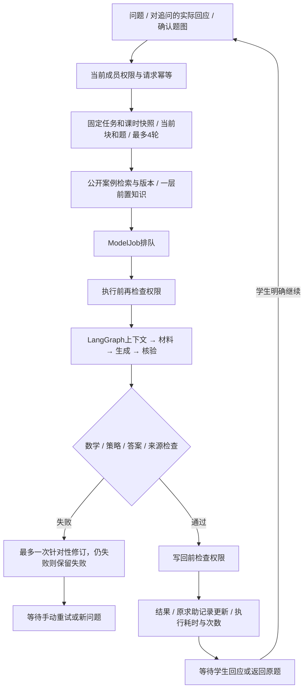

# 第十二步指导流程与状态设计

日期2026-11-10，版本v1。

复用既有学生ModelJob，不新增聊天平台。每次学生操作生成一条任务；有限LangGraph一次走完后等待学生下一次明确操作。

自主尝试分支由程序返回一个检查点，modelCalls=0，不生成新的解题步骤；实际答案仍通过原作答接口保存。既有HelpRecord不删除。数学可核验范围、完整教学语言适切性、提交完成与独立正确分别记录。

## 状态

queued→running→succeeded，失败为failed，主动结束为cancelled。刷新和离页只重连，不重新生成。服务恢复将遗留running及其ModelRun标为失败，保留输入和既有结果；手动重试创建下一次run，不重复创建同一帮助记录。运行中失去权限时不写回指导，历史可读。

同一record但不同题、块或题图不能相互作为父轮。新题、任务、内容块和学生切换时取消旧订阅及本地等待，并用作用域代次拒绝晚到的初始化、上传和模型响应。题图确认后context.focus=confirmed_image，context.question是确认的题目；scope.questionId继续指向原任务记录，避免丢失来源。

## 成本和来源

模型只接收允许字段重建后的教学输入，私有核验答案留在业务服务。单次最多一次主生成和一次结构/质量修订；每轮结果记录nodes、modelCalls、elapsedMs、historyTurns和contextChars。失败的调用和运行后失权也在ModelRun.result.workflow记录成本，不把失败调用计成零。来源只接受本轮实际提供的公开版本ID。原始材料不因24000字上下文上限被修改。

用户在原题请求帮助时先保存“指导请求”，成功后更新同一HelpRecord为模型指导，防止等待期间提交作答被误记成独立。失败仍明确显示是求助请求，没有伪造成功指导；新题按新题记录重新判断。
