# 初高中全学科验收证据

2026-11-12 / v1

[交付与验收说明](../../planning/初高中全学科通用化交付与验收_20261112_v1.md)。所有跨学科示例在隔离MySQL执行，自编内容用于工程验收。

- `backend-final.log`：完整182项后端检查。
- `backend-related.log`：最终相关42项检查。
- `domain-unit.log`、`mysql-final.log`：最终全科规则及业务检查。
- `frontend-final.log`、`js-unit.log`、`build.log`：浏览器44项、JS17项与构建。
- `browser.json`：实际三端操作；1440与1920宽度无页面横向溢出、无捕获到的脚本异常。
- `local-update.json`：8099更新、qmx登录、新学科接口及数据/上传保持。
- `real-ai.json`：真实请求与重试记录；模型成功不等于自然语言教学质量已由真实教师评审。
- `backend-full.log`、`frontend.log`、`mysql.log`：较早批次的通过记录，保留追溯；最终批次优先。

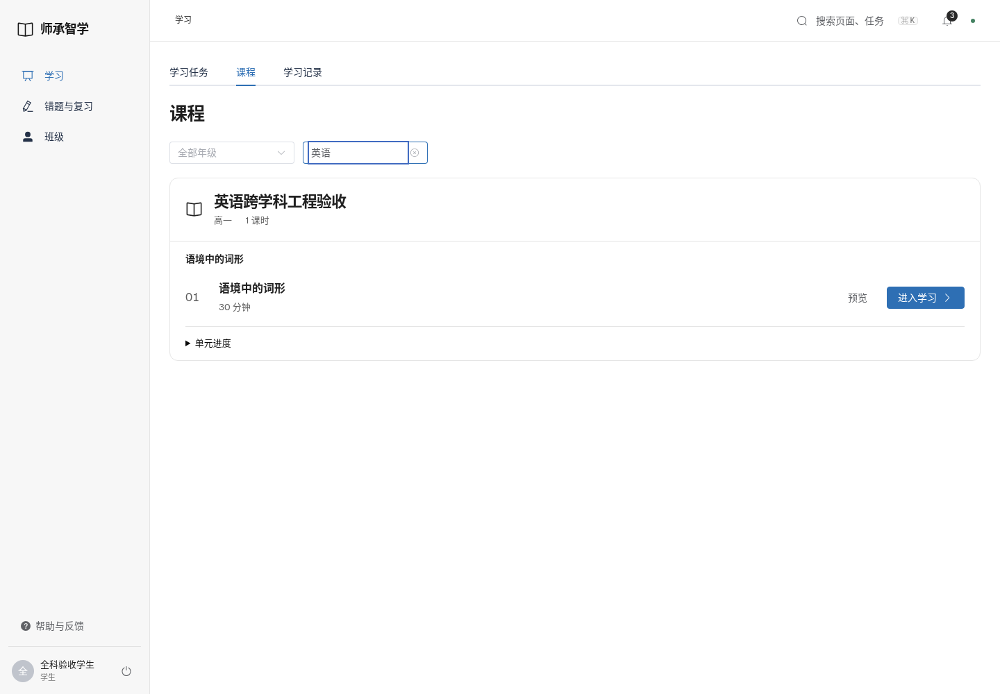
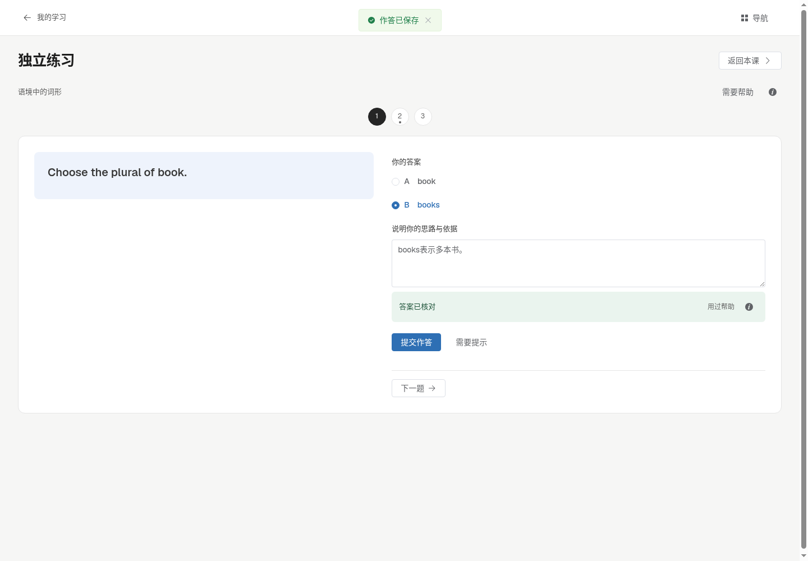
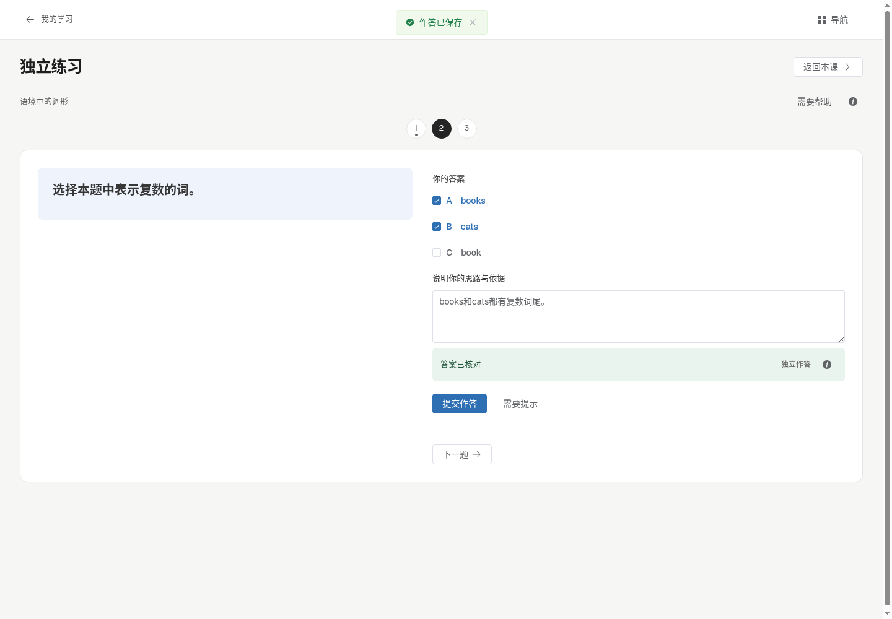
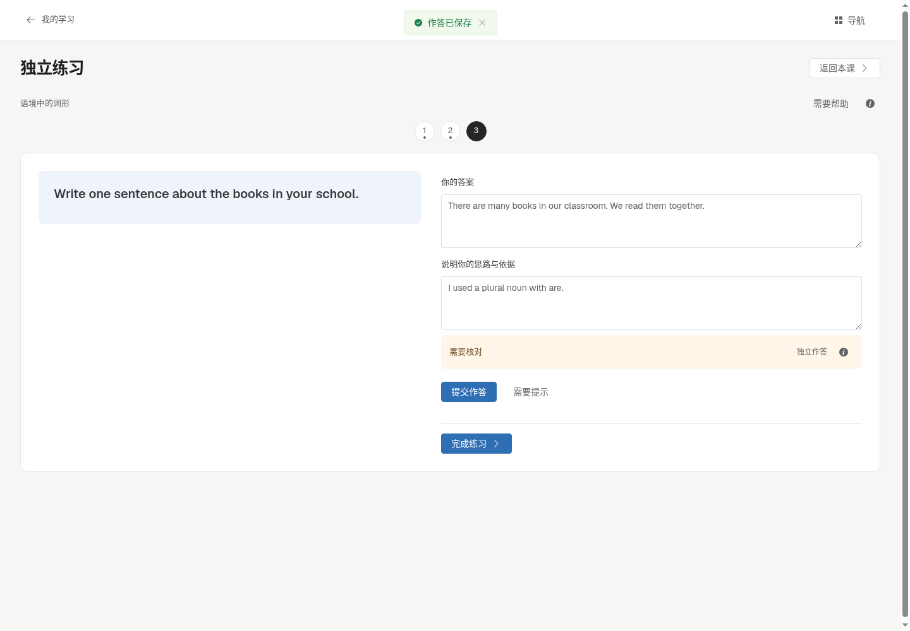
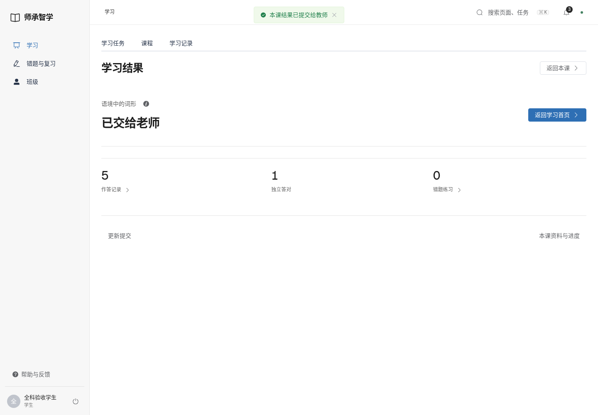
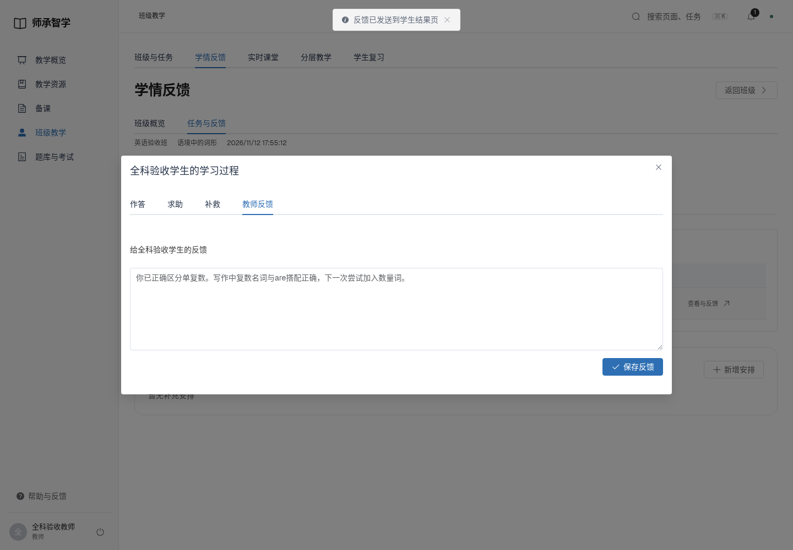
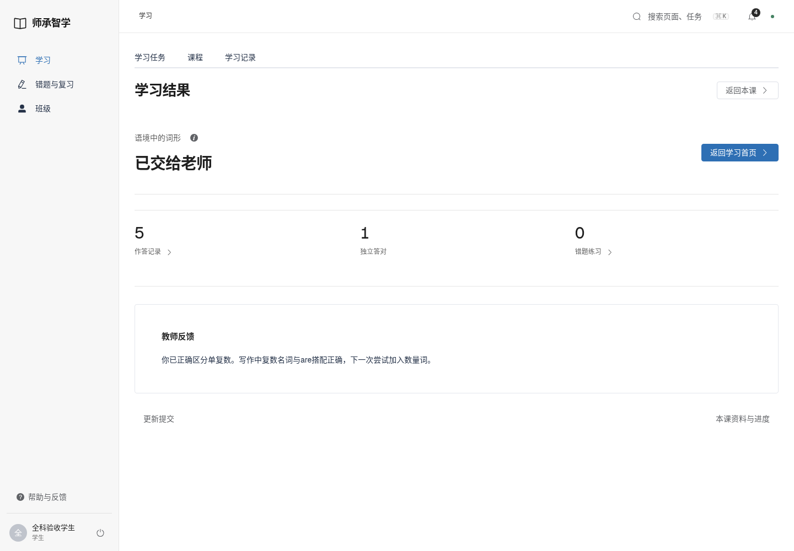
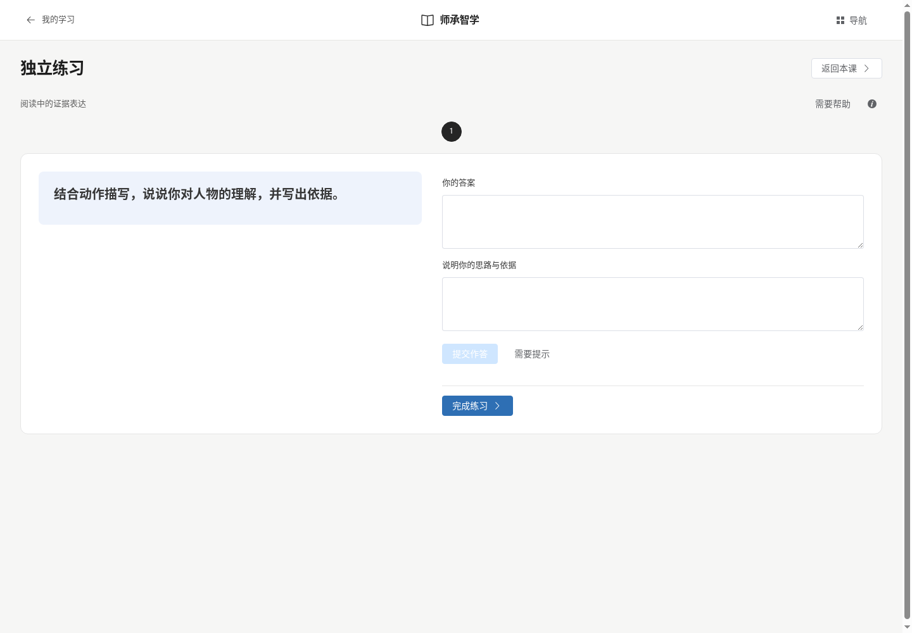
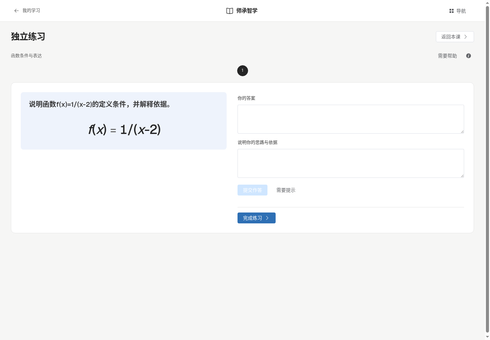
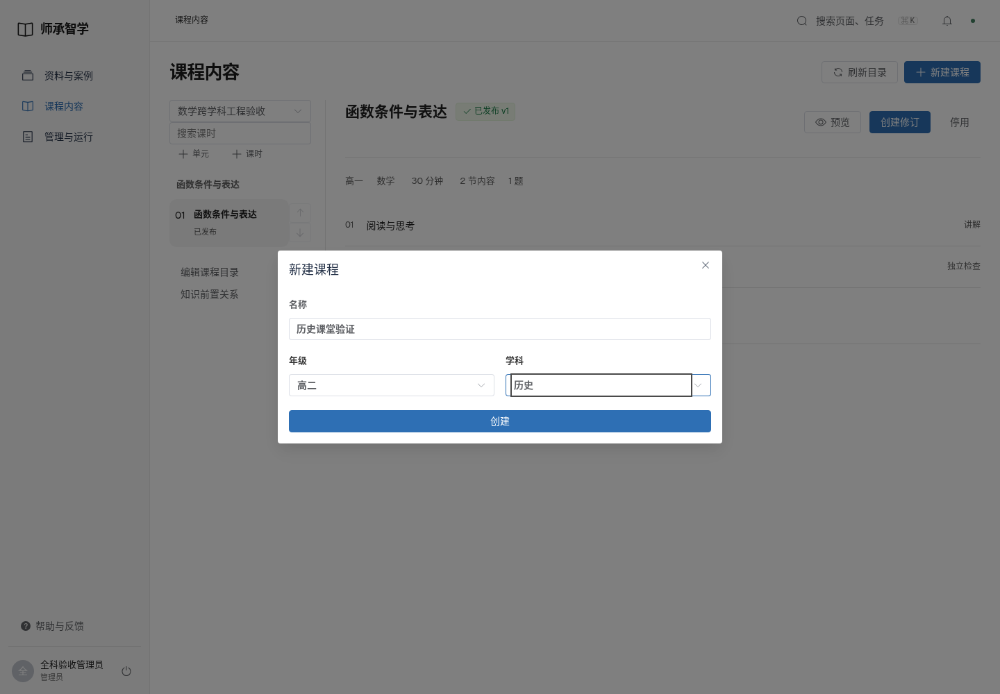
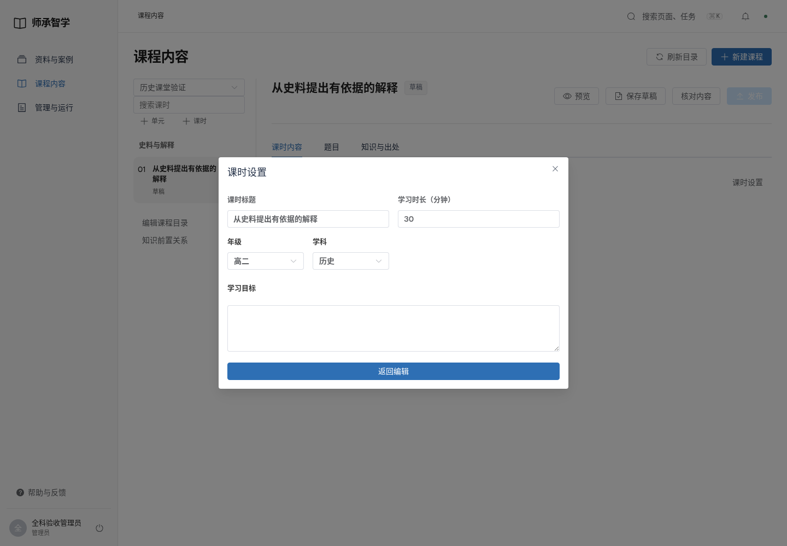

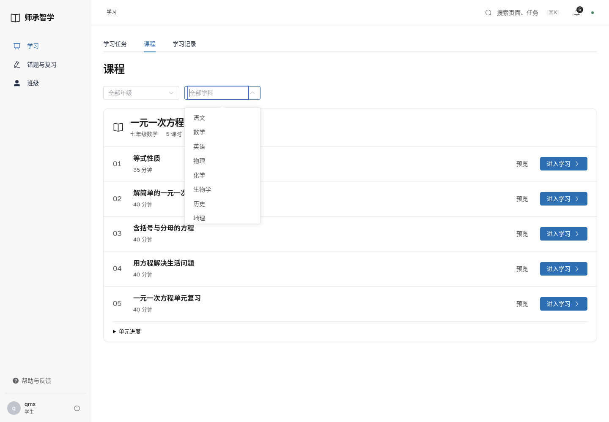
