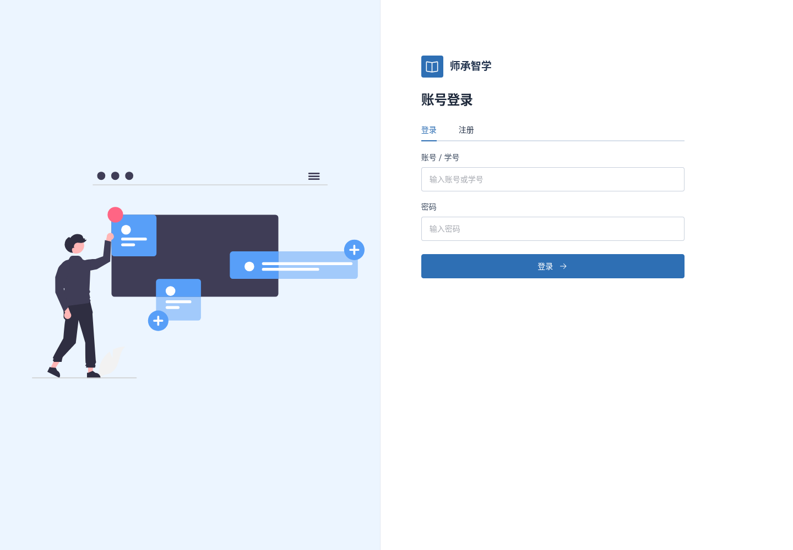
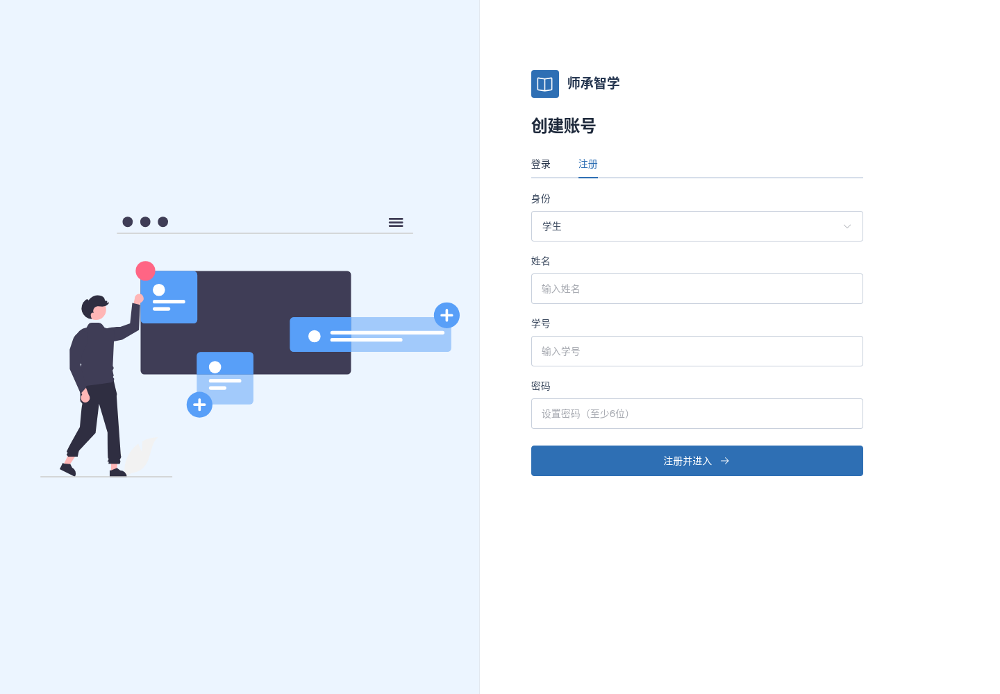

# 分栏登录页留白调整

2026-11-13 / v1

左侧占48%，图像移除760px宽度上限并朝右对齐；右侧表单靠左，宽度上限从440px增至480px，去掉表单内层24px重复内边距，收紧两栏相邻区域。保留Element Plus、原插画、44px控件、6位密码及字段错误。

1920宽度下，原分栏边界到输入框约285px，现为95px；1440宽度现为约89px。截图与layout.json记录实际尺寸。

验证：两种表单×四种尺寸共8次检查，插画加载、控件尺寸、无溢出/脚本异常；切换位置与字段错误两项针对回归通过；构建通过。前端5175。

