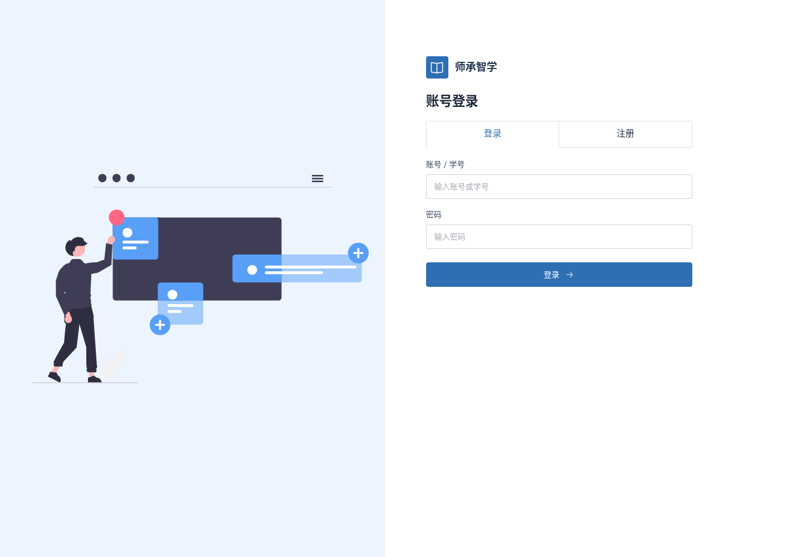
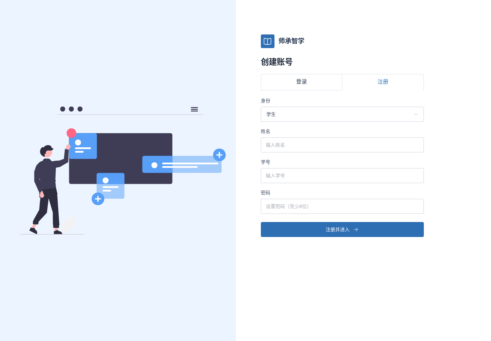

# 登录注册大面积切换

2026-11-13 / v1

参考Element Plus官方卡片页签与stretch用法：https://element-plus.org/en-US/component/tabs.html 。沿用已使用的vue-pure-admin左图右表单，不引入新模板运行时或UI依赖。

登录与注册改为官方card页签，平分整行，48px高、16px字号，整块可点击；继续关闭切换动画。仍保留6位密码、字段错误和固定表单起点。

验证：实际鼠标点击每块右边缘（远离文字）能切换；点击目标约239×48px。四种视口反复切换位置稳定；字段错误回归通过，共3项针对检查。两种模式四种视口共8次布局无溢出/脚本异常，图片正常加载，表单控件仍44px。构建和UI源码审计通过。

