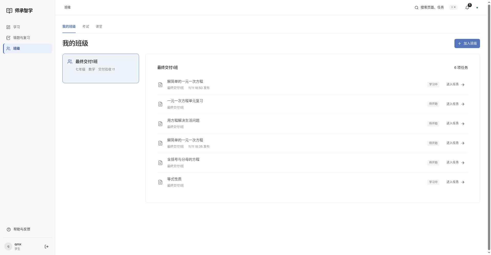
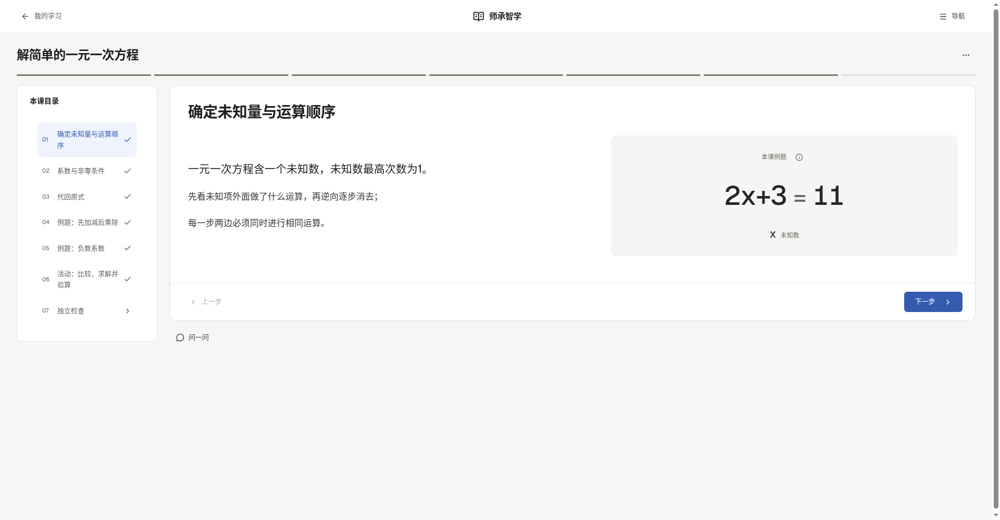
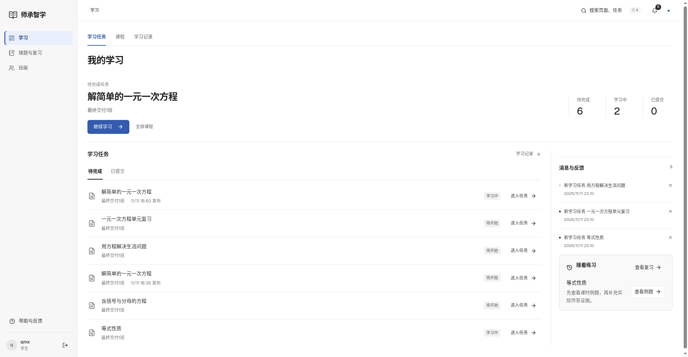
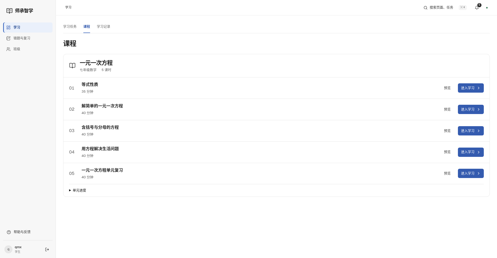
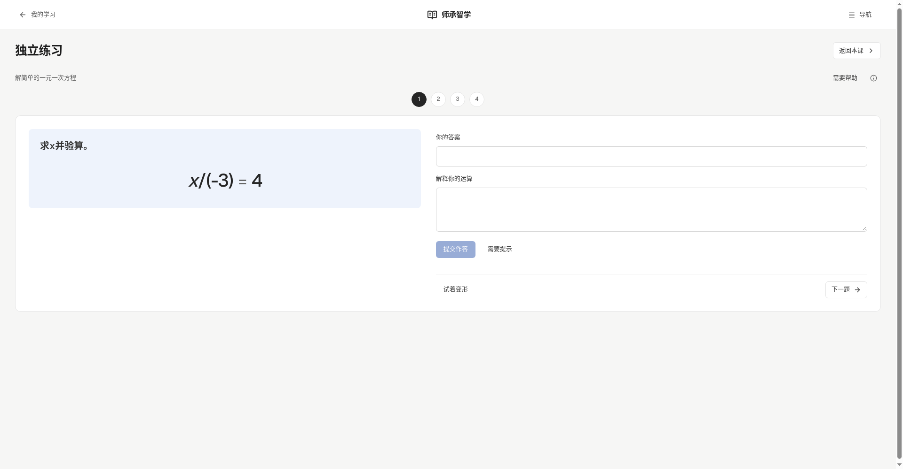
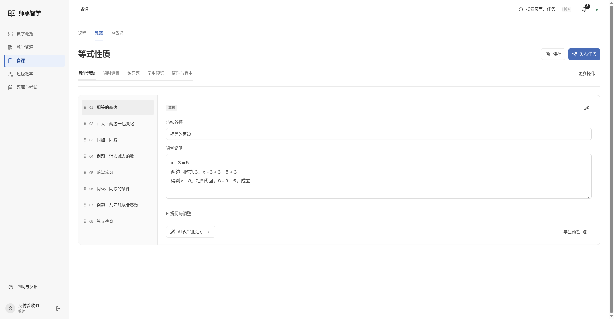
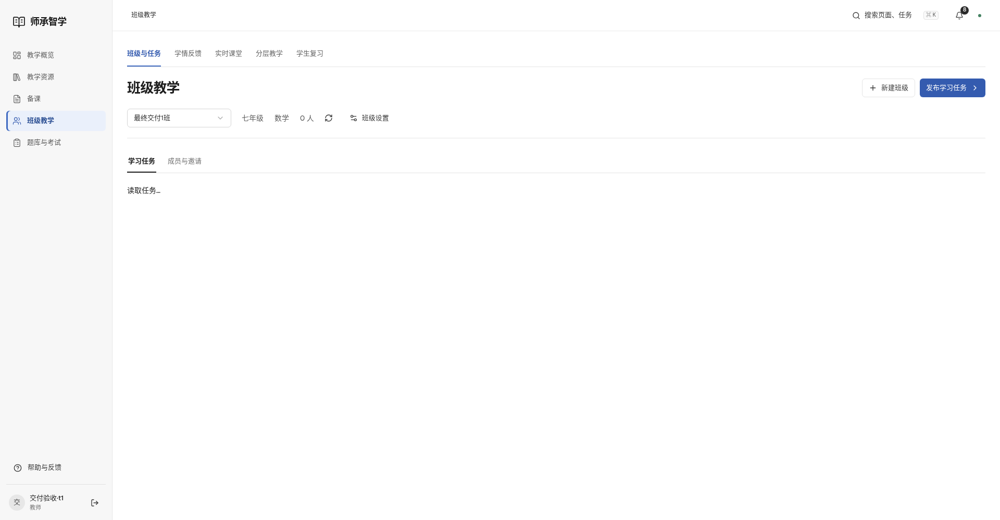
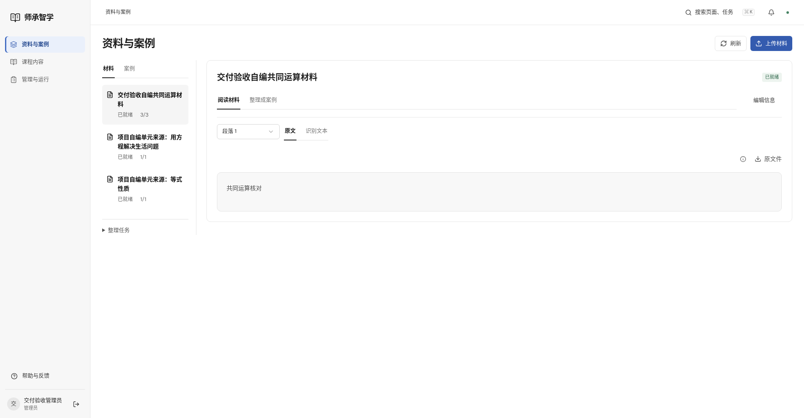

# 桌面布局验收证据

2026-11-12。本轮按实际数据检查学生、教师、管理员页面。浏览器使用本地Chromium。

- [三端78次尺寸检查](desktop-review.json)：26个页面，1440、1920、2560宽度，无横向溢出与页面错误提示。
- [本地8099实际操作](local-acceptance.json)：账号登录后选择班级、刷新恢复、进入任务、鼠标点击目录，无脚本异常。
- [40项浏览器回归](browser-tests.log)、[12项JS检查](unit-tests.log)、[构建](build.log)。

## 实际运行版本

## 三端页面截图

屏幕高度1000px。空数据和短内容保留自然背景，未添加假数据填充。截图自审不替代真实用户研究。
