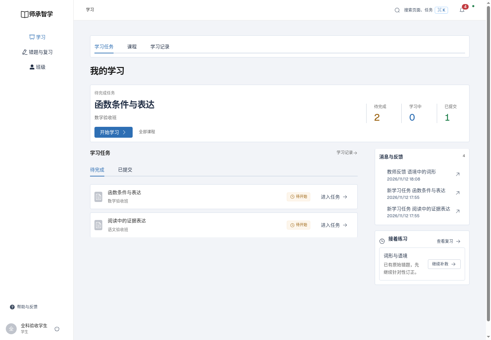
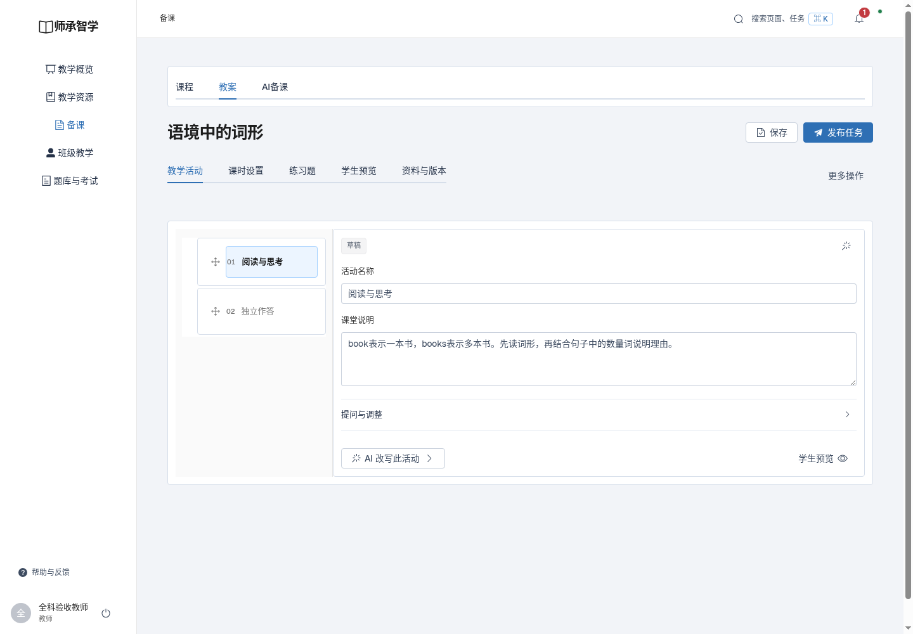
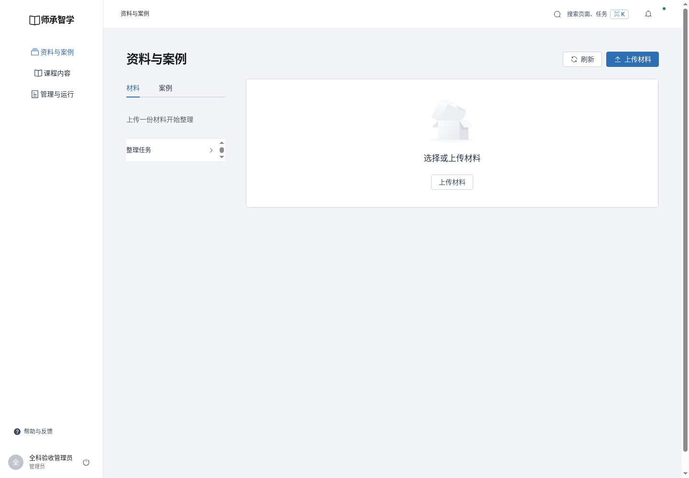

# 全站组件与区域边界验收证据

2026-11-12 / v1

本轮源码审计、回归与桌面浏览器检查。使用隔离MySQL实例的数据进行三端操作，本地8099另行验证qmx登录；不提交账号凭据。

- source-audit.json：Vue模板及CSS扫描，无原生可见控件、自绘通用框，官方组件适配清单。
- browser-tests.log / js-tests.log / build.log：48项浏览器、18项JS及构建。
- pages.json：32路由两种桌面宽度共64次，检查溢出、脚本异常和页面/卡片颜色。
- walkthrough.json：学生反馈、教师讲稿/确认取消、AI流程、管理内容的实际点击。
- local-update.json：本地构建、源文件哈希及运行检查。

其他截图01—07分别覆盖学生成功、待评阅、讲稿折叠、确认框、备课步骤、管理内容及本地构建的学科筛选。

这些是浏览器工程验收与截图自审，不是三位真实用户评分；音频控件不等同于真实扬声器/麦克风硬件验收。
