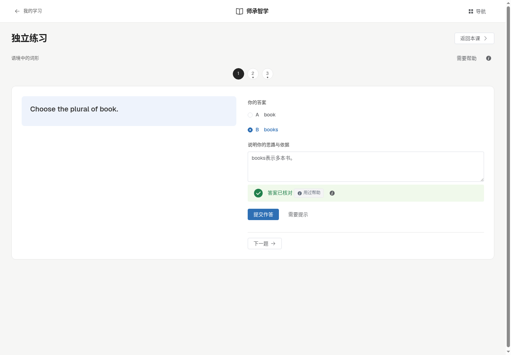
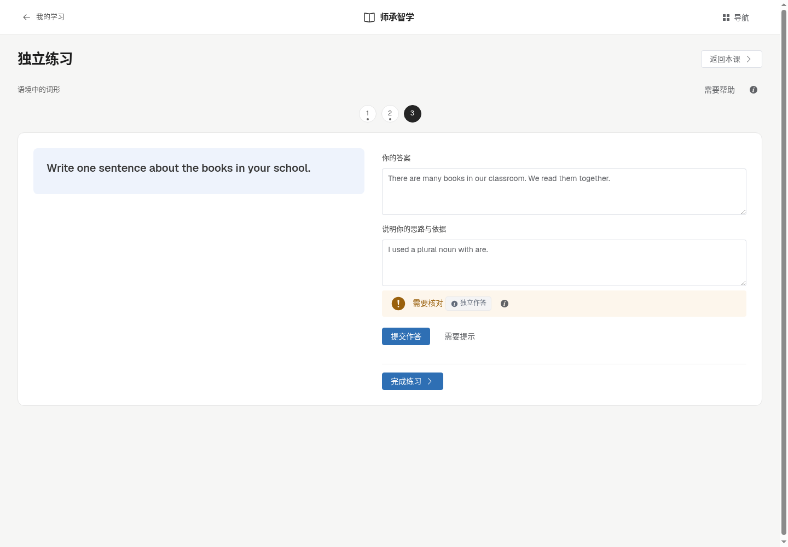
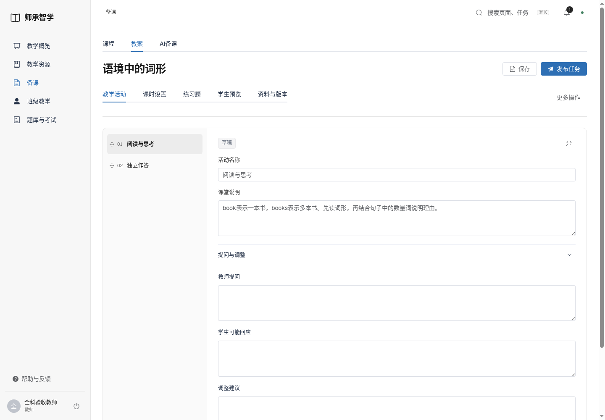
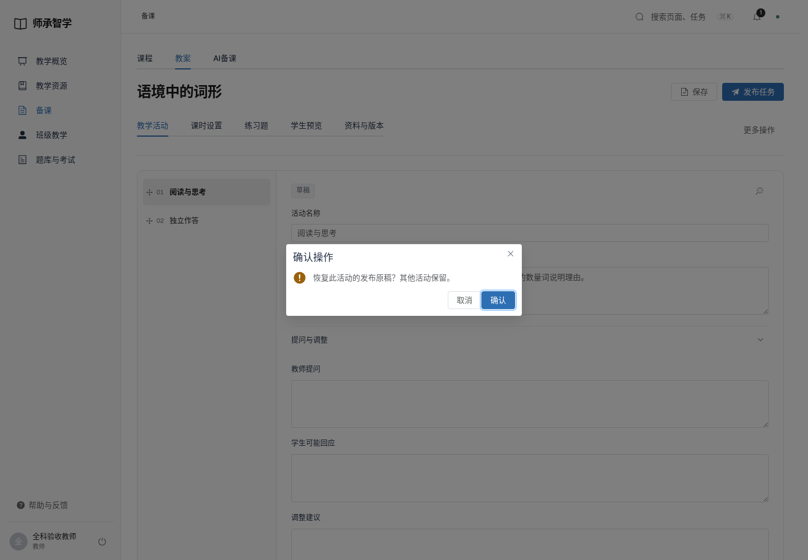
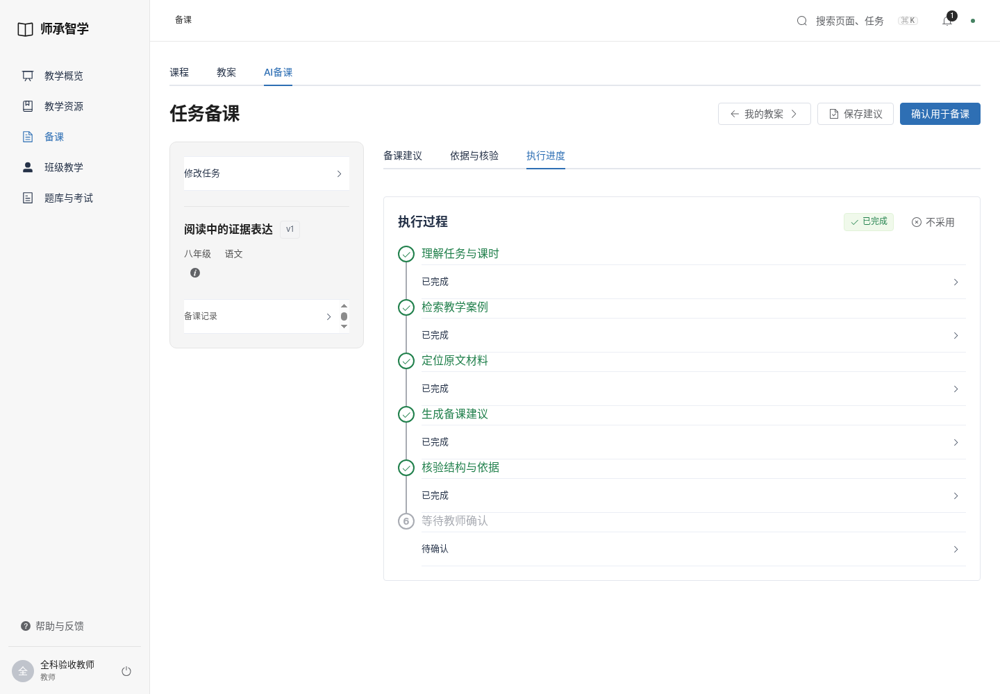
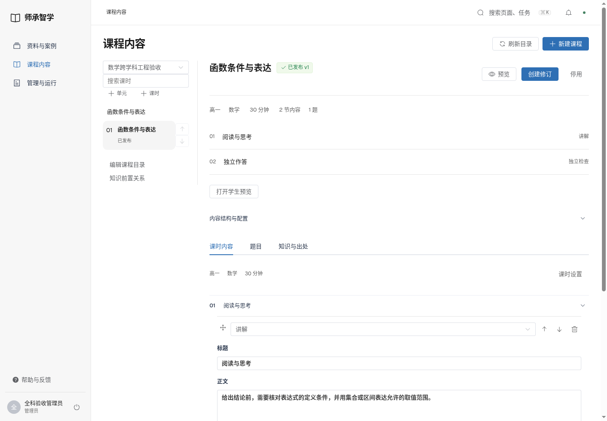
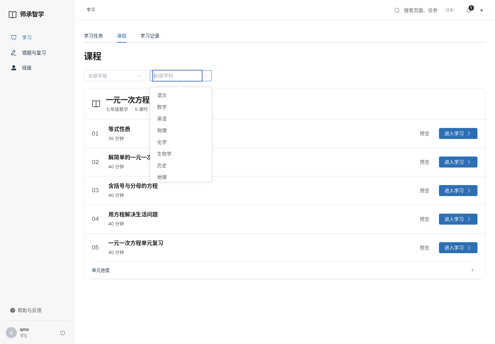

# Element Plus提示与讲稿验收

2026-11-12 / v1

[改动说明](../../planning/ElementPlus提示与讲稿统一_20261112_v1.md)。页面截图来自隔离验收数据；不代表新增教材或真实课堂评价。

- `browser-tests.log`：45项浏览器回归通过。
- `js-tests.log`：17项JS检查通过。
- `build.log`：构建成功；已有体积提示保留。
- `walkthrough.json`：三端实际操作、1440/1920宽度与脚本错误检查。
- `source-audit.json`：控件使用及原生确认/折叠残留检查。
- `local-update.json`：本地构建来源一致、8099可用与登录检查。

