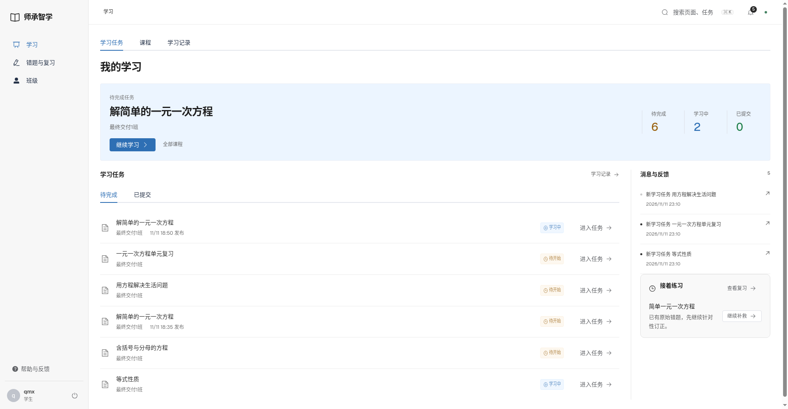
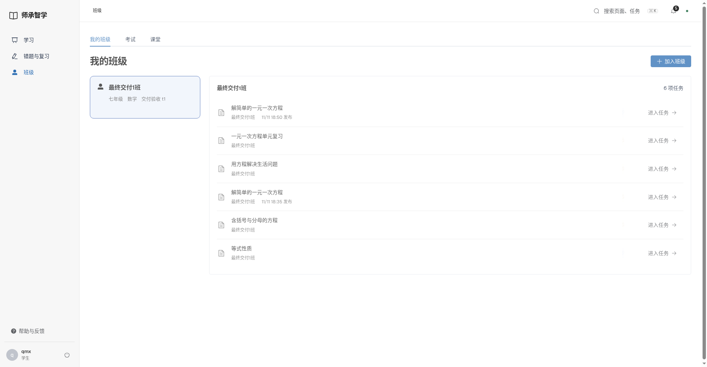
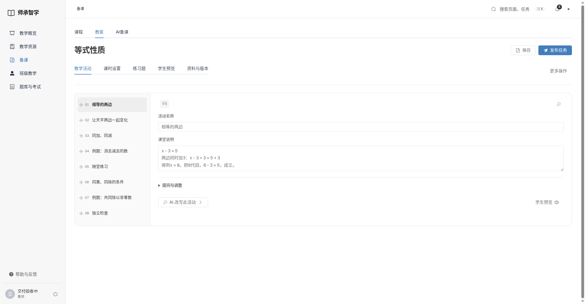
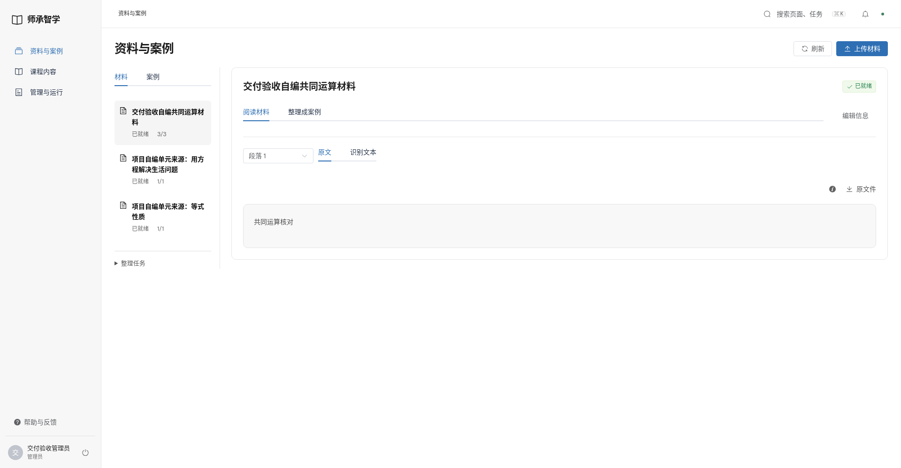

# Element Plus 导航与图标验收

2026-11-12。

- [43项浏览器回归](browser-tests.log)、[17项JS](unit.log)、[构建](build.log)。
- [三端78次页面检查](desktop-review.json)：包含选中项边框、阴影、官方图标数量与Lucide残留检查。
- [本地8099实际操作](local-acceptance.json)、[依赖](dependencies.log)。

