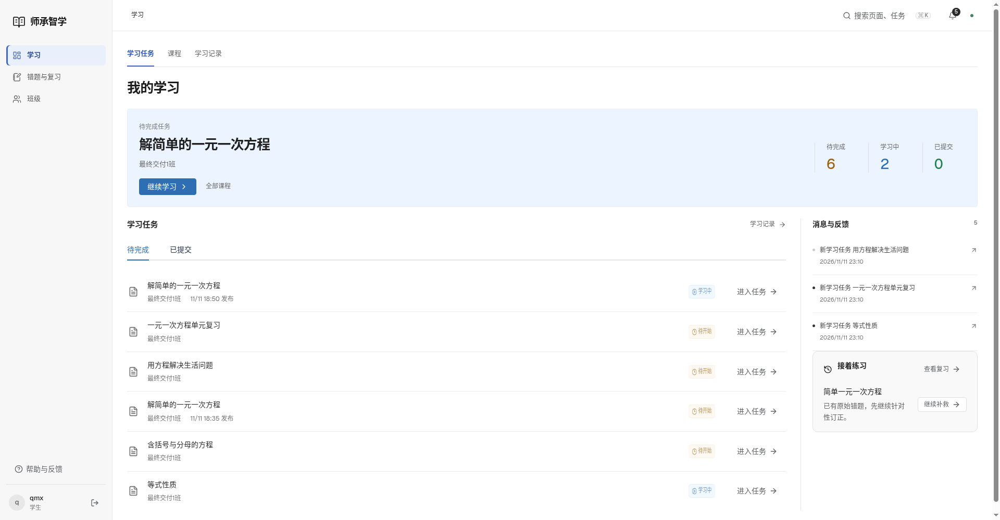
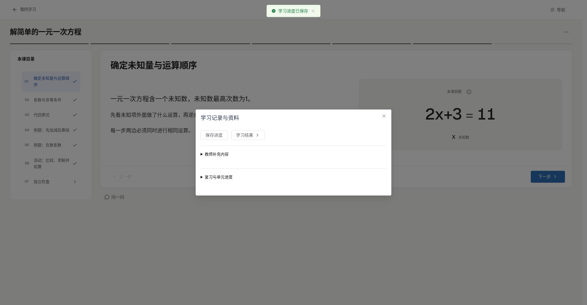
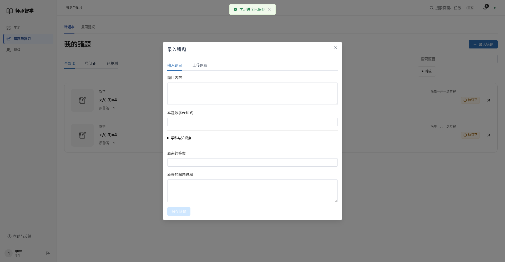
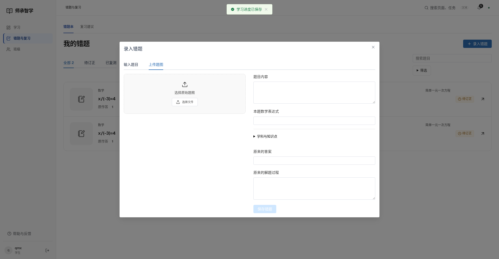
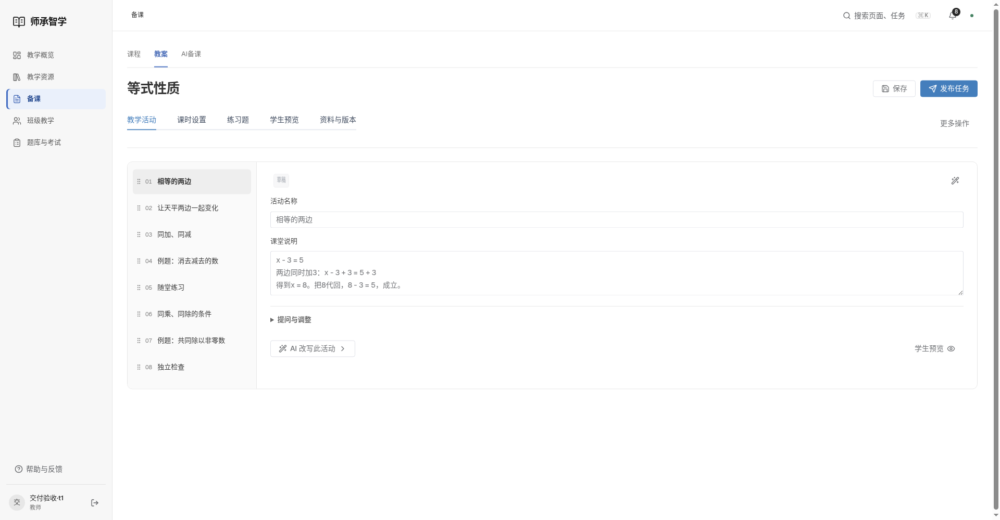
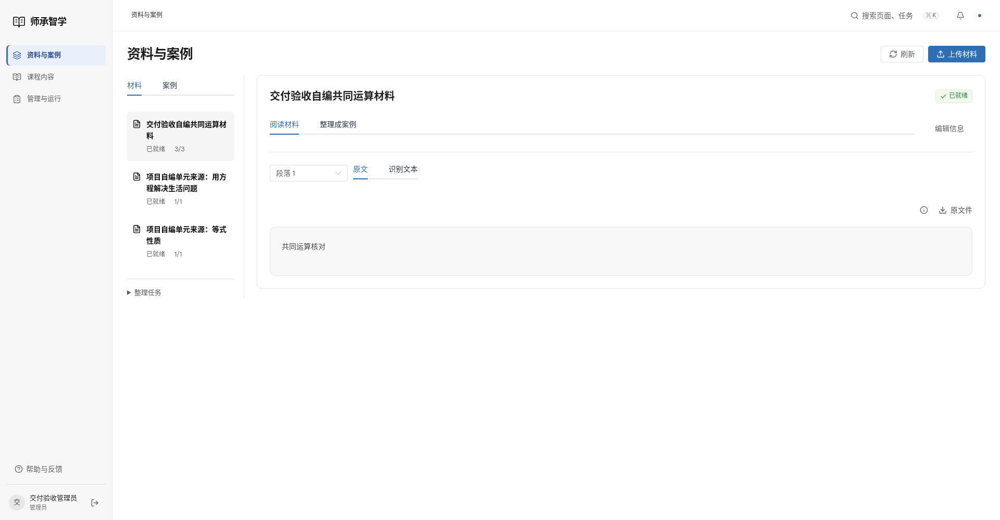
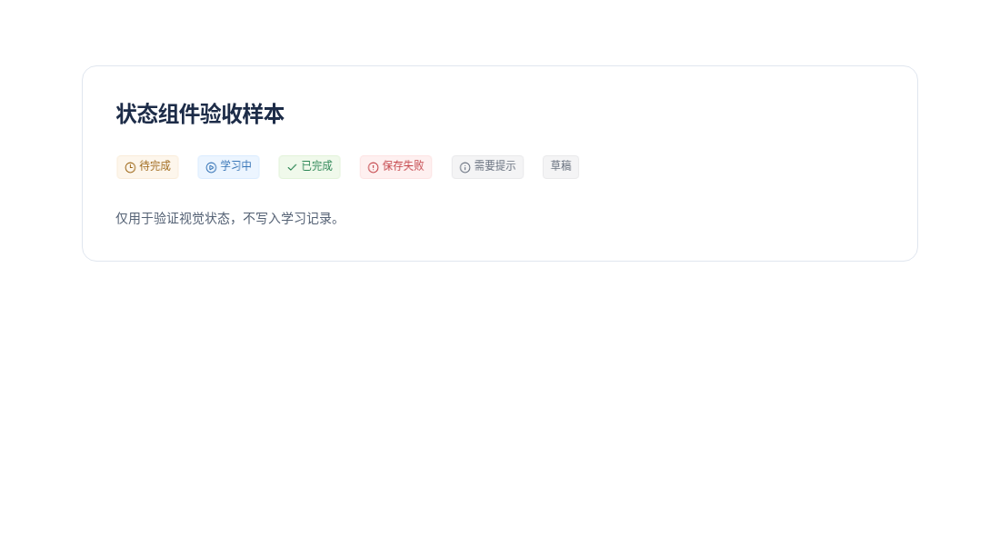

# Element Plus 迁移验收

2026-11-12。实际账号页面与独立状态样本分别记录。

- [42项浏览器回归](browser-tests.log)、[17项JS检查](unit.log)、[构建](build.log)。
- [三端78次布局检查](desktop-review.json)：26页，1440/1920/2560宽度。
- [本地8099操作](local-acceptance.json)：实际保存提醒和错题录入布局。
- [六类标签对比度](status-contrast.json)、[直接依赖](dependencies.log)。

## 实际本地界面

## 独立组件样本

样本只展示标签，不生成业务记录。

