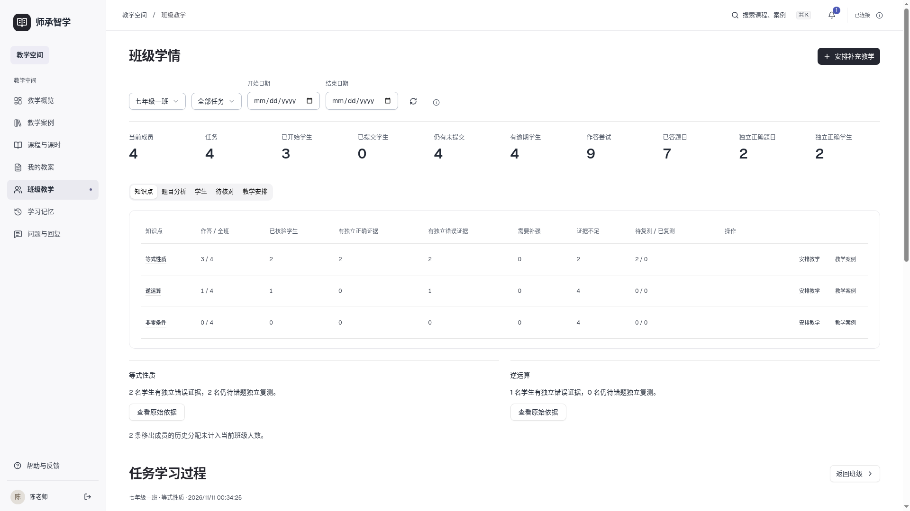
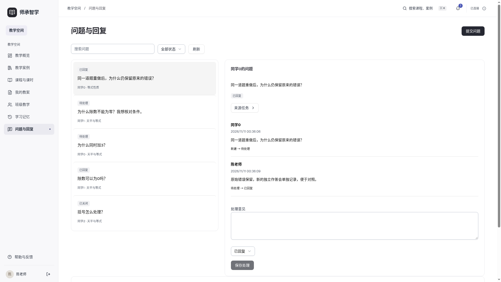
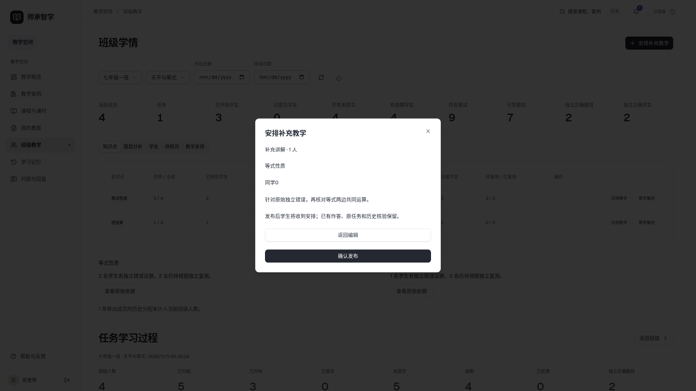
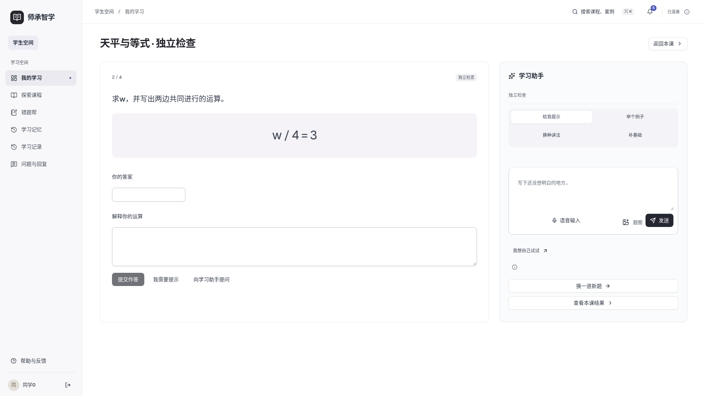
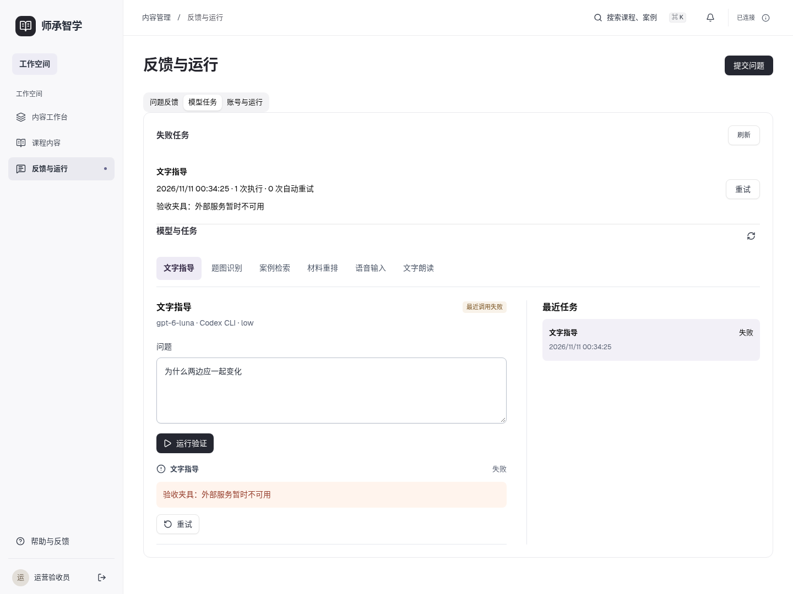

# 第十五步验收证据

2026-11-11，v1。桌面Web；Vue3/JavaScript、FastAPI/MySQL与原Codex CLI。完整验收为A01—A03、S01—S32共35项，任务书标题32为计数笔误。

- [逐项方法、数据、结果](acceptance.json)，[环境](environment.json)，[问题修复](review-issues.json)。
- [103项后端日志](mysql-tests.log)，[15项Chromium](frontend-final.log)，[3个JS文件](frontend-unit-final.log)，[冻结构建](build-frozen.log)。全部相关测试通过，无后端/Chromium跳过。
- [三条真实流程](browser-flow.json)、[原始流程日志](browser-final.log)、[异常与真实模型重试](states.json)、[候选名单和队列最终测量](final-visual.json)。
- [来源核对/修订发布](content-operations.json)、[实际前置课时与错题目标](supplement-types.json)。
- [旧0012升级](migration.json)、[正式库旧字段保护](main-protection.json)、[17项正式入口](main-smoke.json)。私有备份、真实账号凭据和原学生资料未进入仓库。

场景为工程自编：2教师、3班各4人、一跨班、一移出、3课时和至少4知识点；不会把自编规则结果称为教学效果。普通程序测试、实际浏览器保存与真实Codex调用分别记载；真实重试见states.json中的ModelRun，model=gpt-6-luna，provider=Codex CLI · low。

原失败日志和截图保留为初验材料，不能用其代替最终结果。initial-tests-3.log有14项初验失败证据；原94项全量日志被同路径终验覆盖，review-issues.json如实记录，未声称保留全部原始调试输出。浏览器脚本修正了登录/刷新等待、Reka页签需要原生鼠标事件等假失败；源码的页面重建与列表包裹层问题另有实际修复。

## 复现

正常项目运行见README；测试必须另用空的sczx_test_*库，不能连接正式库。Python使用已有虚拟环境，设置绝对PYTHONPATH为backend-business；MySQL测试需要SCZX_RUN_MYSQL_TESTS=1。

本机重现脚本在[scripts](scripts/)：run-tests.py每次新建隔离库并运行全部测试；seed-browser.py创建独立浏览器数据，私有账号文件只写/tmp/sczx-step15/browser-private.json，权限0600。serve.py从该私有文件启动8015，前端用SCZX_API_PROXY=http://127.0.0.1:8015在5185运行。设置CHROME_PATH为现有Chromium后执行browser.mjs。states.mjs覆盖恢复/权限/模型实际重试，需先完成browser.mjs；再次全程验收应新建夹具，不能把已答题的重做当新题。

content-check.py实际上传自编DOCX并修订发布，校验旧快照；supplement-types.py验证真实前置关系和原错题收件目标。migration.py需要先将第十四步9177348的backend-business展开到/tmp/sczx-step15/old-business，再建旧结构升级。脚本中的本机路径按执行环境调整；无凭据随仓库发布。

## 最终桌面

每类另有1440、1920、2560截图。final-visual.json中队列逐行y递增，页面宽度未溢出；早期横排截图仅保留用于说明修复。
