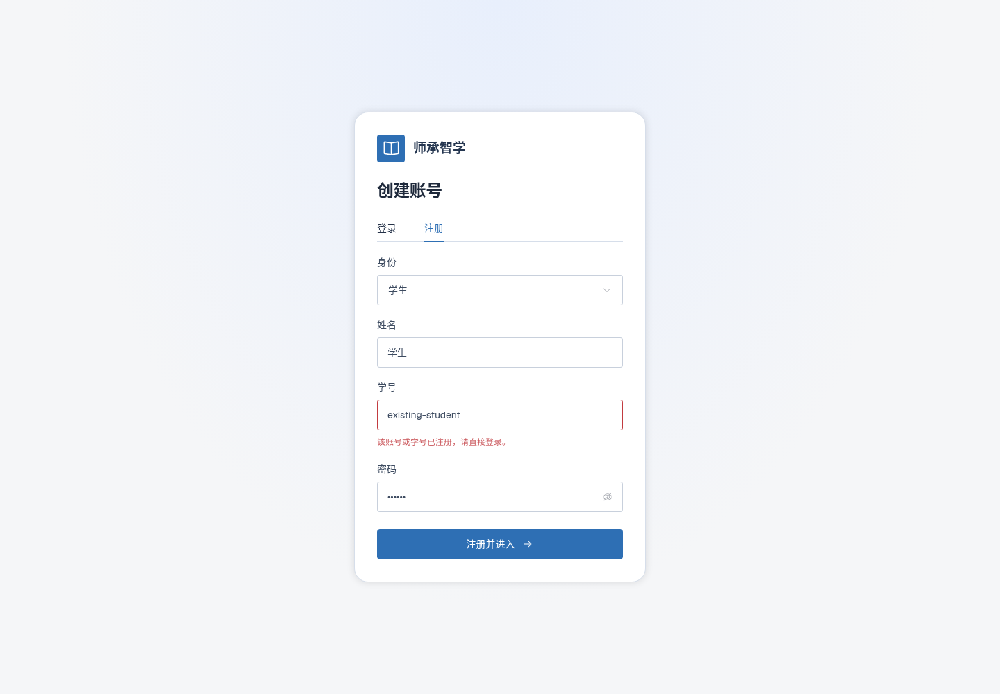

# 登录注册错误使用字段反馈

2026-11-13 / v1

移除登录与注册页的整块Alert提示。账号重复显示在账号/学号字段下，登录失败显示在密码字段下，沿用Element Plus FormItem error与inline-message。编辑内容或切换模式后清除旧错误，不新增自绘提示框。

注册密码继续至少6位，学号标签无括号说明。新增浏览器回归覆盖409响应、字段归属、无Alert横幅与修改后清除；共49项浏览器回归通过，构建与UI源码审计通过。重复账号响应为受控注入，不创建或修改真实账号。

