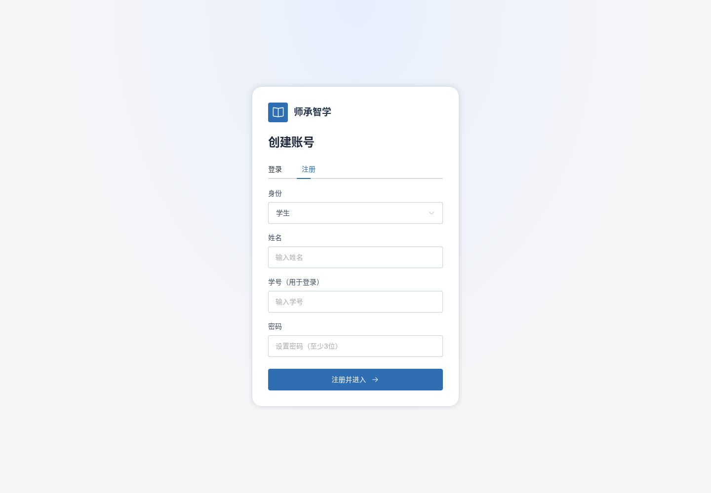
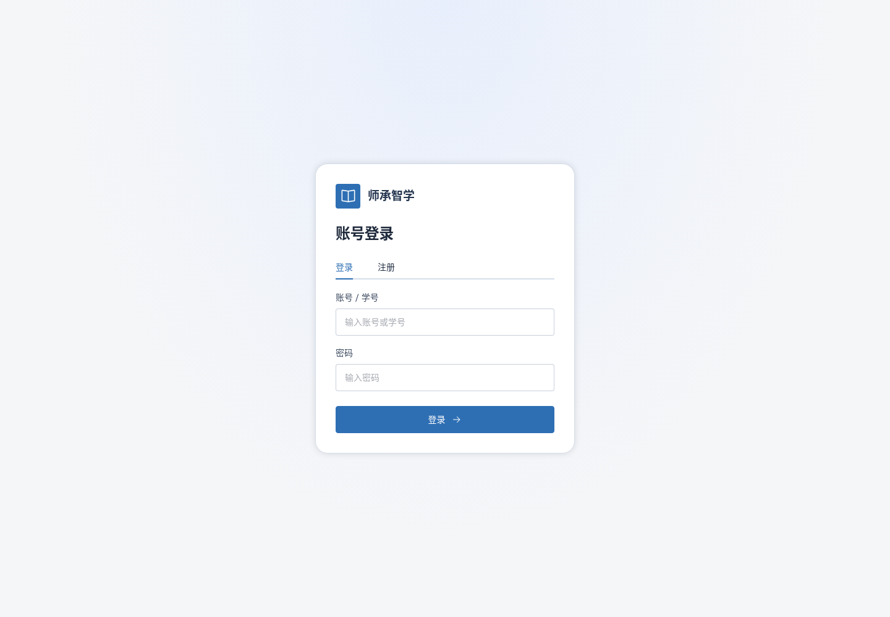

# 登录注册页尺寸与视觉整理

2026-11-13 / v1

使用un-design整理表单层级，保留姓名、身份、学号与密码标签。表单直接使用Element Plus FormItem、Input、Select、Button，统一官方large尺寸并以组件尺寸变量设为44px。避免历史Input适配层data-slot规则与下拉框尺寸冲突。

品牌头像使用主题蓝底白图标；卡片内边距32px，字段间距18px，按钮内容居中。页面继续5175，账号、注册API与后端均不改。

- layout.json：登录/注册×1440、1920、768，所有输入框、选择框、提交按钮实测44px，无横向溢出，卡片完整显示。
- browser-tests.log：48项浏览器回归。
- login-smoke.log：实际qmx登录、课程筛选，无脚本异常。
- build.log：生产构建通过；UI源码审计无原生可见控件、自绘通用框遗留。

