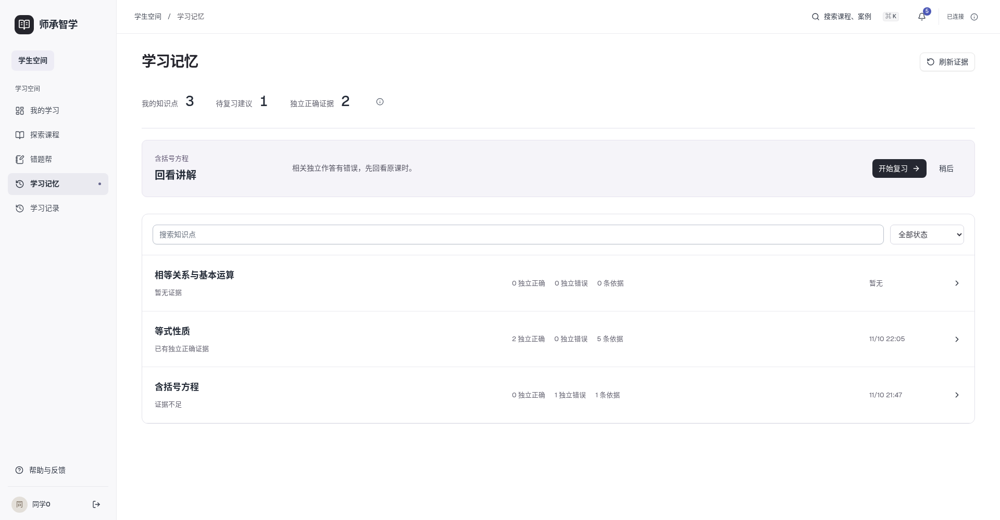
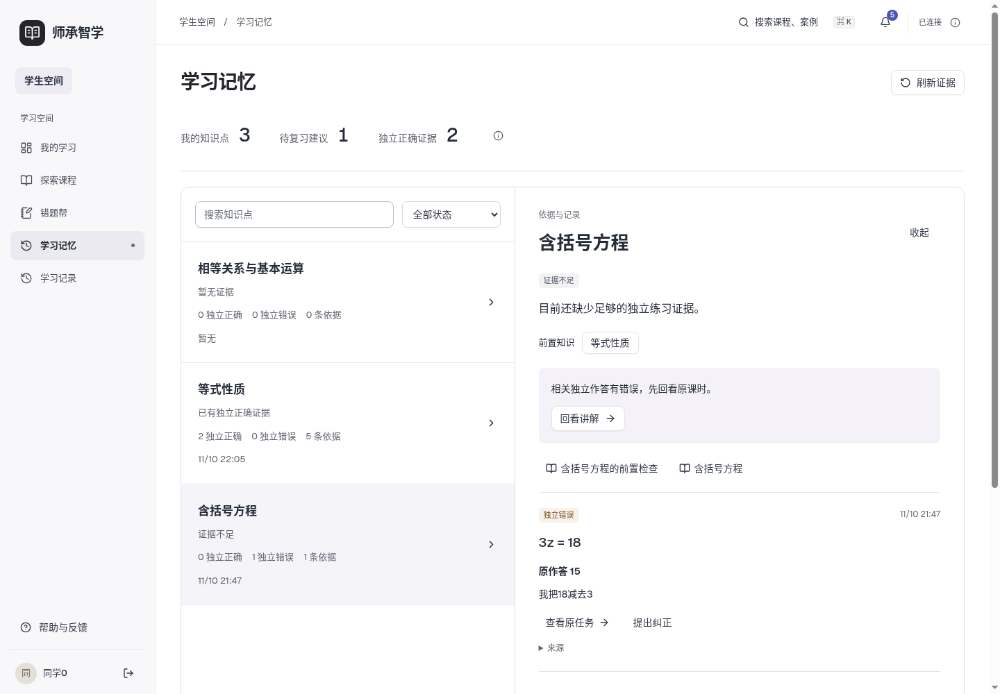
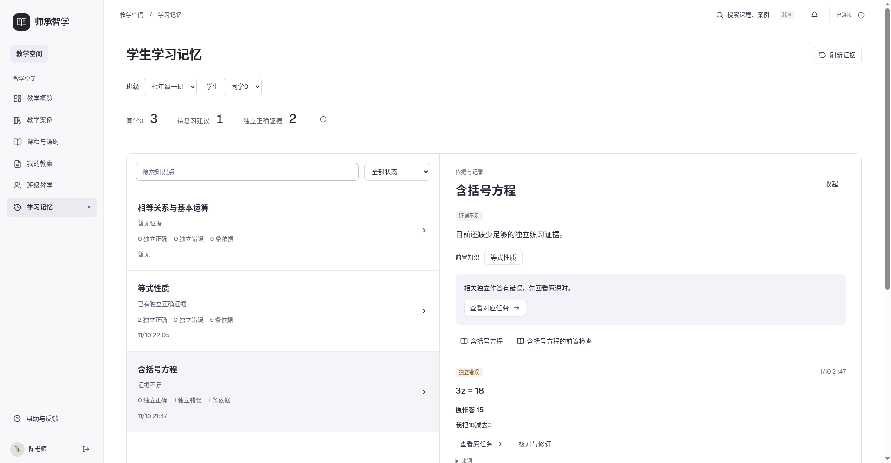

# 第十四步验收证据

2026-11-10，v1。全部测试账号、课程和题目为隔离自编数据。固定预期为AI拟稿、用户单人复核，不是实际教师标注或课堂效果评价。

- [32项验收记录](acceptance.json)：逐项时间、环境、数据、方法、预期、实际结果和证据路径。
- [三条实际业务流程](browser-flow.json)：A课错误/补救→B课记忆指导→独立新题→状态更新并返回；前置A补救并返回C；学生请求→教师关联修订→学生回看与跨教师拒绝。
- [状态与桌面](states.json)：新学生、搜索无结果、无效知识点、稍后/刷新、新事实更新、零额外模型调用、断网恢复、教师过期请求和历史只读。
- [教师来源入口](teacher-target.json)：打开对应原任务学情并保留学生，不跳到学生作答页；[最终教师三种宽度](teacher-visual.json)。
- [固定规则比较](rule-comparison.json)与[预期人工复核](human-review.json)：B0/B1/B2同14情境一致数7/10/14；不能据此宣称提高学习成绩。
- [80项后端](mysql-tests.log)、[定向规则](rules-final.log)、[13项Chromium](frontend-final.log)、[4项JS](frontend-unit.log)、[构建](build-final.log)。
- [旧结构迁移](migration.json)、[主库原字段保护](main-protection.json)、[正式12项读取](main-smoke.json)；SQL备份、主库原始快照和临时凭据未上传。
- [环境](environment.json)、[源码哈希](source-sha256.json)、[文件哈希](sha256.json)、[初验问题与修订](review-issues.json)。

最终三个视图各检查1440、1920、2560，共9张最终截图。另保留三条业务流程时的截图和初验截图，文件名不含final的图片不是最终视觉版本。

browser-flow-initial/mid/correction/permission及相关日志按阶段保留，用于说明初验问题和后续补充验证。最终browser-flow.json聚合了已经实际执行的流程段，没有把只打开页面当成实际作答。并非每次调试的完整控制台均另存，已知问题均在review-issues记录；原测试没有删除。

复现：按backend-business/tests/README.md运行当前测试。scripts/browser_fixture.py建立新sczx_test库，生成/tmp/sczx-step14/browser-private.json（0600，本机私有）；scripts/add_flow_tasks.py新增真正同知识后续B与前置场景C，保留旧快照。启动8014测试API和代理到该API的5184 Vite，运行flow-final.mjs，再运行状态/来源检查脚本。状态脚本会新增实际作答，需使用全新fixture重现其完整初始前提。真实模型沿用已登录Codex gpt-6-luna/low。不要将测试连接指向正式sczx。

后续分段脚本用于保留初验事实并继续验证；完整新夹具优先使用flow-final.mjs。临时账号和连接文件不随源码发布。
