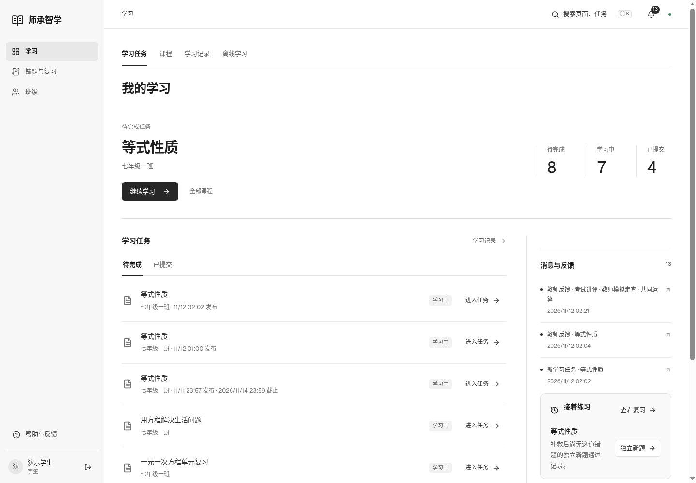
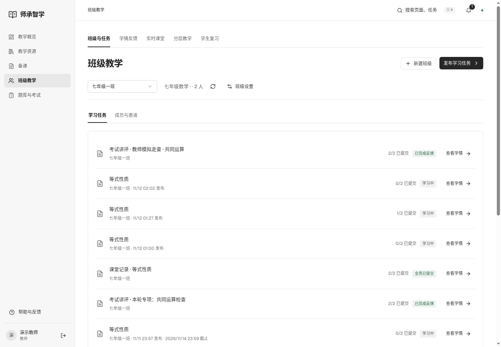
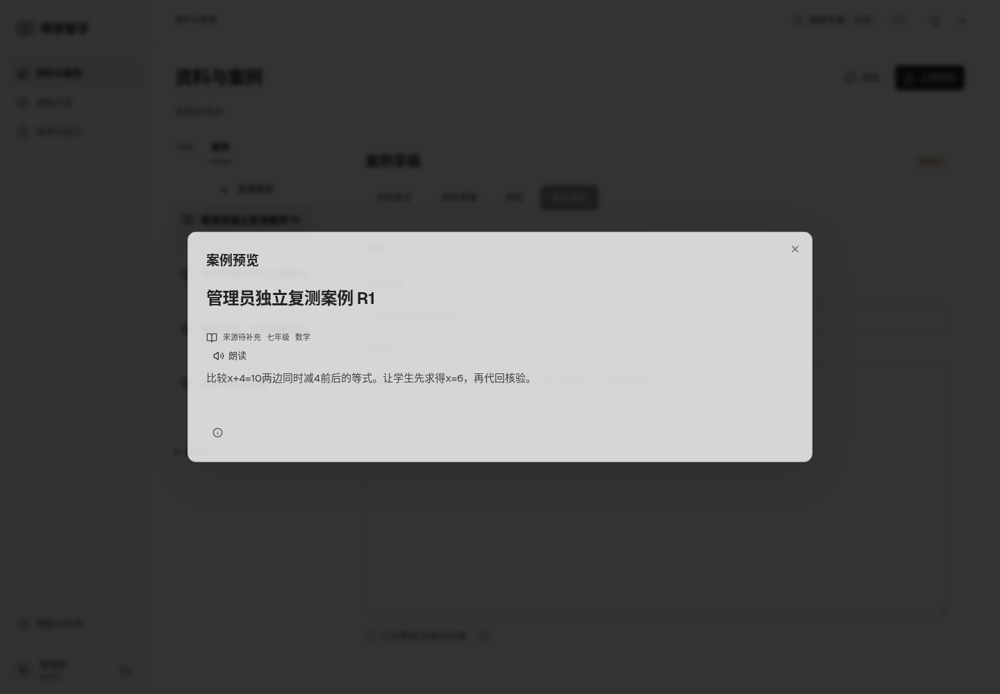

# 三角色界面返修验收

2026-11-12 · 本地Web · AI模拟角色，非真人研究。

| 角色 | 基线 | 首次返修 | 最终 | 报告 |
|---|---:|---:|---:|---|
| 学生 | 89 | 98 | 100 | [最终](student/score.md) · [首复测](student/retest1.md) · [基线](student/baseline.md) |
| 教师 | 84 | 98 | 98 | [最终](teacher/retest2.md) · [首复测](teacher/retest1.md) · [基线](teacher/baseline.md) |
| 管理员 | 94 | 99 | 99 | [最终](admin/retest1.md) · [基线](admin/baseline.md) |

[完整返修报告](../../planning/三角色界面走查与返修报告_20261112_v1.md) · [冻结协议](PROTOCOL.md) · [结构化汇总](summary.json) · [首轮发现](FINDINGS.md)

角色操作使用8102独立MySQL与合成材料、账号及新作答。从登录和可见入口寻路，保留前后截图、计算字体、点击日志与分项扣分。报告通过后原始作答与成绩保留。公开证据省略凭据、私有账号文件和浏览器档案。

- 学生：[首复测148条操作](student/retest1/actions.json)、[追加两项](student/retest2/actions.json)，完成学习、求助、提交、错题、新考试、教师反馈及离线与失败恢复。
- 教师：[首复测](teacher/retest1/actions.json)、[第二学生辅助操作](teacher/retest1/student2/actions.json)、[追加定向复测](teacher/retest2/actions.json)，新考试已发布两名学生成绩并在学生端回看。
- 管理员：[复测116条动作](admin/retest1/events.json)，材料解析、案例和课程草稿、问题处理、账号错误恢复、服务及成功模型结果恢复。

| 技术检查 | 结果 | 记录 |
|---|---|---|
| 前端浏览器 | 37通过 | [日志](browser-tests-final.log) |
| JS单元 | 10通过 | [日志](unit-tests.log) |
| 补救MySQL | 独立新库12通过 | [日志](backend-remediation-12.log) |
| Python基础 | 173项，55通过、118条件跳过 | [日志](backend-basic-final.log) |
| 构建 | 通过 | [日志](final-build.log) |
| 桌面布局 | 33页×3宽度99项，溢出0、异常0 | [数据](layout/report.json) |
| 最终两项小改布局 | 5页×3宽度15项，溢出0、异常0 | [数据](layout-final/report.json) |
| 当前8099 | 健康、数据库、学生登录通过，资源与验收构建相同 | [数据](runtime.json) |

截图中以`baseline`、`retest1`、`retest2`区分轮次。最终JS为`index-CxoPIcBj.js`，CSS为`index-BRBChled.css`；首轮返修JS为`index-BxirpJC8.js`。未受追加两项小改影响的证据复用。语音设备沿用既有未验证限制。

最终仍保留教师AI入口轻微重复及行内公式比例、管理员返回默认问题分类的轻微扣分；完整观察见各角色报告。达到95门槛不表示没有其他改进空间。

