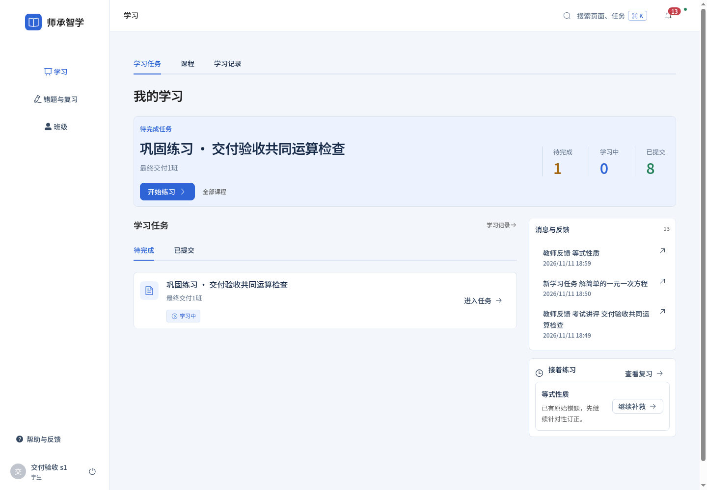
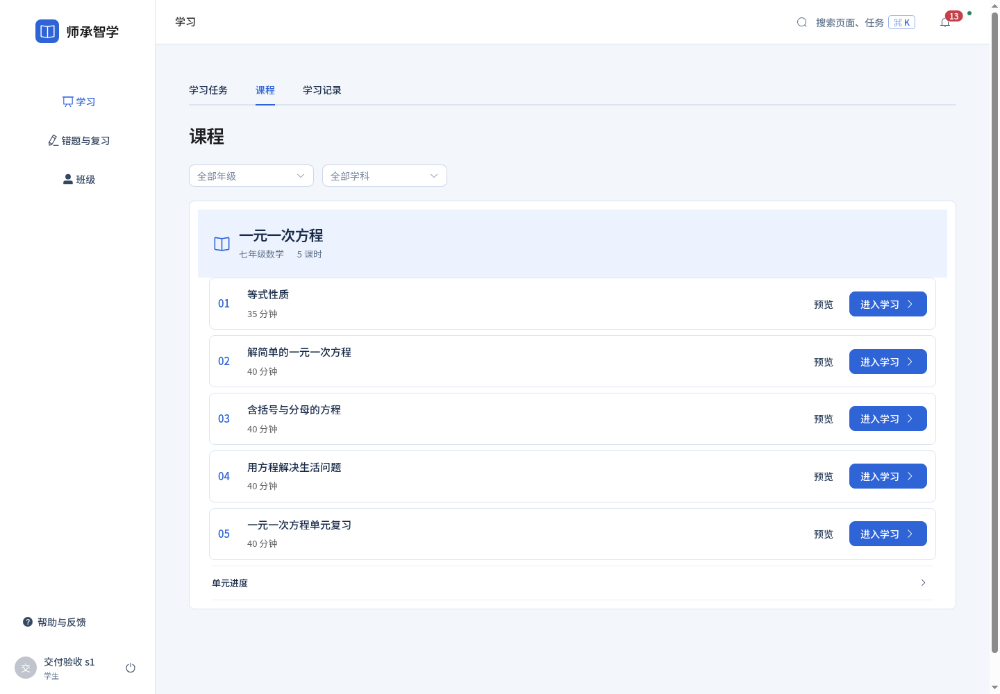
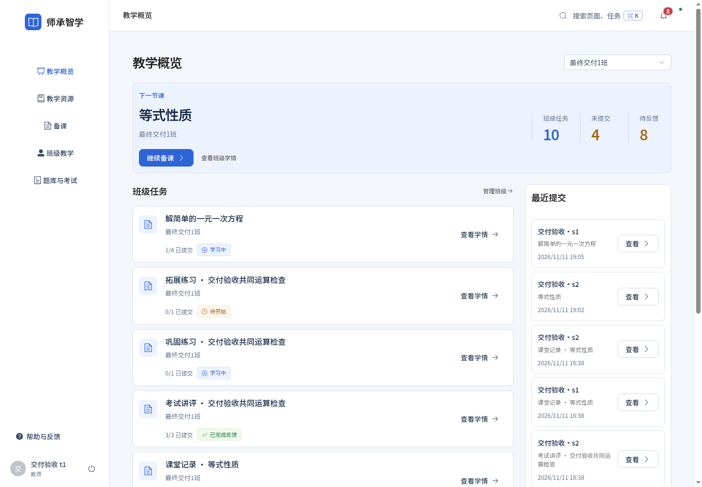
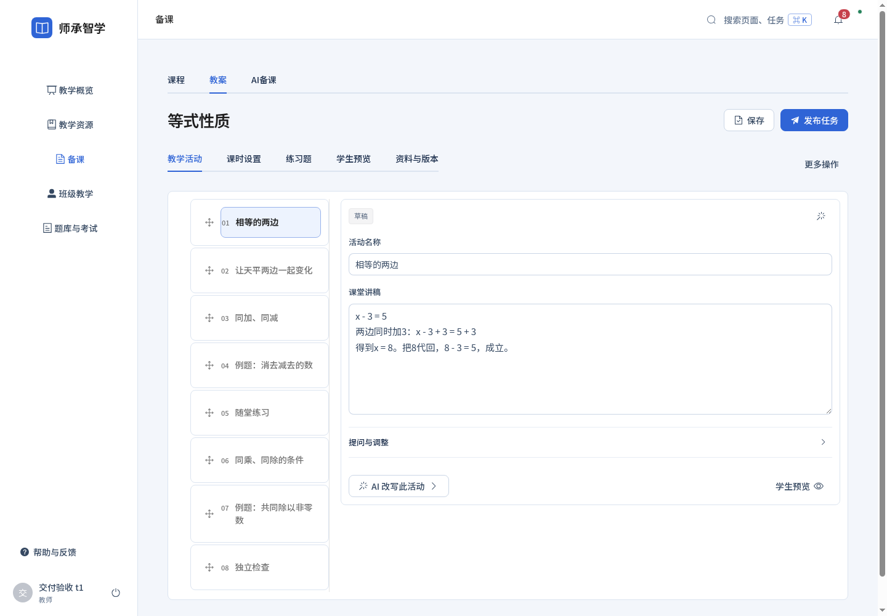
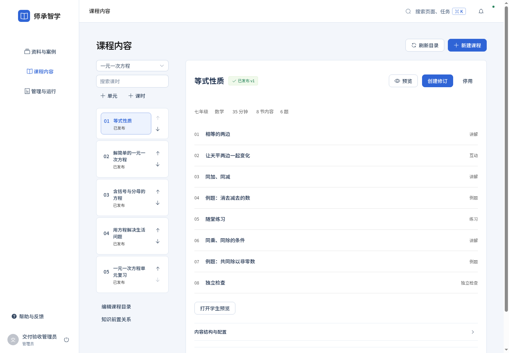

# 全平台蓝白工作台检查

2026-11-13 / v1

用户已确认蓝白教育工作台。本轮包含统一中文字体、全站导航与排版，首页、课程、错题筛选、备课与管理编辑区的布局调整。

- pages.json：三端40个页面/入口×1440/1920，共80次；包含正常列表、空状态、无记录恢复入口。字体加载、角色、横向溢出与脚本异常均检查。
- browser-tests.log：52项浏览器回归，含中文字体与多行消息不重叠的新检查。
- js-tests.log：18项JavaScript检查。
- source-audit.json / source-audit.log：原生可见控件、自绘通用框遗留为0；组件继续Element Plus。
- build.log：生产构建。

页面检查使用本机已有交付账号做正常页面读取；截图中的“交付验收”班级是既有演示数据，真实运行仍使用MySQL。无真实模型调用，不声称已覆盖每种课程内容或所有业务分支，也不以自动检查冒充真人满意度评分。

其余逐页截图见同目录；完整调研与规则见[设计说明](../../design/全平台蓝白教育工作台调研与重构_20261113_v1.md)。
