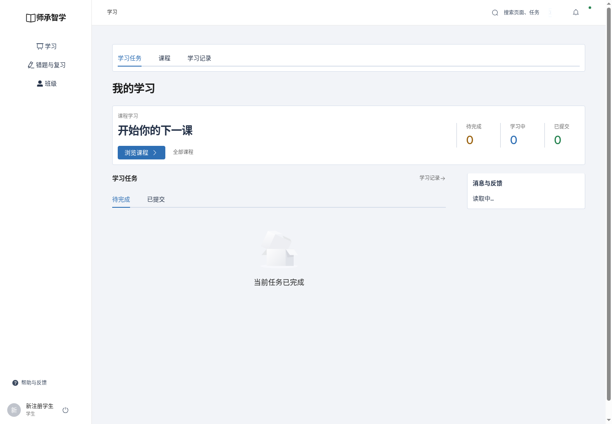
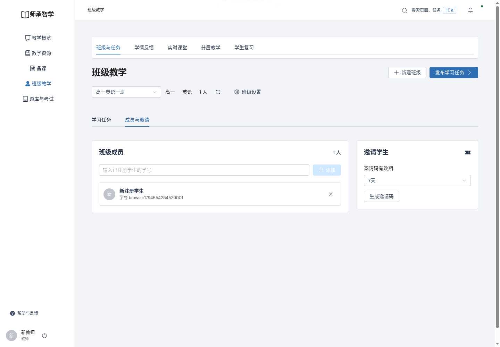
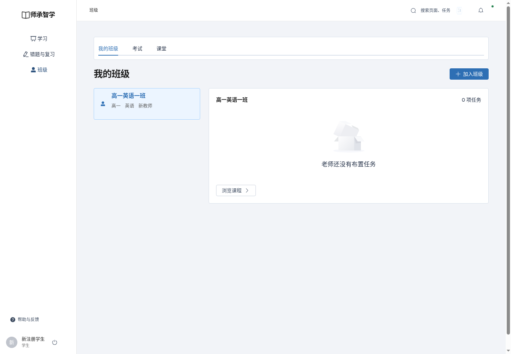

# 注册与班级实际流程验收

2026-11-13 / v1

使用独立sczx_test数据库与上传目录，验收数据不并入日常账户。API检查使用真实MySQL；浏览器使用生产构建与真实业务接口。

- api-tests.log：注册、账号冲突、角色、学号添加、成员持久化。
- browser.json及01—03截图：学生页面注册、教师页面添加成员、学生重登查看班级。
- browser-tests.log、js-tests.log、build.log：前端回归、JS和构建。

