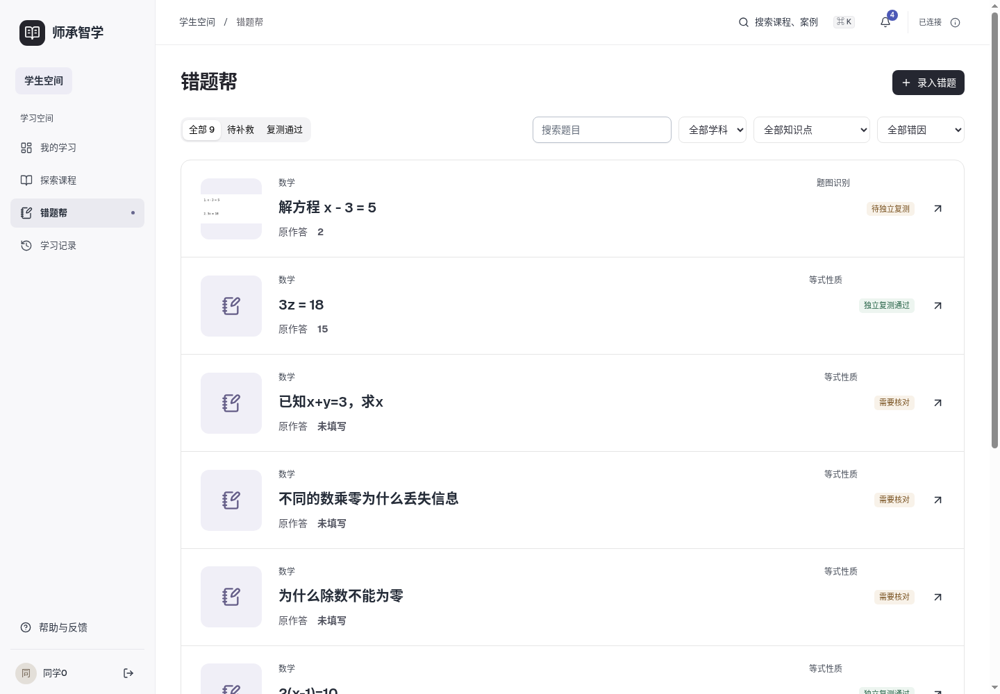
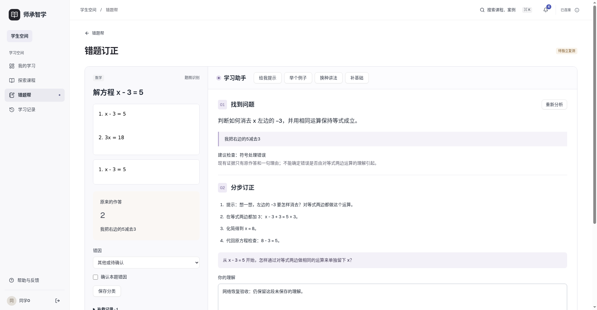
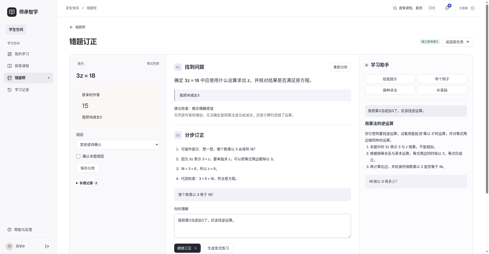
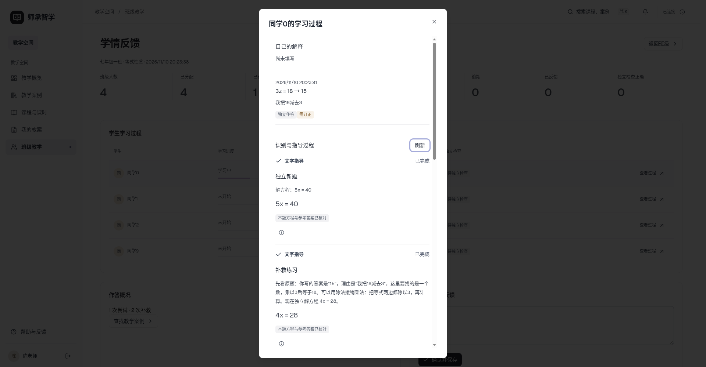

# 第十三步验收证据

2026-11-10，v1。自编账号、课程、错题及程序绘制题图；正式数据未作为测试夹具。

- [逐项验收](acceptance.json)：A01/A02与S01—S30，每项包含执行时间、环境、数据、方法、预期、实际结果及证据。
- [真实三条业务流程](browser-flow.json)：课程发布到补救复测并返回；个人题图裁剪/OCR确认及重登；三类错题在浏览器分别实际独立作答。flow3的实际提交是后续追加验证，不能只看初始打开详情的检查。
- [纯文字独立录题](manual.json)：无课程任务关联，保存、刷新、重登一致。
- [桌面与状态](states.json)：1440/1920/2560，空列表、搜索无结果、无效详情、草稿恢复、断网重试及天平动作。
- [故障与真实恢复](faults.json)：两条故障为明确注入，随后重试是真实Codex/OCR；另有实际断网上传及12MB服务端边界，不冒称自然发生的外部故障。
- [不同错题真实模型](real-cases.json)：E01—E06/E09的原题、原答、分析、实际变式与核验；条件不足拒绝自动评分，不把失败删掉。E07/E08题图选择与负号修订见browser-flow，E10见manual。
- [最终模型/原图审计](final-output-audit.json)：最终规则重新核验22条成功补救输出，原图哈希与输入PNG一致，裁剪另存。
- [偏题修复前后](quality.json)及[用户复核](human-review.json)：原q12/q15/q18与本次实际输出，用户单人认可三项；原25情境证据仍在tutoring目录。
- [旧结构迁移](migration.json)与[主库保护](main-protection.json)：原字段原值逐一比对；本机私有SQL备份及原始业务快照没有上传。
- [后端回归](mysql-tests.log)、[Chromium](frontend-final.log)、[JS](frontend-unit.log)、[最终竞态定向检查](frontend-scope-final.log)、[构建](build-final.log)、[主服务8读接口](main-smoke.json)。
- [环境](environment.json)、[源码哈希](source-sha256.json)、[文件哈希](sha256.json)与[审查修订](review-issues.json)。

以下是最终桌面检查的部分截图。完整目录有15张，覆盖5个视图×3种宽度。没有扩展手机端。

保留初次脚本失败报告 browser-flow-initial.json、output-audit-harness-initial.json 及相关日志；它们与最终通过结果分开记录。查看 review-issues.json 了解修订原因。没有覆盖第十二步旧输出或改低通过标准。

复现先安装当前前后端依赖并启动一个独立 sczx_test_* MySQL 库，运行后端unittest、前端npm test/test:unit与build，命令见 backend-business/tests/README.md。scripts/browser_fixture.py会新建隔离库，并把临时账号/连接写入/tmp/sczx-step13/browser-private.json（0600，不提交）；本地API8013和Vite5183指向该库。随后运行scripts中的real_cases、flow、flow-photo、flow3、states、manual、faults。故障脚本需要先在隔离库运行fault_fixture；模型脚本会调用已登录Codex，gpt-6-luna/low。不要把测试环境指向正式库。

业务解释、评分范围及历史兼容见 docs/planning 的第十三步说明。自动检查和用户单人复核不能代表真实课堂教学效果。
