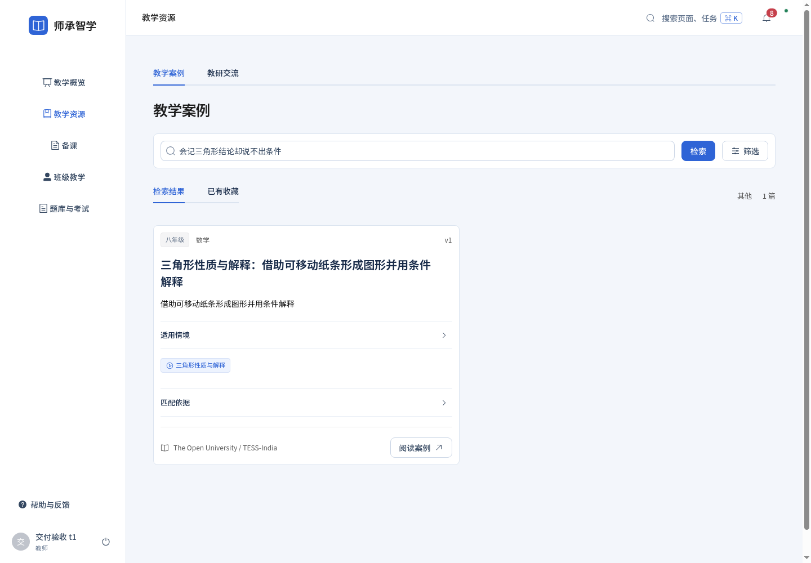
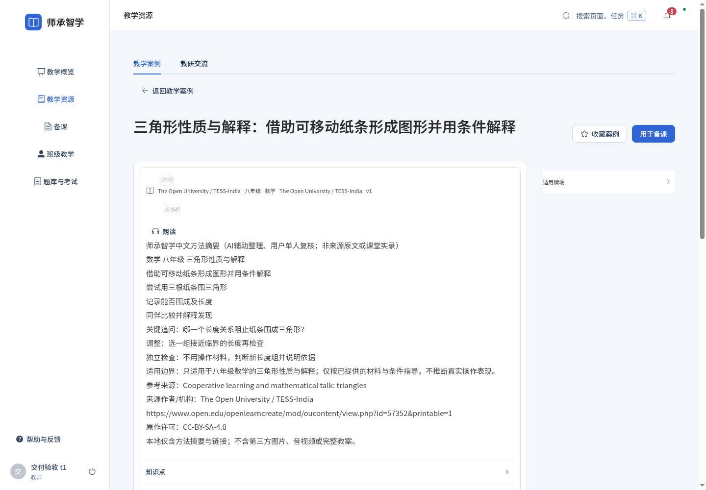
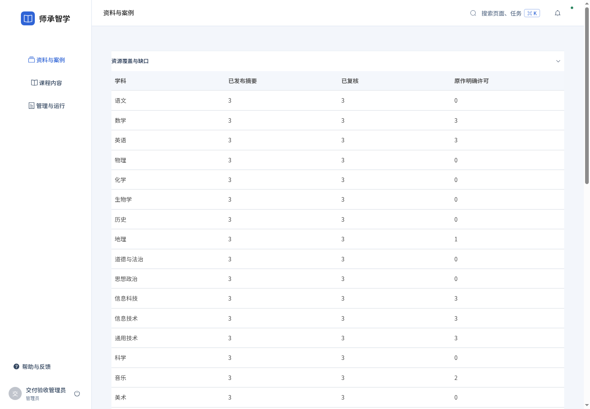
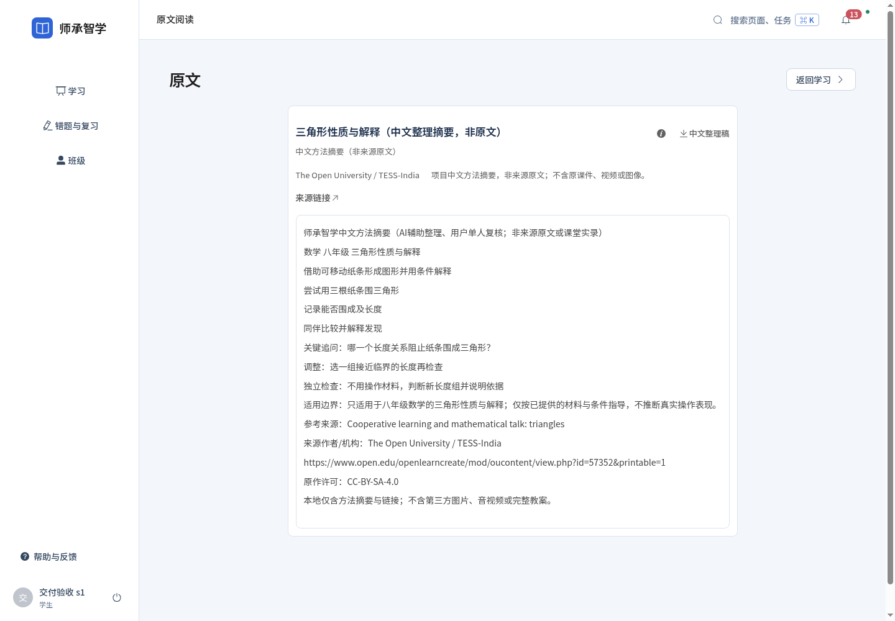

# 第二轮：全学科教学方法资源交付与验收

2026-11-14 / v1。基线sczx/main cf1fa7c；本轮不做公网部署、正式数据库迁移或全站重构。

## 交付结果

现有案例库增加57条中文方法摘要，19个实际预设学科各3条，引用29个不同正文来源。来源目录32项，另3项仅调研背景。每条保留适用年级、知识点、困难、目标、方法、步骤、追问、预设回应、调整、独立检查、出处及许可；预设回应不冒充课堂实录。

用户明确确认“已阅读，认可57条中文方法摘要用于本地教学”。复核清单与每条内容/来源SHA256绑定；修改任何一项不继承审核。来源标签是“公开材料整理”，不是“教师直接提供”；明确披露AI辅助整理及用户单人复核。

[逐学科验收表](../../planning/全学科优质教学经验资源建设与验收表.md) / [逐来源调研目录](../../planning/第二轮19学科资源调研目录_20261114_v1.md) / [人工复核原清单](../../planning/第二轮57条经验候选人工复核_20261114_v1.md)。

## 实现与边界

复用TeachingCase、CaseVersion、CaseDraftContent、SourceMaterial、MaterialUnit、FileAsset、KnowledgePoint及已有审核机制，未增加业务表或第二套资源库。稳定ID，重复执行保留所有已有案例、教师草稿及发布版本；只有核验摘要进入发布，其余留草稿。源文件是清楚标注的中文整理稿，界面不再把它叫作外部原稿。

学生课程指导及独立录题后的指导都通过现有检索筛选资源；明确匹配学科、年级、知识点及已复核结构化适用范围。证据不足先问诊断问题，不能按知识点直接判定错因。未审核、来源/许可未知且无本地摘要确认、范围不符均不作为可信经验。无匹配保存到原有ModelJob，并进入管理端最近200条指导/备课记录的缺口查看；这不是全历史计数。

教师沿用“教学资源→检索→阅读案例/来源→用于备课”，并有现有AI备课直接调用。自主修改和确认决定仍属于教师。原有课程、考试、课堂和历史任务快照保留。

## 本地可用状态

当前本地开发实例已加载本轮代码及57份摘要，前端固定http://127.0.0.1:5175，代理后端8099。操作前确认development、专属sczx_test_local_*、活动模型任务0，停止自己管理的开发后端，完成私有一致备份，逐行核对旧记录后追加；没有数据库结构迁移、正式环境切换或改父级数据库。

`local-append.json`记录追加57、旧业务行逐行保持、6个旧上传文件哈希保持、新增57份摘要文件。私有SQL/上传备份在backend-business/var/local/backups/resources-20261114-v1，不提交学生数据及配置。原账号可继续使用。

全新安装的初始化脚本自动载入本批已复核摘要，无需用户先上传材料。已有隔离副本在配置好现有环境变量后可预览、显式导入：

```bash
.venv/bin/python backend-business/scripts/seed_teaching_experiences.py --check-only
# 现有SCZX_DATABASE_URL/SCZX_STORAGE_DIR指向自己的sczx_test_*副本
.venv/bin/python backend-business/scripts/seed_teaching_experiences.py --admin-id 已有管理员ID
.venv/bin/python backend-business/scripts/seed_teaching_experiences.py --admin-id 已有管理员ID --apply
```

脚本不执行DDL，不访问正式库。已存在的ID一律跳过；本轮不自动覆盖旧内容或覆盖后悄悄重审。Python wheel已实际构建，资源JSON及NOTICE一同打包。

## 验证结果

| 项目 | 已观察结果 |
|---|---|
| 全量后端隔离MySQL回归 | 204项通过；其后新增独立录题与缺口检查，并对最终资源代码11项相关检查全部通过 |
| 资源数量/人工复核指纹/重复导入/版本保护/权限/来源下载 | 11项新增检查通过 |
| 57次精准范围查询 | 57/57 |
| 错学科、错年级、同科其他已存在知识点 | 171/171拒绝，0次错误选择 |
| 八科真实MySQL、业务API、受控模型闭环 | 修复后8/8 |
| 八科真实Codex学生指导与教师备课 | 最终8/8；初次16次模型调用，地理/生物修订后另4次真实调用 |
| 独立新题/帮助标记/教师读记录/教师反馈/学生重读反馈 | 八科通过，开放题人工评阅范围保留 |
| 前端浏览器回归 | 53/53 |
| 前端JavaScript单元检查 | 18/18 |
| Element Plus审计 | 原生UI节点0、自绘原生框0，隐藏音频引擎1 |
| 前端正式构建及输入哈希 | 通过；保留现有大包体积提示 |
| 实际5175三角色浏览器 | 教师搜索、阅读摘要来源；管理员19行覆盖；学生读整理稿；断网提示及重试，无脚本异常 |

真实模型调用指当前Codex CLI的gpt-6-luna/low；没有用受控响应冒充真实调用。八科是语文、数学、英语、物理、化学、历史、地理、生物学。原始作答、指导输出、引用版本、教师备课、确认、独立新题和反馈关联见eight-subject-real-final.json。

证据文件中的重复检索文档与重复ModelRun输入/结果已压缩为ID、数量、SHA256，保留最终模型输出、引用、作答及关联检查。未压缩快照在开发主机私有目录及隔离MySQL保留；压缩不改变结果计数。初次失败文件没有删除。

## 发现与修复

1. 受控八科首次6/8，两个新教案并发确认触发InnoDB死锁。后端对1213/1205返回可重试409、回滚当前事务；验收客户端只对该提示重试一次，最终8/8；既有确认幂等机制保留。
2. 重复真实调用后，资源缺口统计排序整条大JSON触发MySQL1038。改为先对窄ID排序、再读取选中记录；同一累积数据11项检查通过，不扩大数据库内存配置。
3. 地理初次提示步骤过早透露原题方向；加强跨学科hint提示词，真实复测只追问参照依据。生物初次样题引用未提供的图片；工程样题改为完整文字观察资料，重新真实调用通过。旧结果保留并注明替代关系。
4. 截图发现教师案例卡片沿用错误横向flex，导致长中文竖排；改为卡片正文纵向排列，搜索图标使用Element Plus输入框前缀。再次真实浏览器检查布局、标签动画结束后可见性并截图。
5. 管理工作台回归的Vite HMR模块副本使旧mock失效；按实际编译导入地址设置mock，53项回归通过。这是测试隔离修正，没有绕过产品鉴权。

三角色浏览器是自动化模拟，不能称为真实乡村教师/学生试用，也不打虚构满意度分数。断网恢复已实测，尚未覆盖各类弱网速度与抖动。教师“搜索→阅读→用于备课”入口保留，八科实际生成并确认教案在隔离API测试完成；本地浏览器没有覆盖所有19科备课。

## 来源与未完成范围

明确版本开放许可19份摘要；CC-BY-SA但版本未确认21份；原作许可不明17份。用户确认只覆盖独立中文摘要的本地教学，不补发原作者版权授权。所有材料仅摘要与链接，不含原课件、视频、第三方媒体或整套教案。署名及同许可/非商业条件见资源目录NOTICE。

本批没有完成国内真实名师19科完整课例库，没有取得未明原件的重分发许可，没有验证课堂学习效果；其他11科尚未逐科真实模型调用。8科独立作答来自自动化样本，不能以“提交成功”判掌握。不能把57条精准检索100%推广为真实开放查询质量。知识点ID不匹配时正确回退，后续应补教材映射和真实教师语料。

下一轮优先补国内可核验中文优质课例与高中资源，其次开展其余11科真实调用、乡村师生试用和真实相关性评阅；不新增上传萃取流程或重复资源系统。

## 截图与复现

浏览器复现：`CHROME_PATH=可用Chromium路径 node frontend/scripts/accept-resource-browser.mjs`，使用私有本地accounts.json，只读取本批资源并测试断网恢复，不写入教师教案。八科API复现使用`backend-business/tests/accept_resource_chain.py`，强制sczx_test_*；默认受控模型，SCZX_RESOURCE_REAL=1才使用真实Codex。测试会在隔离库创建专用工程账号/班级/课程，不能用正式库。






## GitHub CI

源码提交`4fb3e2c02132878ba36408da21c000f134dbbfbe`已通过[Basic checks #54](https://github.com/Baxxhy/sczx/actions/runs/43580926761)：check成功、mysql-integration成功。远程MySQL完整206项通过、无跳过，耗时41.382秒；前端18项单元检查和正式构建通过。源码树`11a754465213cd8d338f6f4340992b7ded2d79a6`已核对与本地sczx子目录一致。

该结果对应上述明确源码提交。后续仅补记本CI证据的文档提交沿用同一业务源码；不能把两个SHA混写为同一个提交。
