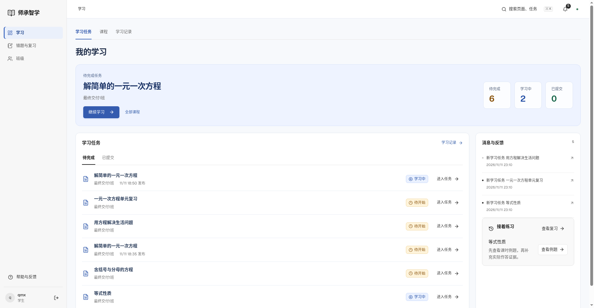
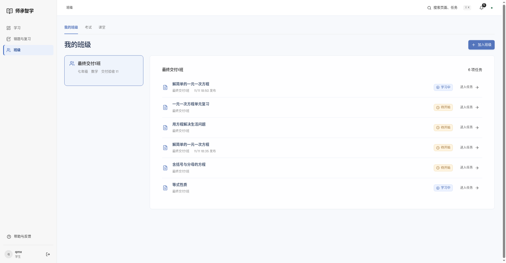
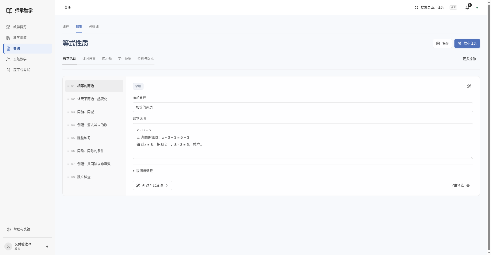
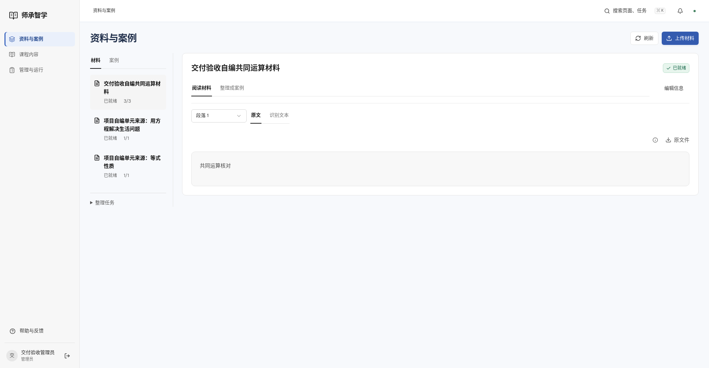
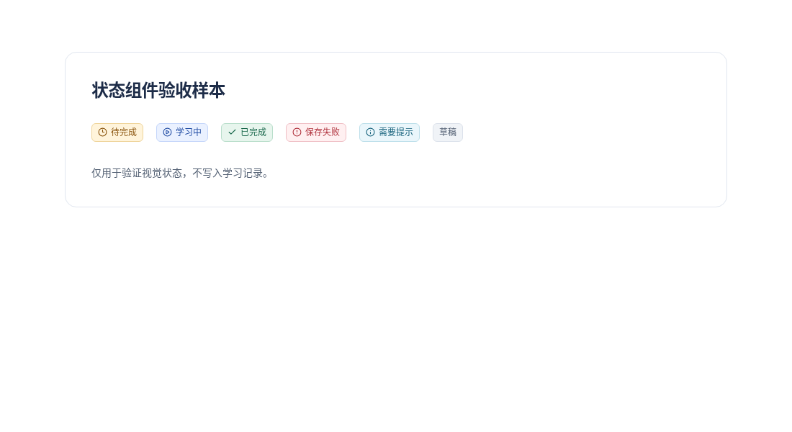

# 状态与视觉验收

2026-11-12。实际账号三端页面与独立组件样本分开记录。

- [78次三端尺寸检查](three-role-review.json)：包含页面上实际显示的状态文字和颜色。
- [状态对比度](status-contrast.json)：六类组件样本，最低5.65:1。
- [本地8099操作](local-acceptance.json)：选班、刷新、进入任务、点击目录。
- [浏览器41项](browser-tests.log)、[JS17项](unit.log)、[构建](build.log)。

## 实际页面

## 组件验收样本

以下独立渲染现有Status组件，展示六类视觉状态，不写入学习记录，不表示实际业务发生过错误。

